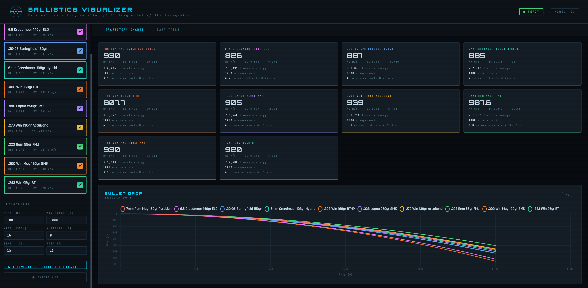

# Ballistics Visualizer

[](https://github.com/dirkharrington/ballistics/actions/workflows/ci.yml)

A physics-accurate external ballistics calculator and trajectory visualizer. Compare up to five of 37 built-in rifle cartridges (G1 + G7 BCs) or custom loads side-by-side across drop, velocity, retained energy, wind drift, and scope adjustments — out to 2,000 metres.



---

## Table of Contents

- [Features](#features)
- [Physics Model](#physics-model)
- [Tech Stack](#tech-stack)
- [Getting Started](#getting-started)
- [Bullet Catalog](#bullet-catalog)
- [Architecture](#architecture)
- [Testing](#testing)
- [Project Structure](#project-structure)

---

## Features

| Feature | Detail |
|---|---|
| **Multi-round comparison** | Select up to 5 rounds from the 37 built-in cartridges (G1 + G7 BCs) or saved custom bullets and plot them on the same axes |
| **Custom round** | Enter your own weight, muzzle velocity, BC, and diameter, or save reusable custom bullets & presets |
| **Named rifle profiles** | Save and recall complete rifle/zero/optic/ammo setups locally |
| **Five charts** | Bullet drop (cm), velocity (m/s), energy (J), wind drift (cm), and dual-axis elevation adjustment (MOA / MRAD) vs. range |
| **Data table** | Sortable full tabular output — range, drop, velocity, energy, wind drift, time of flight, MOA, MRAD, spin drift, Coriolis |
| **CSV / JSON / Markdown / PNG export** | Download trajectory tables as CSV, JSON, or Markdown, re-import exported JSON, or save any chart as a PNG |
| **Spin drift** | Litz simplified formula; displayed in wind drift chart and data table when twist rate is set |
| **Coriolis & Eötvös** | First-order horizontal Coriolis deflection and Eötvös vertical correction; displayed when latitude and azimuth are set |
| **Custom drag table** | Upload a `Mach,CD` CSV for the custom round; overrides G1/G7 drag |
| **Configurable atmosphere & units** | Zero range, max range, step interval, wind speed/direction, altitude, temperature, station pressure & humidity, plus Metric / Imperial toggle |
| **DOPE, MPBR & ballistics tools** | Interactive & printable DOPE come-ups card, Maximum Point Blank Range (MPBR) calculator, worker-backed BC back-calculator, MOA/MRAD & unit converters |
| **Offline capable & themes** | Service Worker with navigation preload caches all assets for offline runs; light/dark theme toggle persisted to `localStorage` |

---

## Physics Model

The trajectory solver uses a zero-allocation **4th-order Runge-Kutta (RK4)** integrator at 0.5 ms timesteps, implemented in TypeScript at `app/physics/engine.ts` and executed off the main thread in a Web Worker pool.

### Drag

Both **G1** and **G7** standard drag functions (plus optional custom `Mach,CD` drag tables) are compiled into flat `Float64Array` lookup structures (`app/data/physics-tables.yaml`) with O(1) amortized local-bracket interpolation:

```
Cd = interpolate_drag(|v|) × ρ/BC
```

where `ρ` is the air density ratio corrected for altitude, temperature, station pressure, and relative humidity.

### Atmosphere model

```
pressureRatio = (1 − 6.876×10⁻⁶ × altFt)^5.256
tempRatio     = (459.67 + T_std_at_alt) / (459.67 + T_actual)
ρ             = pressureRatio × tempRatio
```

### Zero-angle solver

A safeguarded bracketed secant solver converges the launch angle until the bullet crosses the line-of-sight at the zero range, accounting for sight height (default 38.1 mm / 1.5 in).

### Wind drift, spin drift & Coriolis / Eötvös

Wind drift uses the Pejsa time-of-flight method. Lateral drift is proportional to the difference between actual TOF and vacuum TOF at the same range, eliminating the constant-velocity approximation:

```
drift = windSpeed_fps × (TOF_actual − rangeYd × 3 / (mv × cos θ)) × 12
```

When barrel twist rate is supplied, gyroscopic spin drift is computed via the Litz simplified formula using the Miller stability factor. When latitude and shooting azimuth are supplied, first-order Coriolis lateral deflection and Eötvös vertical deflection are applied.

---

## Tech Stack

| Layer | Technology |
|---|---|
| Language | TypeScript (physics engine & Web Worker pool) + Vanilla JavaScript ES6 modules (UI) |
| Build tool | Vite 8 (`vite.config.mjs` + Rolldown bundler + Lightning CSS) |
| Charts | Chart.js 4 (tree-shaken via `app/chart-loader.js`, LTTB decimation) |
| Fonts | Orbitron, Rajdhani, Share Tech Mono (with metric-matched fallback `@font-face` rules) |
| Tests | Jest 30 + jsdom (100 / 100 / 100 / 100 Istanbul) + Puppeteer E2E (`npm run test:e2e`) |
| CI | GitHub Actions (`frontend-build`, `e2e-smoke`, CodeQL, Trivy, GitHub Pages deploy) |
| Offline | Service Worker (`app/sw.js`) — navigation preload + deterministic SHA-256 precache manifest |

---

## Getting Started

**Prerequisites:** Node.js 24+ (CI runs Node 24.22.3)

```bash
git clone https://github.com/dirkharrington/ballistics.git
cd ballistics
npm install
npm run dev
```

Open [http://localhost:5173/ballistics/](http://localhost:5173/ballistics/).

### Build for production

```bash
npm run build
```

Output is written to `dist/`. Serve `dist/` from any static host (e.g. GitHub Pages, Netlify, a plain `nginx`).

### Run tests

```bash
npm test
npm run build && npm run test:e2e
```

---

## Bullet Catalog

The catalog lives in [`app/data/bullets.yaml`](app/data/bullets.yaml) and defines **37 built-in rounds** spanning rimfire, intermediate, full-power, and long-range magnum cartridges (with G1 and G7 BCs). At build time, `catalog-projection.cjs` embeds only runtime physics and UI fields into `virtual:bullet-catalog`, stripping unused prose (`description`, `caliber`). Adding a round requires no code changes.

Representative rounds from the 37-cartridge catalog:

| Round | BC (G1) | MV (m/s) | Weight (g) |
|---|---|---|---|
| .223 Rem 55gr FMJ | 0.243 | 987.6 | 3.56 |
| .243 Win 95gr BT | 0.379 | 920.0 | 6.16 |
| .270 Win 130gr AccuBond | 0.480 | 939.0 | 8.42 |
| .30-06 Springfield 150gr | 0.435 | 887.0 | 9.72 |
| .308 Win 168gr BTHP | 0.475 | 807.7 | 10.89 |
| .300 Win Mag 190gr SMK | 0.533 | 930.0 | 12.31 |
| .338 Lapua 250gr SMK | 0.587 | 905.0 | 16.20 |
| 6mm Creedmoor 108gr Hybrid | 0.536 | 885.0 | 7.00 |
| 6.5 Creedmoor 140gr ELD | 0.646 | 826.0 | 9.07 |
| 7mm Rem Mag 160gr Partition | 0.531 | 930.0 | 10.36 |

### Adding a round

Edit `app/data/bullets.yaml` and add an entry following this schema:

```yaml
- id: "my-custom-round"          # unique kebab-case identifier
  name: "My Custom Round"
  caliber: "7mm"
  bulletWeightGrams: 10.36
  muzzleVelocityMps: 900.0
  ballisticCoefficient: 0.520
  bulletDiameterMm: 7.21
  muzzleEnergyJoules: 4200.0
  description: "Description shown in catalog documentation."
  hexColor: "#FF6B6B"            # must be quoted — # starts a YAML comment
```

Then re-run `npm run build`. The new round is bundled into the app automatically.

---

## Architecture

Ballistics Visualizer is a **pure-browser single-page application** with no server-side component and a strict `<meta http-equiv="Content-Security-Policy">` policy.

```
ballistics/
  app/                           ← Vite root
    ├── index.html               ← App shell + CSP meta + font preloads
    ├── ballistics.js            ← UI orchestration & lazy chunk loaders (ES6 module)
    ├── chart-loader.js          ← Tree-shaken Chart.js named-export lazy wrapper
    ├── io.js / tools.js / ...   ← Modular lazy-loaded & UI feature modules
    ├── physics/
    │   ├── engine.ts            ← Zero-allocation RK4 integrator & solveBC (TypeScript)
    │   ├── engine.worker.ts     ← Dedicated module Web Worker
    │   ├── engine-async.ts      ← Bounded worker pool, AbortSignal & LRU cache
    │   └── packed-points.ts     ← Zero-copy Transferable Float64Array serializer
    ├── data/
    │   └── bullets.yaml         ← 37-round catalog (projected at build time via Vite plugin)
    └── sw.js                    ← Service Worker (navigation preload + hashed cache reuse)
          │
          ▼
  dist/                          ← Vite 8 / Rolldown build output (static files; deploy anywhere)
```

**Build pipeline:**  
`npm run build` → Vite 8 (`vite.config.mjs`) bundles `app/` via Rolldown and Lightning CSS → content-hashed JS/CSS/font assets, minified HTML, and deterministic `sw.js` in `dist/`. Secondary modules (`chart-loader.js`, `tools.js`, `io.js`, `drag-csv.js`, `sweep.js`) are split into lazy chunks loaded on demand.

**Physics pipeline:**  
Trajectory calculations run off the main thread in a bounded Web Worker pool (`app/physics/engine.worker.ts`, `app/physics/engine-async.ts`) using zero-copy Transferable `Float64Array` buffers (`app/physics/packed-points.ts`) and an LRU result cache, keeping the UI thread responsive. All inputs come from the in-memory bullet catalog (bundled at build time) or from the UI form; no network requests are made at runtime.

**Offline:**  
`sw.js` registers after `window.load`, uses Service Worker navigation preload, and copies already-cached immutable Vite-hashed chunks across deploys while precaching app assets for offline use.

---

## Testing

```bash
npm test
```

Run the end-to-end smoke suite against the built `dist/` bundle (`vite preview`):

```bash
npm run build && npm run test:e2e
```

### Coverage thresholds (Jest / Istanbul)

All four gates are enforced in every CI run — a failure blocks the build.

| Metric | Threshold |
|---|---|
| Statements | 100 % |
| Branches | 100 % |
| Functions | 100 % |
| Lines | 100 % |

### Test suites

| File | What it covers |
|---|---|
| `tests/physics-engine.test.js` | RK4 physics, zero-angle secant solver, G1/G7 tables, atmosphere model, spin drift, Coriolis, custom drag, `solveBC` |
| `tests/physics/engine-async.test.ts` | Bounded Web Worker pool, `AbortSignal` cancellation, LRU cache, `solveBCAsync` |
| `tests/physics/packed-points.test.ts` | Zero-copy `Float64Array` trajectory point packing and unpacking |
| `tests/ballistics.test.js` | UI orchestration, delegated sidebar events, profiles, auto-compute, roving nav, lazy loaders |
| `tests/charts.test.js` | Chart rendering & in-place reuse, viewport crosshair sync, readout & stat cards |
| `tests/table.test.js` | Data table formatting, sorting, chunked rendering, Eötvös/spin/Coriolis columns |
| `tests/sweep.test.js` | Parameter sensitivity sweep calculation & multi-series chart reuse |
| `tests/prefs.test.js` | Preference persistence, theme toggle, toast & aria-live status helpers |
| `tests/units.test.js` | Metric / Imperial conversion helpers, labels, and drift-free input helpers |
| `tests/profiles.test.js` | Named rifle profile schema validation and `localStorage` CRUD |
| `tests/custom-bullets.test.js` | Custom bullet catalog CRUD, validation, `localStorage` persistence |
| `tests/custom-rounds.test.js` | Custom-round preset persistence and validation |
| `tests/bullet-catalog.test.js` | Build-time `catalog-projection.cjs` projection of `bullets.yaml` |
| `tests/sw.test.js` | Service Worker install, immutable chunk copy, navigation preload, fetch intercept |
| `tests/tools.test.js` | DOPE card, MPBR / BC back-calculator, MOA/MRAD & unit converters, `interpolateAt` |
| `tests/io.test.js` | Trajectory CSV, JSON, Markdown, PNG export and JSON import sanitization |
| `tests/url-state.test.js` | URL-encoded state round-trips |
| `tests/drag-csv.test.js` | Custom `Mach,CD` CSV drag table parsing and validation |
| `tests/fonts.test.js` | Font file existence, deduplication SHA-256 check, preload and `@font-face` consistency |
| `tests/index-html.test.js` | Preload attributes, single module script entry, `aria-live` region, CSP `<meta>` assertions |
| `tests/css-perf.test.js` | Compositor layer promotion, `transition: all` guard, `content-visibility`, `table-layout: fixed` |
| `tests/e2e/app.e2e.test.js` | Puppeteer end-to-end smoke tests against built `dist/` (`vite preview`) |

---

## Project Structure

```
ballistics/
├── vite.config.mjs                    # Vite 8 config (Rolldown + Lightning CSS + SW/HTML plugins)
├── catalog-projection.cjs             # Strips unread prose from virtual:bullet-catalog
├── package.json                       # JS deps, Jest config, npm scripts
├── tsconfig.json                      # TypeScript config (physics engine)
├── jest-puppeteer.config.cjs          # Puppeteer + vite preview server config
├── jest.e2e.config.cjs                # Jest E2E runner config
│
├── app/                               # Application source (Vite root)
│   ├── index.html                     # App shell, CSP meta, font preloads
│   ├── ballistics.js                  # ES6 module — UI orchestration & lazy chunk loaders
│   ├── ballistics.css                 # Styles, themes, metric-matched font fallbacks
│   ├── chart-loader.js                # Named Chart.js exports for Rolldown tree-shaking
│   ├── charts.js                      # Trajectory chart rendering, reuse & crosshair sync
│   ├── custom-bullets.js              # Custom bullet catalog management
│   ├── custom-rounds.js               # Custom round presets
│   ├── drag-csv.js                    # Custom Mach,CD CSV parser (lazy chunk)
│   ├── io.js                          # CSV/JSON/Markdown/PNG export & JSON import (lazy chunk)
│   ├── prefs.js                       # localStorage prefs, theme toggle & DOM feedback
│   ├── profiles.js                    # Named rifle/load profile persistence
│   ├── sw.js                          # Service worker (offline / navigation preload)
│   ├── sweep.js                       # Parameter sensitivity sweep (lazy chunk)
│   ├── table.js                       # Sortable, rAF-chunked data table renderer
│   ├── tools.js                       # DOPE, MPBR, BC solver, MOA/MRAD & unit tools (lazy chunk)
│   ├── units.js                       # Global Metric / Imperial unit system & converters
│   ├── url-state.js                   # URL query parameter state codec
│   ├── fonts/                         # Orbitron, Rajdhani (400/600), Share Tech Mono woff2
│   ├── physics/
│   │   ├── create-physics-worker.ts   # Vite module worker factory
│   │   ├── engine.ts                  # Zero-allocation RK4 integrator, G1/G7 drag, solveBC
│   │   ├── engine.worker.ts           # Module Web Worker entrypoint
│   │   ├── engine-async.ts            # Bounded worker pool, AbortSignal, LRU cache
│   │   ├── errors.ts                  # TrajectoryInputError
│   │   ├── packed-points.ts           # Transferable Float64Array trajectory packer
│   │   ├── types.ts                   # Shared TypeScript physics interfaces
│   │   └── virtual-physics-tables.d.ts
│   ├── data/
│   │   ├── bullets.yaml               # Canonical 37-round bullet catalog
│   │   └── physics-tables.yaml        # G1/G7 drag tables + atmosphere constants
│   └── public/                        # Copied to dist/ root verbatim
│       ├── apple-touch-icon.png
│       ├── favicon.svg
│       └── manifest.json
│
├── tests/                             # Jest unit & Puppeteer E2E suites
│   ├── ballistics.test.js
│   ├── bullet-catalog.test.js
│   ├── charts.test.js
│   ├── css-perf.test.js
│   ├── custom-bullets.test.js
│   ├── custom-rounds.test.js
│   ├── drag-csv.test.js
│   ├── fonts.test.js
│   ├── index-html.test.js
│   ├── io.test.js
│   ├── physics-engine.test.js
│   ├── prefs.test.js
│   ├── profiles.test.js
│   ├── sw.test.js
│   ├── sweep.test.js
│   ├── table.test.js
│   ├── tools.test.js
│   ├── units.test.js
│   ├── url-state.test.js
│   ├── physics/
│   │   ├── engine-async.test.ts
│   │   └── packed-points.test.ts
│   ├── e2e/
│   │   └── app.e2e.test.js            # Puppeteer end-to-end smoke tests
│   ├── fixtures/
│   │   └── spa1-golden.json
│   └── __mocks__/
│       ├── bullet-catalog.js          # Jest mock for virtual:bullet-catalog
│       ├── chart.js                   # Jest mock for Chart.js
│       └── physics-tables.js          # Jest mock for virtual:physics-tables
│
├── contracts/                         # Current-era Architecture Decision Records & contracts
│
└── dist/                              # Vite build output (gitignored; deployed by CI)
```
