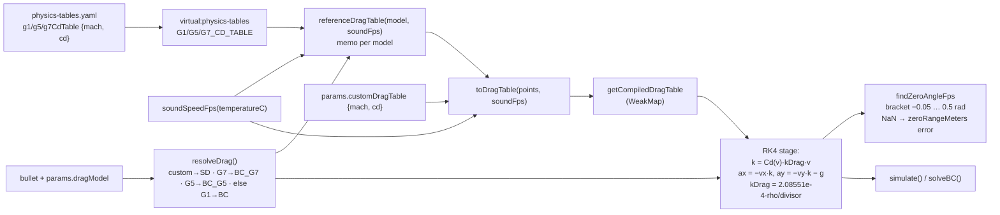

# Contract: engine drag calibration (standard point-mass retardation)

**Version:** 1.1.0. 1.0.0 was the engine-only draft. 1.1.0 records the user's Q1–Q4 decisions (§11) and adds the G5 BC, sectional density for custom curves, zero-angle bracket expansion, and the re-truing notice.
**Status:** Proposed. Q1–Q4 were decided by the user on 2026-11-23. ADR 011 still needs final approval.
**Date:** 2026-11-23
**Author:** Architect
**ADR:** [`adr-engine-drag-calibration.md`](adr-engine-drag-calibration.md) (ADR 011)
**Owners:** backend builder for the engine, `engine-async.ts`, engine tests and the golden fixture (§12.1). Frontend builder for the custom-bullet form, storage and IO, drag-model resolution call sites, profiles and URL state, copy, and the re-truing notice (§12.2). The two task lists are independent and can be built in parallel against this contract.
**Suggested branch:** `claude/engine-drag-calibration` from `main`. It must merge **before** S24-4 (PR #219). #219 then rebases and re-pins its numbers.
**Supersedes:** `feat3-custom-drag-ts.md` §3.4 and `spa1-ts-engine.md` §11.3 item 1 (the `a63f361` baseline). Both carry banners.

Builders implement this contract exactly. To change it, propose the change to the architect. Don't edit this file.

---

## 0. Deviations from the brief

| # | Brief said | Contract says | Why |
|---|---|---|---|
| D1 | "Whether the YAML table values need rescaling or the formula needs a different constant" | **Both, and rescaling isn't enough.** Replace the tables with the standard Mach-keyed C_d tables **and** change the formula (add v² and `CD_TO_RETARD`). | No single factor can fix it. The missing v² makes the error depend on velocity, and the old table shapes are not G1/G5/G7 (ADR §1.3). |
| D2 | "Keep the RK4 structure" | It is kept. **One addition:** the three loop stop checks move from total speed to horizontal speed `vx` (§3.4). | With real drag, low-BC inputs reachable from the UI would otherwise loop forever (ADR §4.1 item 5, R6a). |
| D3 | (not mentioned) | `solveBC` gains a feasible-lower-bound search (§3.7). | With real drag, BC 0.001 never reaches the range, and the current code would return `null` for **every** input. That would break the BC solver card and S24-4. |
| D4 | "Same public API" | Function signatures are unchanged. The **module** surface of `virtual:physics-tables` changes (`G1_TABLE` becomes `G1_CD_TABLE` and so on, with `{mach, cd}` rows). Since 1.1.0, `Bullet` also gains an optional field (D5), and `simulate()` can throw one new `TrajectoryInputError` (D7). | Renaming makes any stale caller fail loudly. Only `engine.ts`, the Vite plugin and the Jest mock consume the module. |
| D5 | Q1: "Add `ballisticCoefficientG5` … use it when dragModel is G5" | Add `Bullet.ballisticCoefficientG5?: number \| null`. The **engine** now picks the BC for the drag model (§3.9): G5 uses `ballisticCoefficientG5` and G7 uses `ballisticCoefficientG7`. If the selected model's BC is absent, **that bullet falls back to G1 with its G1 BC**, and `result.dragModel` reports `'G1'`. `ballisticCoefficient` always means the G1 BC. | **Architect decisions, flagged for awareness:** (a) **G7 gets the same rule.** Today a missing G7 BC sends the G1 BC through the G7 table, the same bug class as Q1. (b) **The fallback is G1, not an error.** No catalog bullet has a published G5 BC, so an error would make G5 unusable for the whole catalog. (c) **The engine resolves the BC, not the UI.** This keeps one source of truth, and the existing `result.dragModel` tells the UI what was actually used. |
| D6 | Q2: "When dragModel is custom, divide by sectional density" | With a non-empty `customDragTable`, the drag divisor is SD = (`bulletWeightGrams` / 453.592) / (`bulletDiameterMm` / 25.4)², in lb/in² (§3.9). It is **derived on every run and not stored**. `ballisticCoefficient` is still required and validated, but it is ignored for custom runs. `bulletDiameterMm` becomes required ([1, 30]) whenever a custom table is present. | Deriving SD from two fields that are already stored can't drift out of sync. A stored SD would need a migration and could disagree with the stored weight and diameter. |
| D7 | Q3: "Widen the bracket or use a smarter search" | The upper bracket doubles from 0.05 rad up to `ZERO_ANGLE_MAX = 0.5` rad. Unreachable zeros return `NaN` from `findZeroAngleFps`. `simulate()` then throws `TrajectoryInputError('zeroRangeMeters', …)`, and `solveBC` treats the case as infeasible (§3.10). | It keeps the PERF-16/30 secant solver and costs at most 4 extra evaluations, only when they're needed. The silent clamp is gone. |
| D8 | Q4: "One-time notice for '(trued)' / '(trued-BC)' bullets" | This is a frontend-only task (§12.2 F5). It is shown once per browser, gated by `localStorage['bv_physicsNotice'] = 'adr011'`. | — |

## 1. Scope

### 1.1 In scope
**Backend** (§12.1):
- `app/data/physics-tables.yaml`: table data and keys (§2.1).
- `vite.config.mjs`: `physicsTablesPlugin()` body only (§2.2).
- `tests/__mocks__/physics-tables.js` (§2.3).
- `app/physics/virtual-physics-tables.d.ts` (§2.4).
- `app/physics/engine.ts` (§3).
- `app/physics/types.ts` (§4): one new optional `Bullet` field, plus comments.
- `app/physics/engine-async.ts`: `simulationCacheKey` only (§3.11).
- Engine tests and the golden fixture (§7). `README.md` "Drag" subsection (§8).

**Frontend** (§12.2):
- `app/custom-bullets.js`, `app/ballistics.js`, `app/index.html`, `app/io.js`, `app/tools.js`, `app/sweep.js`, `app/profiles.js`, `app/url-state.js`, any CSS needed for the notice, and their tests.

**Shared:** `BACKLOG.md` (§8). Each PR updates its own entry.

### 1.2 Out of scope
- Publishing G5 BCs for catalog bullets in `bullets.yaml`. That is a data-sourcing task: catalog bullets fall back to G1 under G5 (D5).
- Automatic migration or recomputation of "(trued)" bullets. Q4 asks for a notice only.
- A notice for "(trued)" bullets arriving through JSON import. The notice is checked once, at app init (F5).
- Any change to `solveBC`'s model (it stays G1 only) or to its UI card.

### 1.3 Don't touch
- The RK4 scheme: 4 stages, `DT_S = 0.0005`, the `sixthDt` combination, position update `x += vx*DT_S`, and the order of the `t` update.
- Bracket tracking (`findBracket`, the in-loop `while` walks), `compileDragTable`, `CompiledDragTable`, and the `WeakMap` compile cache mechanism.
- The zero-angle solver's iteration (PERF-16/30 hint logic, and secant with bisection fallback). Only the bracket setup and the non-finite guard change (§3.10).
- `solveBC`'s secant/Illinois iteration. Only the bracket setup changes (§3.7).
- Atmosphere functions (`airDensityRatio`, `stationAirDensityRatio`), `soundSpeedFps`, spin drift, Coriolis/Eötvös, wind-drift lag formula, rounding of output fields, density-altitude calculation, and existing validation rules and messages. Validation rules are **added** in §3.9. Existing ones are unchanged.
- Function signatures of public exports (`simulate`, `solveBC`, `soundSpeedFps`, `TrajectoryInputError`) and of existing `@internal` exports (`findZeroAngleFps`, `integrateTrajectoryFps`, `toDragTable`, `compileDragTable`, `findBracket`, and the rest).
- `engine.worker.ts`. In `engine-async.ts`, everything except `simulationCacheKey`.

## 2. Data and module surface

### 2.1 `app/data/physics-tables.yaml`
- Delete `g1Table`, `g5Table` and `g7Table` (keyed `{ v, f }`) completely.
- Add `g1CdTable`, `g5CdTable` and `g7CdTable`, rows `{ mach: <number>, cd: <number> }`, **exactly** as in Appendix A: 79, 76 and 84 rows, Mach 0.00 → 5.00, strictly increasing.
- Header comment: say these are the standard BRL / JBM reference drag coefficients C_G(M) (public domain), keyed by Mach, and that the engine converts them to fps per run at the ambient speed of sound (ADR 011).
- `atmosphere:` is unchanged.

### 2.2 `vite.config.mjs`, `physicsTablesPlugin()` `load()` only
Emit:
```js
export const G1_CD_TABLE = [{"mach":0,"cd":0.2629}, ...];   // data.g1CdTable mapped to ({ mach, cd })
export const G5_CD_TABLE = [...];
export const G7_CD_TABLE = [...];
export const ATMOSPHERE  = {...};
export default { G1_CD_TABLE, G5_CD_TABLE, G7_CD_TABLE, ATMOSPHERE };
```
Map each row to a fresh `{ mach, cd }` object so stray YAML keys are dropped. Update the plugin comment ("G1 drag table" becomes "G1/G5/G7 reference C_d tables"). Change nothing else in the file.

### 2.3 `tests/__mocks__/physics-tables.js`
Mirror §2.2 exactly: same export names, same `{ mach, cd }` mapping, same `default` object.

### 2.4 `app/physics/virtual-physics-tables.d.ts`
```ts
declare module 'virtual:physics-tables' {
  type CdRow = { readonly mach: number; readonly cd: number };
  const G1_CD_TABLE: ReadonlyArray<CdRow>;
  const G5_CD_TABLE: ReadonlyArray<CdRow>;
  const G7_CD_TABLE: ReadonlyArray<CdRow>;
  const ATMOSPHERE: { /* unchanged */ };
  export { G1_CD_TABLE, G5_CD_TABLE, G7_CD_TABLE, ATMOSPHERE };
  const _default: { G1_CD_TABLE: typeof G1_CD_TABLE; G5_CD_TABLE: typeof G5_CD_TABLE; G7_CD_TABLE: typeof G7_CD_TABLE; ATMOSPHERE: typeof ATMOSPHERE };
  export default _default;
}
```
`CdRow` is structurally identical to `DragPoint`. Ambient modules can't import relative types, so it is written inline.

## 3. Engine changes (`app/physics/engine.ts`)

### 3.1 Imports and constants
```ts
import { G1_CD_TABLE, G5_CD_TABLE, G7_CD_TABLE, ATMOSPHERE } from 'virtual:physics-tables';
```
Add this to the "Physics constants" block:
```ts
/**
 * Converts a reference drag coefficient to retardation (ADR 011):
 *   a [ft/s²] = rhoRatio · CD_TO_RETARD · Cd(M) · v² / BC[lb/in²]
 * CD_TO_RETARD = ρ₀·π/(8·144), ρ₀ = 0.0764742 lb/ft³ (ICAO sea level). @internal
 */
export const CD_TO_RETARD = 2.08551e-4;
```
Use the literal `2.08551e-4`. Don't compute it at runtime.

### 3.2 Reference tables and the compile cache
Remove `G1_COMPILED`, `G5_COMPILED` and `G7_COMPILED`, and the pre-seeded entries in `_compiledCache`. `_compiledCache` becomes `new WeakMap<DragTable, CompiledDragTable>()`. `getCompiledDragTable` is unchanged.

Add:
```ts
type ReferenceDragModel = Exclude<EffectiveDragModel, 'custom'>;   // 'G1' | 'G5' | 'G7'

const REFERENCE_CD: Readonly<Record<ReferenceDragModel, readonly DragPoint[]>> = {
  G1: G1_CD_TABLE, G5: G5_CD_TABLE, G7: G7_CD_TABLE,
};

const _refMemo = new Map<ReferenceDragModel, { readonly soundFps: number; readonly table: DragTable }>();

/**
 * fps-keyed DragTable [mach × soundFps, Cd] for a standard reference model (ADR 011).
 * One-entry memo per model: the same (model, soundFps) returns the SAME array object,
 * so the WeakMap compile cache hits across runs at one temperature. @internal
 */
export function referenceDragTable(model: ReferenceDragModel, soundFps: number): DragTable {
  const hit = _refMemo.get(model);
  if (hit !== undefined && hit.soundFps === soundFps) return hit.table;
  const table = toDragTable(REFERENCE_CD[model], soundFps);
  _refMemo.set(model, { soundFps, table });
  return table;
}
```
Rewrite the `toDragTable` JSDoc to: "Converts a Mach→C_d table to the engine's `[velocity fps, C_d]` `DragTable`. Used for both the standard G1/G5/G7 tables and user custom tables. Drag is `CD_TO_RETARD · rho · C_d · v² / BC` (ADR 011). @internal". Delete the "scaled form-factor … near-vacuum" text. The function body is unchanged.

### 3.3 RK4 drag expression (12 sites, same pattern each)
In `evalHeightAtZero`, `integrateTrajectoryFps` and `evalDropCmAtRange`, every stage `s ∈ {1,2,3,4}` currently reads:
```ts
const d{s}  = drag{s} * rhoOverBc;
const ax{s} = -(v{x,s} / v{s}) * d{s};
const ay{s} = -(v{y,s} / v{s}) * d{s} - G_FPS2;
```
Replace it with exactly:
```ts
const k{s}  = drag{s} * kDrag * v{s};      // a/v, units 1/s
const ax{s} = -v{x,s} * k{s};
const ay{s} = -v{y,s} * k{s} - G_FPS2;
```
where `v{s}` is the stage speed already in scope (`v1`, or `vel` in stage 1 of `integrateTrajectoryFps` and `evalDropCmAtRange`, then `v2`, `v3`, `v4`), and `v{x,s}`/`v{y,s}` are the stage velocity components already used (`vx`/`vy`, `vx2`/`vy2`, …). Keep the multiplication order `drag * kDrag * v`, so the regenerated golden is reproducible. `k1`–`k4` don't clash with `ck`/`ek` in `integrateTrajectoryFps`.

`kDrag` replaces `rhoOverBc` everywhere:
```ts
const kDrag = CD_TO_RETARD * rho / bc;   // 1/ft
```
- `findZeroAngleFps`: compute `kDrag` in place of `rhoOverBc` and pass it to `evalHeightAtZero`.
- `evalHeightAtZero`: rename the parameter `rhoOverBc` to `kDrag`. The position is unchanged.
- `integrateTrajectoryFps`, `evalDropCmAtRange`: compute `kDrag` in place of `rhoOverBc`.

No identifier `rhoOverBc` remains in the file.

### 3.4 Loop termination guard (mandatory, D2)
| Function | Current | New |
|---|---|---|
| `evalHeightAtZero` (loop top) | `if (v1 < 50) break;` | `if (vx < 50) break;` |
| `integrateTrajectoryFps` (loop end) | `if (vel < MIN_VEL_FPS) break;` | `if (vx < MIN_VEL_FPS) break;` |
| `evalDropCmAtRange` (loop top) | `if (vel < MIN_VEL_FPS) return null;` | `if (vx < MIN_VEL_FPS) return null;` |

In `evalDropCmAtRange`, `vel` is still computed and used for drag. Rationale: |vx| ≤ v, so each new check fires whenever the old one did. vx starts positive (launch angle within ±0.05 rad) and only decreases (dvx/dt = −k·vx), so every loop now ends. Add a one-line comment at each site: `// horizontal-speed stop: guarantees termination under terminal-velocity fall (ADR 011)`.

### 3.5 Defaults on `@internal` functions
- `findZeroAngleFps(..., dragTable: DragTable = referenceDragTable('G1', soundSpeedFps(15)), hintAngle?)`
- `integrateTrajectoryFps(..., dragTable: DragTable = referenceDragTable('G1', soundSpeedFps(15)), extras = {}, soundFps = soundSpeedFps(15))`

The parameter lists and order are otherwise unchanged.

### 3.6 `simulate()`
Replace the `dragModel` / `dragTable` selection and the `bc` constant with the §3.9 resolver:
```ts
const { model: dragModel, divisor } = resolveDrag(bullet, params);
const dragTable = dragModel === 'custom'
  ? toDragTable(params.customDragTable!, soundFps)
  : referenceDragTable(dragModel, soundFps);
```
Pass `divisor` everywhere `bc` is passed today (`findZeroAngleFps`, `integrateTrajectoryFps`). After `findZeroAngleFps`, apply the §3.10 NaN check. `TrajectoryResult.dragModel` is the **resolved** `dragModel`. `rho` stays the station density ratio, and `soundFps` stays `soundSpeedFps(params.temperatureC)`. Everything else in `simulate()` is unchanged. TS narrowing is fine. `any` is not.

### 3.7 `evalDropCmAtRange` and `solveBC`
`evalDropCmAtRange` (private): replace the `ct: CompiledDragTable` parameter with `dragTable: DragTable` in the same position, and derive `const ct = getCompiledDragTable(dragTable);` inside. Pass `dragTable`, not `G1_TABLE`, to `findZeroAngleFps`. Apply §3.3 and §3.4.

`solveBC`: the input validation, `mvFps`, `rho` (`airDensityRatio`, unchanged), `sightHtFt`, `zeroFt` and `targetFt` are unchanged. Replace everything from `startIdx` down to `const resLo … if (resLo === null) return null;` with:
```ts
const g1       = referenceDragTable('G1', soundSpeedFps(tempC));
const g1Ct     = getCompiledDragTable(g1);
const startIdx = findBracket(mvFps, g1Ct, g1Ct.last);

// Feasible lower bound (ADR 011 §4.1 item 6): with real drag a tiny BC never reaches the
// zero or target range. Double lo until the projectile reaches max(target, zero).
const probeFt = Math.max(targetFt, zeroFt);
let lo = 0.001, hi = 1.5;
while (lo < hi && evalDropCmAtRange(mvFps, lo, rho, zeroFt, sightHtFt, probeFt, g1, startIdx) === null) {
  lo = Math.min(lo * 2, hi);
}
const resLo = evalDropCmAtRange(mvFps, lo, rho, zeroFt, sightHtFt, targetFt, g1, startIdx);
if (resLo === null) return null;
```
After that the code is unchanged, except:
- `fLo >= 0` returns `Math.round(lo * 10000) / 10000`, not `lo`.
- Every `evalDropCmAtRange(..., G1_COMPILED, ...)` becomes `evalDropCmAtRange(..., g1, ...)`.

There are at most 12 evaluations in the doubling loop. Each infeasible one ends early under §3.4. `measuredDropCm` keeps its meaning: **bore-line** drop in cm, negative down, the same quantity as `TrajectoryPoint.dropCm`.

In `evalDropCmAtRange`, immediately after the `findZeroAngleFps` call, add `if (Number.isNaN(angle)) return null;` (§3.10). This makes an unreachable zero infeasible for the doubling loop.

### 3.8 Comments
- Header block: add `CD_TO_RETARD` with its derivation (§3.1).
- Remove every remaining reference to "form factor F(v)" or "near-vacuum".

### 3.9 Drag-model and divisor resolution (Q1 and Q2; D5 and D6)
Add these `@internal` exports:
```ts
/** Sectional density in lb/in² (form factor 1). Used as the drag divisor for custom Cd curves (ADR 011, Q2). @internal */
export function sectionalDensityLbIn2(weightGrams: number, diameterMm: number): number {
  const dIn = diameterMm / MM_PER_INCH;
  return (weightGrams / G_PER_LB) / (dIn * dIn);
}

/**
 * Resolves the effective drag model and the divisor in `kDrag = CD_TO_RETARD·rho/divisor` (ADR 011).
 * Order: custom table → sectional density; G7 + numeric G7 BC → G7; G5 + numeric G5 BC → G5; otherwise G1 + G1 BC.
 * @internal
 */
export function resolveDrag(bullet: Bullet, params: TrajectoryParams): { model: EffectiveDragModel; divisor: number } {
  const custom = params.customDragTable;
  if (custom != null && custom.length > 0)
    return { model: 'custom', divisor: sectionalDensityLbIn2(bullet.bulletWeightGrams, bullet.bulletDiameterMm) };
  if (params.dragModel === 'G7' && bullet.ballisticCoefficientG7 != null)
    return { model: 'G7', divisor: bullet.ballisticCoefficientG7 };
  if (params.dragModel === 'G5' && bullet.ballisticCoefficientG5 != null)
    return { model: 'G5', divisor: bullet.ballisticCoefficientG5 };
  return { model: 'G1', divisor: bullet.ballisticCoefficient };
}
```
- Use the existing constants `G_PER_LB` (453.592) and `MM_PER_INCH` (25.4). For the worked bullet (10.89 g, 7.82 mm): SD = 0.024009 / 0.307874² = **0.25329 lb/in²**.
- `ballisticCoefficient` is **always the G1 BC** from now on. Update the `Bullet` comment (§4).
- **The UI's G7 swap becomes redundant.** Today `bulletForDragModel` copies the G7 BC into `ballisticCoefficient`. If it still does, the engine sees a G7 bullet whose `ballisticCoefficientG7` is the same value, and the result is identical. So the backend PR doesn't depend on the frontend PR. F2 removes the swap.

**Validation additions** to `validate()`. Append them after the existing `bullet.*` checks, in this order. Each throws `TrajectoryInputError(field, expected)`.
| # | Rule | field | `expected` |
|---|---|---|---|
| V1 | If `bullet.ballisticCoefficientG7 != null`: finite and > 0 | `bullet.ballisticCoefficientG7` | `'a finite number greater than 0'` |
| V2 | If `bullet.ballisticCoefficientG5 != null`: finite and > 0 | `bullet.ballisticCoefficientG5` | `'a finite number greater than 0'` |
| V3 | If `customDragTable` is non-empty (checked after the existing table rules): `bulletDiameterMm` is finite and in [1, 30] | `bullet.bulletDiameterMm` | `'a finite number between 1 and 30'` (same text as the twist rule) |

### 3.10 Zero-angle bracket expansion (Q3, D7)
Add these constants: `export const ZERO_ANGLE_MIN = -0.05;` and `export const ZERO_ANGLE_MAX = 0.5;` (rad, 28.6°, below the roughly 30–35° maximum-range elevation of rifle bullets under drag). Both are `@internal`.

**`evalHeightAtZero`.** After the loop, return `x >= zeroFt ? y : Number.NEGATIVE_INFINITY`. The loop can only end early through the §3.4 `vx` stop, so this flags "never reached the zero range".

**`findZeroAngleFps`.** The signature is unchanged. The return value is either the angle, or `NaN` when there is no root in [`ZERO_ANGLE_MIN`, `ZERO_ANGLE_MAX`]. Make exactly these changes:
```ts
let lo = ZERO_ANGLE_MIN, hi = 0.05;            // initial bracket unchanged
// hint path: clamp hLo/hHi to [ZERO_ANGLE_MIN, ZERO_ANGLE_MAX] (was ±0.05); logic otherwise unchanged
if (!hit) {
  fLo = evalHeightAtZero(lo, ...) - sightHtFt;
  if (fLo >= 0) return Number.NaN;               // was: return lo   (no silent clamp)
  fHi = evalHeightAtZero(hi, ...) - sightHtFt;
  while (fHi < 0 && hi < ZERO_ANGLE_MAX) {       // NEW: upward expansion 0.05 → 0.1 → 0.2 → 0.4 → 0.5
    lo = hi; fLo = fHi;
    hi = Math.min(hi * 2, ZERO_ANGLE_MAX);
    fHi = evalHeightAtZero(hi, ...) - sightHtFt;
  }
  if (fHi < 0) return Number.NaN;                // was: return hi   (no silent clamp)
}
// secant/bisection loop unchanged except the secant candidate:
const secant = Number.isFinite(fLo) ? hi - fHi * (span / (fHi - fLo)) : Number.NaN;   // NaN → bisection
```
`fHi` is always finite (≥ 0) once bracketed. `fLo` can be `-Infinity` (stall), and the guard sends that case to bisection. At most 4 extra evaluations happen, and only when the root is above 0.05 rad.

**Callers:**
- `simulate()`: `if (Number.isNaN(angle)) throw new TrajectoryInputError('zeroRangeMeters', 'within reach of this projectile (no launch angle between -0.05 and 0.5 rad zeroes it)');`
- `evalDropCmAtRange`: returns `null` (§3.7).

### 3.11 `engine-async.ts` → `simulationCacheKey` (backend)
The key must cover every input that `resolveDrag` reads. Change:
- `twist != null ? bullet.bulletDiameterMm : null` to `(twist != null || custom != null) ? bullet.bulletDiameterMm : null`.
- Add `bullet.ballisticCoefficientG7 ?? null` and `bullet.ballisticCoefficientG5 ?? null` immediately after `bullet.ballisticCoefficient`.

Nothing else in the file changes.

## 4. Types (`app/physics/types.ts`)
- **New field** in `Bullet`, right after `ballisticCoefficientG7`:
  ```ts
  readonly ballisticCoefficientG5?: number | null; // optional G5 BC (lb/in²); used when dragModel is 'G5' (ADR 011 Q1)
  ```
- `Bullet.ballisticCoefficient` comment becomes `// engine input; > 0. G1 BC (lb/in²). Used for G1 runs and as the fallback when the selected model's BC is absent. Ignored for custom-table runs (sectional density is used).`
- `Bullet.ballisticCoefficientG7` comment: `// optional G7 BC (lb/in²); used when dragModel is 'G7'`.
- `Bullet.bulletDiameterMm` comment: `// [1, 30]; required when twistRateInchesPerTurn is set or customDragTable is non-empty`.
- `TrajectoryResult.dragModel` comment: `// resolved model: 'custom' | the requested model if its BC is present | 'G1' fallback (ADR 011)`.
- `DragTableRow` comment: `[velocity ft/s, reference drag coefficient C_d]. Built per run from a Mach-keyed table (ADR 011).`

## 5. Data flow



## 6. Worked example and expected values

### 6.1 Inputs
```js
bullet = { id: 'x', name: 'x', bulletWeightGrams: 10.89, muzzleVelocityMps: 807,
           ballisticCoefficient: 0.475, bulletDiameterMm: 7.82, muzzleEnergyJoules: 3546 };
params = { zeroRangeMeters: 100, maxRangeMeters: 600, stepMeters: 100,
           windSpeedKph: 16, windDirectionDeg: 90, altitudeMeters: 0, temperatureC: 15,
           sightHeightMm: 38.1, shootingAngleDegrees: 0, dragModel: 'G1' };
```
This is .308 Win 168 gr (10.89 g), G1 BC 0.475, 807 m/s, ICAO sea level (`rho` = 1.000), 15 °C.

### 6.2 Hand derivation
1. v₀ = 807 × 3.28084 = **2,647.64 ft/s**. `soundSpeedFps(15)` = 331.3·√(1 + 15/273.15)·3.28084 = **1,116.39 ft/s**, so M₀ = **2.3716**.
2. G1 at M₀: rows 2.35 → 0.5527 and 2.40 → 0.5481, so C_d = 0.5527 − 0.432·0.0046 = **0.55071**.
3. kDrag = 2.08551e-4 × 1.000 / 0.475 = **4.39055e-4 ft⁻¹**.
4. Muzzle retardation a = kDrag · C_d · v² = 4.39055e-4 × 0.55071 × 2,647.64² = **1,695 ft/s²** (516.6 m/s², about 53 g). The current engine gives 0.245 ft/s².
5. Downrange, dv/dx = −kDrag·C_d(M)·v (flat fire). So x(M) = (1/kDrag)·∫ dM / (C_d(M)·M), integrated over the G1 table rows. 1/kDrag = 2,277.6 ft.
6. Time t(x) = ∫ dx / v. Drop below the bore line D(x) = g·∫₀ˣ ∫₀^ξ dη / v(η)² dξ. This is exact for flat fire, because d(vy/vx)/dx = −g/vx².
7. Wind drift (lag method, as in the engine) = 14.5815 ft/s × (t − x / v₀). 16 kph = 9.94194 mph = 14.5815 ft/s.
8. Path relative to the line of sight = `dropCm(x)` + (x/100 m)·(3.81 − `dropCm(100 m)`) − 3.81 cm.

### 6.3 Expected output
The engine samples at the first step past each range, so `rangeMeters` reads 100.x and so on. Match points with `|rangeMeters − R| < 1`.

| R (m) | `velocityMps` | `timeOfFlightSec` | `dropCm` (bore line) | Path vs LOS (cm, derived) | `windDriftCm` | `energyJoules` |
|---|---|---|---|---|---|---|
| 0 | 807.0 | 0 | 0 | −3.8 | 0 | 3,546 |
| 100 | 744.5 | 0.1290 | −7.96 | 0.0 | 2.3 | 3,018 |
| 200 | 684.7 | 0.2691 | −33.7 | −13.9 | 9.4 | 2,553 |
| 300 | 627.7 | 0.4216 | −80.4 | −48.9 | 22.2 | 2,145 |
| 400 | 573.6 | 0.5882 | −152.1 | −108.8 | 41.2 | 1,792 |
| 500 | 522.7 | 0.7709 | −253.7 | −198.6 | 67.3 | 1,488 |
| 600 | 475.3 | 0.9715 | −391.3 | −324.5 (5.41 mil) | 101.4 | 1,230 |

For comparison, the current engine (golden case `308-win-168gr condA G1`, MV 807.7) at 600 m gives `velocityMps` 807.7, `timeOfFlightSec` 0.743, `dropCm` −270.9 and `windDriftCm` 0.

### 6.4 Acceptance bands (the physics-sanity test, §7.2 N1–N4)
The hand integration is accurate to about ±0.5 % in v and t and ±1 % in drop. The test bands are wider so they test physics, not arithmetic.

| Field (100–600 m rows, §6.3) | Band |
|---|---|
| `velocityMps` | ±1.0 % |
| `timeOfFlightSec` | ±1.0 % |
| `dropCm` at 200–600 m | ±2.0 % (at 100 m: ±0.3 cm) |
| `windDriftCm` at 200–600 m | ±5.0 % |
| `energyJoules` | ±2.0 % |

Extra anchors:
| Check | Input change from §6.1 | Expected |
|---|---|---|
| A1 Supersonic limit | `maxRangeMeters: 1000, stepMeters: 25` | `supersonicLimitMeters` ∈ [955, 1010] (hand value 982) |
| A2 Very low BC | `ballisticCoefficient: 0.05, maxRangeMeters: 300, stepMeters: 25` | `supersonicLimitMeters` ∈ [95, 112] (hand value 103) |
| A3 G7 with the catalog G7 BC | `dragModel: 'G7', ballisticCoefficientG7: 0.224` (G1 BC stays 0.475; `result.dragModel === 'G7'`) | `velocityMps` at 600 m ∈ [445, 461] (hand value 453) |
| A4 BC response | BC ∈ {0.2, 0.3, 0.475, 0.6, 1.0}, 600 m point | `velocityMps` strictly increasing, `dropCm` strictly increasing (less negative), `timeOfFlightSec` strictly decreasing. v(0.475) − v(0.3) > 100 m/s (hand values 475 vs 348) |

## 7. Tests

Coverage must stay at **100/100/100/100**. `npm test` (including `tsc --noEmit`) must be green, and the E2E suite must pass against the built `dist/`.

### 7.1 Existing tests to update (`tests/physics-engine.test.js` unless stated)
| Where | Change |
|---|---|
| Line 13, import from the mock | Import `G1_CD_TABLE`, `G5_CD_TABLE` and `G7_CD_TABLE`. Where an fps table is needed, build it with `referenceDragTable('G1' \| 'G7' \| 'G5', soundSpeedFps(15))`. |
| "G1/G5/G7 velocities strictly ascending" (around line 324) | Assert `mach` strictly ascending in each C_d table, and fps strictly ascending after `referenceDragTable`. |
| PERF-15 `compileDragTable` / `findBracket` loops (around lines 1210, 1237) | Use the fps reference tables. Extend the sweeps to 6,000 fps so the top clamp is exercised (Mach 5 ≈ 5,582 fps). |
| PERF-16 reference bisection (around lines 1293–1336) | Mirror §3.3 in `refBisection`: `k = Cd·(2.08551e-4·rho/bc)·v; ax = −vx·k; ay = −vy·k − 32.174`. Use the `vx < 50` stop (§3.4). Use the fps G1 table at 15 °C. Keep the 1e-9 tolerance. |
| PERF-17 BC recovery (around line 1375) | BC 0.02 at 1000 m is now infeasible. Use BC 0.15 and 0.50 at 500 m. Keep the monotonicity and 4-dp assertions. |
| PERF-16/30 `findZeroAngleFps` clamp tests (around lines 1352–1356 and 1450–1452) | These encoded the silent clamp, which §3.10 removes. A sight height of −50 ft (root below −0.05) now returns `NaN`. A sight height of +50 ft at 328 ft now returns a real root above 0.05. Assert that it is finite and in (0.05, `ZERO_ANGLE_MAX`), and that calling again with `hintAngle = root + 0.001` returns the same angle to within 1e-12. `evalHeightAtZero` is private, so test through `findZeroAngleFps`. Hints at ±0.04 still fall back. Add a hint near 0.3 to cover the widened hint clamp. |
| FEAT-3 test 10 and the golden `dragModel` fallback expression | A `dragModel: 'G7'` request on a bullet **without** `ballisticCoefficientG7` now resolves to `'G1'` (D5). Give the bullet a G7 BC where the test means G7, and add an explicit fallback assertion. |
| PERF-30 clamps (around line 1455) | `-50 cm @ 500 m` still returns 1.5. For `-5000 cm @ 500 m`, assert the result is `0.001·2ⁿ` (rounded to 4 dp) for some n ≥ 1, and that it is < 0.2. Pin the exact value from the engine. |
| PERF-30 interior roots (around line 1460) | Replace the three pinned cases with measured drops that give roots in (0.1, 1.2) at 500 m and 1000 m. Pin the engine's 4-dp results. Keep the secant and bisection-fallback paths both covered (check the coverage report). |
| PERF-30 branch tests (around line 1466) | **super-vMax** needs MV > 5 × `soundSpeedFps(15)` / 3.28084 ≈ 1,701 m/s, so use **1,800 m/s** in `simulate` and `solveBC`. **sub-vMin**: a custom table starting at Mach 0.5 is now 558.2 fps, and MV 160 m/s (525 fps) still works. **Upward bracket advance**: the 400 fps row is gone. Pick an MV just below a new row (for example Mach 0.35 = 390.74 fps at 15 °C) with a high BC (1.5) and a long range (≥ 400 m), so that gravity's along-path component beats drag. Confirm the branch in the coverage report. |
| FEAT-3 test 3, "G1-equivalent custom table" | Build the table as `G1_CD_TABLE.map(r => ({ mach: r.mach, cd: r.cd }))`. Custom runs divide by SD (D6), so set the bullet's `ballisticCoefficient = sectionalDensityLbIn2(w, d)` for the plain G1 comparison run. Then strengthen the assertion from ±0.1 to `toEqual` the plain G1 run (identical path, so bit-identical). Keep `result.dragModel === 'custom'`. |
| FEAT-3 test 7 (`toDragTable`) | Unchanged. |
| Zero-angle and integrate G1-vs-G7 tests (around lines 445, 502) | Pass fps reference tables. Keep the relational assertions. |
| Spin drift, Coriolis and Eötvös tests with pinned numbers | Re-pin from the engine. They scale with TOF, which is now about 30 % longer at 600 m. Formula tests on `spinDriftInches` and `stabilityFactor` are unchanged. |
| `tests/physics/packed-points.test.ts`, `tests/physics/engine-async.test.ts`, `tests/ballistics.test.js` (real-`simulate` blocks around lines 467 and 1836), `tests/custom-bullets.test.js` | Re-pin only the assertions that hard-code engine-derived numbers. Don't weaken relational assertions. |
| `tests/e2e/app.e2e.test.js` | Run it. No change expected (S24-3b is tolerant). If any assertion hard-codes engine numbers, re-pin it. |

### 7.2 New tests (`tests/physics-engine.test.js`, new `describe('ADR 011: drag calibration')`)
| # | Test |
|---|---|
| N1 | Worked example §6.1. Every §6.3 row is inside the §6.4 bands. |
| N2 | A1 and A2 (supersonic limit). |
| N3 | A3 (G7 with the G7 BC). |
| N4 | A4 (BC response, monotonic). |
| N5 | `CD_TO_RETARD === 2.08551e-4`, and `toBeCloseTo(0.0764742 * Math.PI / 1152, 8)`. |
| N6 | Table integrity. Row counts are G1 79, G5 76 and G7 84. The first `mach` is 0 and the last is 5, strictly ascending. Spot values: G1 {0: 0.2629, 1.40: 0.6625, 2.40: 0.5481, 5: 0.4988}; G5 {0: 0.1710, 1.40: 0.4406, 5: 0.2280}; G7 {0: 0.1198, 1.05: 0.4043, 2.40: 0.2752, 5: 0.1618}. |
| N7 | `referenceDragTable`. Rows equal `[mach × soundFps, cd]`. The same `(model, soundFps)` returns the same object (`toBe`). A different `soundFps` returns a different object with scaled fps and identical `cd`. Switching back rebuilds the table, which covers the memo-miss branch. |
| N8 | Temperature affects drag through Mach. Fix `pressureHpa: 1013.25, humidityPercent: 0` and compare −20 °C with +40 °C. Use `referenceDragTable` row-level checks to isolate the Mach effect (fps of row i = mach_i × `soundSpeedFps(T)`). |
| N9 | `solveBC` round trip. For each BC in {0.25, 0.475, 0.8}: `simulate` with §6.1 params (`windSpeedKph: 0`, `maxRangeMeters: 600`) and take the point nearest 500 m. Then `solveBC({ weightG: 10.89, mvMps: 807, measuredDropCm: p.dropCm, rangeM: p.rangeMeters, altM: 0, tempC: 15 })` must be within ±0.002 of the input BC. |
| N10 | `solveBC` feasible-lower-bound search: a case where 0.001 is infeasible but a larger BC is feasible returns a non-null value. The existing MV 20 m/s case still returns `null`. |
| N11 | **Termination in the zero solver and with a heavy custom table (Jest timeout 5,000 ms each).** (a) `simulate` with BC 0.01, MV 91.44 m/s (300 fps, the UI minimum), zero 100 m, max 1000 m: returns. With these inputs v_term ≈ 80 fps, which is above the old 50 fps zero-solver stop, and the 100 m zero is out of reach, so the old code hangs in `evalHeightAtZero`. `points.length` is ≥ 1 and < the full count. Every field is finite. (b) `simulate` with custom table `cd: 2.0` at Mach 0/1/3, BC 0.01, MV 800 m/s, zero 100 m, max 5000 m: returns. (c) `findZeroAngleFps` with the N11(a) inputs (fps G1 table at 15 °C) returns a finite angle in [−0.05, 0.05]. (d) `solveBC` with `weightG: 10, mvMps: 100, measuredDropCm: -100, rangeM: 3000`: returns (null or a number). |
| N12 | **Termination in `integrateTrajectoryFps` (Jest timeout 5,000 ms).** `simulate` with BC 0.02, MV 800 m/s, G1, zero 100 m, max 1000 m, step 25 (the old PERF-17 inputs). Here v_term ≈ 113 fps, which is above the old 100 fps stop, and the downrange limit is about 350 m. Assert that the call returns, the last point's `rangeMeters` < 1000, and the last point's `velocityMps` > 100 / 3.28084. That last check shows the old `vel < MIN_VEL_FPS` stop could never have fired, which is the reason the guard exists. If the hand estimates are off, pick inputs where all three hold. |
| N13 | **G5 BC (Q1).** The §6.1 bullet plus `ballisticCoefficientG5: 0.30`, with `dragModel: 'G5'`: `result.dragModel === 'G5'`. The points differ from the G1 run. Raising the G5 BC to 0.40 gives a higher 600 m `velocityMps`. Without `ballisticCoefficientG5` and with `dragModel: 'G5'`: `result.dragModel === 'G1'`, and the points `toEqual` the plain G1 run. |
| N14 | **G7 fallback (D5a).** `dragModel: 'G7'` without `ballisticCoefficientG7`: `result.dragModel === 'G1'` and the result equals the G1 run. With `ballisticCoefficientG7` set: `'G7'`. A bullet that already has the G7 BC copied into `ballisticCoefficient` (the legacy UI swap) gives an identical result to one with only `ballisticCoefficientG7` set to the same value. |
| N15 | **Sectional density (Q2).** `sectionalDensityLbIn2(10.89, 7.82)` is `toBeCloseTo(0.25329, 4)`. For a custom-table run, changing `ballisticCoefficient` (0.2 vs 0.8) gives `toEqual` points. Changing `bulletDiameterMm` (7.82 vs 8.00) changes the points: larger diameter, lower SD, more drop. `resolveDrag` returns `{ model: 'custom', divisor: SD }`. |
| N16 | **Validation V1–V3.** G7/G5 BC of `0`, `-1`, `NaN` or `Infinity` throws with the matching field. `null` and absent pass. A custom table with `bulletDiameterMm` `0`, `31` or `NaN` (no twist set) throws `bullet.bulletDiameterMm`. A custom table with a valid diameter passes. |
| N17 | **Zero bracket expansion (Q3).** .223 55 gr catalog bullet (G1 0.243, 987.6 m/s), `zeroRangeMeters: 3000`, `maxRangeMeters: 3000`: either it returns with the 3000 m point's bore-line drop matched to the sight line (path within ±1 cm of 0), or, if out of reach, it throws `TrajectoryInputError` with `field === 'zeroRangeMeters'`. **It never silently clamps.** Also: an input whose zero angle is known to be > 0.05 (for example the §6.1 bullet at MV 300 m/s, zero 800 m) gets a resolved angle > 0.05 and the zero-range path within ±1 cm of the sight line. An input that is clearly unreachable (BC 0.01, MV 91.44 m/s, zero 1000 m) throws `zeroRangeMeters`. |
| N18 | **`evalDropCmAtRange` and `solveBC` with an unreachable zero.** `solveBC` at very low MV, where every BC's zero is unreachable, returns `null` and doesn't throw. |
| N19 | **`simulationCacheKey`** (`tests/physics/engine-async.test.ts`). Keys differ when only `ballisticCoefficientG7` differs, when only `ballisticCoefficientG5` differs, and when only `bulletDiameterMm` differs with a custom table and no twist. Keys are equal when `bulletDiameterMm` differs with neither a custom table nor twist. |

### 7.3 Golden fixture re-baseline (`tests/fixtures/spa1-golden.json`)
Do this **last**, after N1–N12 pass.
1. Generate it with a throwaway script or test. **Don't commit the script.**
2. Keep every case's `name` and `params` byte-identical. In `bullet`, make exactly one change: for each case whose `params.dragModel` is `'G7'`, add `"ballisticCoefficientG7"` from `bullets.yaml` (`223-rem-55gr` 0.124, `308-win-168gr` 0.224, `65-creedmoor-140gr` 0.326). Without it those cases would silently resolve to G1 (D5) and lose G7 coverage. Replace the `expected` values. Keep the existing `expected` keys, including `expected.dragModel` on the custom cases.
2a. Append 2 cases (`.308 168 gr`, `condA` params, `dragModel: "G5"`):
   - `"308-win-168gr condA G5"`: bullet plus `"ballisticCoefficientG5": 0.300` (a **synthetic** regression value, not published data), `expected.dragModel: "G5"`.
   - `"308-win-168gr condA G5-fallback"`: no G5 BC, `expected.dragModel: "G1"`.
2b. The golden loop's `dragModel` fallback expression, `expected.dragModel ?? (params.dragModel === 'G7' ? 'G7' : 'G1')`, **stays as it is**. G7 cases now carry a G7 BC, and the G5 cases carry an explicit `expected.dragModel`.
3. Set `generatedFrom` to `"<short-sha of the commit before the fixture commit> engine.ts simulate (ADR 011 drag calibration)"`.
4. Append to `amendments`: `"ADR 011: all expected values re-baselined under standard drag (CD_TO_RETARD, BRL G1/G5/G7 Cd tables, vx stop, SD for custom, zero bracket to 0.5 rad); G7 cases gain ballisticCoefficientG7; 2 G5 cases appended"`.
5. Spot check: in case `308-win-168gr condA G1` (MV 807.7), the 600.x m point has `velocityMps` within ±1 % of 475.8 and `windDriftCm` > 90. If that fails, stop: the physics is wrong, not the fixture.
6. The golden loop assertion is unchanged (exact `toEqual`).

## 8. Docs
- `README.md` §"Drag": replace the `Cd = interpolate_drag(|v|) × ρ/BC` block with the §3.1 formula and one sentence on Mach-keyed standard tables converted at the ambient speed of sound. Line 291's comment becomes `# G1/G5/G7 reference Cd tables (Mach-keyed) + atmosphere constants`.
- `README.md` §"Drag": also document G5/G7 BC selection with the G1 fallback, and that custom C_d curves use sectional density.
- `BACKLOG.md`: add the story under Sprint 24 as two entries, engine (§12.1) and UI (§12.2). Each PR marks its own entry done. Note that S24-4 (PR #219) depends on both.

## 9. Threat model
See ADR 011 §5.3. Required mitigations, and where this contract covers each:
| Mitigation | Covered by |
|---|---|
| Termination guard against worker hang (DoS) | §3.4, tests N11 and N12 |
| Integrity of constants and tables (tampering or silent regression) | N5, N6, N1–N4 bands, §7.3 exact golden lock |
| Bounded `solveBC` work | §3.7 (at most 12 extra evaluations) |
| Bounded zero search | §3.10 (at most 4 extra evaluations) |
| No silent wrong zero (integrity) | §3.10, N17 |
| Tampered `localStorage` or imported G5 BC | Engine V1–V2 (§3.9), plus UI limits and record validation (F1) |
| Results cache poisoning across drag inputs (stale result for a different BC or diameter) | §3.11, N19 |
| Bullet names in the re-truing notice (DOM injection) | F5 builds the list with `textContent` and `createElement` only. No `innerHTML` |
| Custom-table validation | Unchanged (FEAT-3 §3.3) |

## 10. Acceptance criteria

### 10.1 Backend PR
1. §2–§4, §3.9–§3.11 are implemented exactly. `git diff` shows no change to the RK4 combination lines, `findBracket`, `compileDragTable`, the zero solver's secant/bisection loop (apart from the §3.10 `secant` guard), or the `solveBC` secant loop body.
2. No identifier `rhoOverBc`, `G1_TABLE`, `G5_TABLE`, `G7_TABLE` or `G1_COMPILED` remains under `app/` or `tests/`.
3. N1–N19 pass. The golden fixture is re-baselined per §7.3. `npm test` is green at 100/100/100/100. The E2E suite passes against `dist/`.
4. Manual check (`npm run dev`): select the .308 168 gr with G1 at default conditions.
   - The table shows velocity falling to about 475 m/s at 600 m.
   - Changing BC visibly changes drop.
   - The BC back-calculator returns about 0.475 when given that run's 500 m `dropCm`.
   - A 3000 m zero on the .223 either works or shows the `zeroRangeMeters` error. It never silently mis-zeroes.
5. Files changed are limited to the backend list in §1.1.

### 10.2 Frontend PR
1. F1–F6 (§12.2) are implemented. Jest is at 100/100/100/100. The E2E suite passes against `dist/`.
2. Custom bullets saved **before** this change (no `ballisticCoefficientG5` key) still load, display, export and simulate unchanged.
3. Manual checks:
   - Create a custom bullet with a G5 BC, select G5, and the MODEL pill shows `G5`.
   - Select G5 with a catalog bullet, and the pill shows the G1 fallback indicator (F3).
   - Save a profile and share a URL with G5. Both round-trip.
   - Seed `localStorage` with a "(trued)" record and no `bv_physicsNotice`. The notice appears once. After **Got it** it doesn't reappear on reload.
4. Files changed are limited to the frontend list in §1.1.

## 11. Decisions (user, 2026-11-23)
| Q | Decision | Where |
|---|---|---|
| Q1 G5 BC | Add `ballisticCoefficientG5` and use it for G5. The same rule is applied to G7, and a missing BC falls back to G1 (architect detail, D5) | §3.9, §4, F1–F4 |
| Q2 Custom C_d | Divide by sectional density, derived from weight and diameter on each run and not stored | §3.9 (D6), F6 |
| Q3 Zero bracket | Fixed in this story: upward expansion to 0.5 rad, and an error instead of a clamp | §3.10 (D7) |
| Q4 Trued bullets | One-time UI notice for "(trued)" / "(trued-BC)" custom bullets | F5 (D8) |

There are no open questions left for this story. The remaining known gap, catalog G5 BCs, is out of scope (§1.2).

## 12. Task split

### 12.1 Backend tasks (engine; branch `claude/engine-drag-calibration`)
| # | Task | Acceptance |
|---|---|---|
| B1 | Tables and module surface (§2.1–§2.4) | Appendix A data matches exactly. N6 passes |
| B2 | Retardation formula, `CD_TO_RETARD`, `referenceDragTable` (§3.1–§3.3, §3.5) | N1–N5, N7, N8 pass |
| B3 | `vx` termination guard (§3.4) | N11 and N12 pass within their timeouts |
| B4 | Drag resolution: G5/G7 BC with G1 fallback, sectional density for custom, validation V1–V3 (§3.9, §4) | N13–N16 pass. `result.dragModel` reports the resolved model |
| B5 | Zero bracket expansion and the unreachable-zero error (§3.10, §3.6) | N17 and N18 pass. Updated PERF-16/30 tests pass |
| B6 | `solveBC` feasible lower bound and temperature-matched G1 (§3.7) | N9, N10, N18 pass |
| B7 | `simulationCacheKey` (§3.11) | N19 passes |
| B8 | Test updates (§7.1), then the golden re-baseline (§7.3), then README (§8) | §10.1 |

### 12.2 Frontend tasks (UI; branch `claude/drag-calibration-ui`, which can be built in parallel)
The frontend PR doesn't depend on the backend PR's numbers. It must not assert engine-derived numeric values. Mock `simulateAsync` as existing UI tests do.

| # | Task | Acceptance |
|---|---|---|
| F1 | **G5 BC on custom bullets.** In `custom-bullets.js`: `CUSTOM_BULLET_LIMITS.ballisticCoefficientG5 = { min: 0.01, max: 1.2 }`; parse an optional `ballisticCoefficientG5` exactly like G7 (blank → `null`); add the field to the record, and to the bullet built from the record. **Record validation:** a missing key means `null`. Existing records **must not** be rejected, which differs from how G7 is handled at line 213. When present, the value must be `null` or a number within the limits. The storage key and version are unchanged. Bullet list spec text: append ` · G5 <bc>` when set. In `index.html`: `#cbBcG5` (label "BC G5 (optional)", `type=number`, `min=0.01 max=1.2 step=0.001`, `inputmode=decimal`, `aria-describedby="cbBcG5-error"`, with a `<small class="field-error" id="cbBcG5-error">`) placed after `#cbBcG7`. In `ballistics.js`: form fill, read and field maps next to every `cbBcG7` / `ballisticCoefficientG7` entry. In `io.js`: add `'ballisticCoefficientG5'` to the export/import field list, and accept imports that lack it. In `tools.js` `truedBulletFields`: copy the G5 BC like G7 | Round-trip tests: form → record → storage → reload → export → import, with and without G5. A legacy record without the key loads. Values out of the limits are rejected with a field error |
| F2 | **Remove the UI BC swap.** Delete `bulletForDragModel` and pass the base bullet at its three call sites (`ballistics.js` `computeClientSide` and `_getTruingContext`, and `sweep.js`). The engine resolves the BC (§3.9). Keep `applyMvSensitivity` | No reference to `bulletForDragModel` remains. Tests updated. G7 runs still use the G7 BC, verified through the request passed to the mocked `simulateAsync` (the bullet carries `ballisticCoefficientG7`) |
| F3 | **Show the effective model.** In `charts.js` (`syncModelPill` and its caller): when `req.dragModel` is `G5` or `G7` and any non-custom result has `r.dragModel === 'G1'`, the pill text becomes `` `MODEL: ${req.dragModel} · G1 FALLBACK ×${n}` ``. Set the pill's `title` with `setAttribute` to `G5 BC not set for: <names>` (or `G7 BC …`). Update the drag-model ℹ tooltip in `index.html` to: "G1: standard flat-base/spitzer. G5/G7: boat-tail standards — uses the bullet's G5/G7 BC; bullets without one are computed with G1." | Tests for: no fallback, partial fallback (count and title), and a custom run (pill stays `CUSTOM`) |
| F4 | **G5 accepted in persisted state.** `profiles.js` (line 60) and `url-state.js` (line 38) accept `'G5'` as well as `'G1'` and `'G7'` | Profile save/load and URL encode/decode round-trip `G5`. Invalid values are still rejected |
| F5 | **Re-truing notice (Q4).** At app init, after custom records load: read `localStorage['bv_physicsNotice']`. If it is already `'adr011'`, do nothing. Otherwise collect custom records whose `name` matches `/\(trued(?:-BC)?\)/i`. If there are none, set the key to `'adr011'` and stop: trued bullets made later use the new physics. If there are some, show `#physicsNotice`: a `<div class="notice" role="status" hidden>` placed above the results area, with the text "Drag physics were corrected in this version. These trued bullets were calculated with the old model — re-run MV/BC truing to update them:", a `<ul>` of up to 10 names (then "…and N more"), and a `<button id="physicsNoticeDismiss" type="button">Got it</button>`. **Clicking Got it** hides the notice and sets the key to `'adr011'`. Until then it reappears on each load. Build the DOM with `createElement` and `textContent` only. If `localStorage` throws, skip the notice silently | Tests: no key with trued records → shown, and names rendered as text (a name containing `` renders literally). Dismiss → key set and hidden. Key already set → not shown. No trued records → key set and not shown. `localStorage` throws → no notice, no error. Keyboard: the button is reachable and focus stays sensible after dismiss |
| F6 | **Custom-table copy (Q2).** Replace every help or status string that describes the custom drag table's effect (`#dragTableHelp` in `index.html`, and the matching strings in `ballistics.js`) with: "Mach,CD columns — this bullet's own drag curve. Computed from sectional density (weight ÷ diameter²); the BC fields are ignored for this bullet." Also update the CSV-loaded success message to end with "— uses sectional density, not BC." | Updated string assertions. No logic change |

---

## Appendix A: reference C_d tables (copy exactly into `physics-tables.yaml`)

Source: standard BRL / JBM G-function tables (public domain). These are the same values distributed with JBM Ballistics and py-ballisticcalc (`drag_tables.py`).

```yaml
# ── G1 reference drag coefficients (flat-base, Ingalls/BRL) — 79 rows ──────────
g1CdTable:
  - { mach: 0.00,  cd: 0.2629 }
  - { mach: 0.05,  cd: 0.2558 }
  - { mach: 0.10,  cd: 0.2487 }
  - { mach: 0.15,  cd: 0.2413 }
  - { mach: 0.20,  cd: 0.2344 }
  - { mach: 0.25,  cd: 0.2278 }
  - { mach: 0.30,  cd: 0.2214 }
  - { mach: 0.35,  cd: 0.2155 }
  - { mach: 0.40,  cd: 0.2104 }
  - { mach: 0.45,  cd: 0.2061 }
  - { mach: 0.50,  cd: 0.2032 }
  - { mach: 0.55,  cd: 0.2020 }
  - { mach: 0.60,  cd: 0.2034 }
  - { mach: 0.70,  cd: 0.2165 }
  - { mach: 0.725, cd: 0.2230 }
  - { mach: 0.75,  cd: 0.2313 }
  - { mach: 0.775, cd: 0.2417 }
  - { mach: 0.80,  cd: 0.2546 }
  - { mach: 0.825, cd: 0.2706 }
  - { mach: 0.85,  cd: 0.2901 }
  - { mach: 0.875, cd: 0.3136 }
  - { mach: 0.90,  cd: 0.3415 }
  - { mach: 0.925, cd: 0.3734 }
  - { mach: 0.95,  cd: 0.4084 }
  - { mach: 0.975, cd: 0.4448 }
  - { mach: 1.00,  cd: 0.4805 }
  - { mach: 1.025, cd: 0.5136 }
  - { mach: 1.05,  cd: 0.5427 }
  - { mach: 1.075, cd: 0.5677 }
  - { mach: 1.10,  cd: 0.5883 }
  - { mach: 1.125, cd: 0.6053 }
  - { mach: 1.15,  cd: 0.6191 }
  - { mach: 1.20,  cd: 0.6393 }
  - { mach: 1.25,  cd: 0.6518 }
  - { mach: 1.30,  cd: 0.6589 }
  - { mach: 1.35,  cd: 0.6621 }
  - { mach: 1.40,  cd: 0.6625 }
  - { mach: 1.45,  cd: 0.6607 }
  - { mach: 1.50,  cd: 0.6573 }
  - { mach: 1.55,  cd: 0.6528 }
  - { mach: 1.60,  cd: 0.6474 }
  - { mach: 1.65,  cd: 0.6413 }
  - { mach: 1.70,  cd: 0.6347 }
  - { mach: 1.75,  cd: 0.6280 }
  - { mach: 1.80,  cd: 0.6210 }
  - { mach: 1.85,  cd: 0.6141 }
  - { mach: 1.90,  cd: 0.6072 }
  - { mach: 1.95,  cd: 0.6003 }
  - { mach: 2.00,  cd: 0.5934 }
  - { mach: 2.05,  cd: 0.5867 }
  - { mach: 2.10,  cd: 0.5804 }
  - { mach: 2.15,  cd: 0.5743 }
  - { mach: 2.20,  cd: 0.5685 }
  - { mach: 2.25,  cd: 0.5630 }
  - { mach: 2.30,  cd: 0.5577 }
  - { mach: 2.35,  cd: 0.5527 }
  - { mach: 2.40,  cd: 0.5481 }
  - { mach: 2.45,  cd: 0.5438 }
  - { mach: 2.50,  cd: 0.5397 }
  - { mach: 2.60,  cd: 0.5325 }
  - { mach: 2.70,  cd: 0.5264 }
  - { mach: 2.80,  cd: 0.5211 }
  - { mach: 2.90,  cd: 0.5168 }
  - { mach: 3.00,  cd: 0.5133 }
  - { mach: 3.10,  cd: 0.5105 }
  - { mach: 3.20,  cd: 0.5084 }
  - { mach: 3.30,  cd: 0.5067 }
  - { mach: 3.40,  cd: 0.5054 }
  - { mach: 3.50,  cd: 0.5040 }
  - { mach: 3.60,  cd: 0.5030 }
  - { mach: 3.70,  cd: 0.5022 }
  - { mach: 3.80,  cd: 0.5016 }
  - { mach: 3.90,  cd: 0.5010 }
  - { mach: 4.00,  cd: 0.5006 }
  - { mach: 4.20,  cd: 0.4998 }
  - { mach: 4.40,  cd: 0.4995 }
  - { mach: 4.60,  cd: 0.4992 }
  - { mach: 4.80,  cd: 0.4990 }
  - { mach: 5.00,  cd: 0.4988 }

# ── G5 reference drag coefficients (short 7.5° boat-tail, 6.19-cal tangent ogive) — 76 rows
g5CdTable:
  - { mach: 0.00,  cd: 0.1710 }
  - { mach: 0.05,  cd: 0.1719 }
  - { mach: 0.10,  cd: 0.1727 }
  - { mach: 0.15,  cd: 0.1732 }
  - { mach: 0.20,  cd: 0.1734 }
  - { mach: 0.25,  cd: 0.1730 }
  - { mach: 0.30,  cd: 0.1718 }
  - { mach: 0.35,  cd: 0.1696 }
  - { mach: 0.40,  cd: 0.1668 }
  - { mach: 0.45,  cd: 0.1637 }
  - { mach: 0.50,  cd: 0.1603 }
  - { mach: 0.55,  cd: 0.1566 }
  - { mach: 0.60,  cd: 0.1529 }
  - { mach: 0.65,  cd: 0.1497 }
  - { mach: 0.70,  cd: 0.1473 }
  - { mach: 0.75,  cd: 0.1463 }
  - { mach: 0.80,  cd: 0.1489 }
  - { mach: 0.85,  cd: 0.1583 }
  - { mach: 0.875, cd: 0.1672 }
  - { mach: 0.90,  cd: 0.1815 }
  - { mach: 0.925, cd: 0.2051 }
  - { mach: 0.95,  cd: 0.2413 }
  - { mach: 0.975, cd: 0.2884 }
  - { mach: 1.00,  cd: 0.3379 }
  - { mach: 1.025, cd: 0.3785 }
  - { mach: 1.05,  cd: 0.4032 }
  - { mach: 1.075, cd: 0.4147 }
  - { mach: 1.10,  cd: 0.4201 }
  - { mach: 1.15,  cd: 0.4278 }
  - { mach: 1.20,  cd: 0.4338 }
  - { mach: 1.25,  cd: 0.4373 }
  - { mach: 1.30,  cd: 0.4392 }
  - { mach: 1.35,  cd: 0.4403 }
  - { mach: 1.40,  cd: 0.4406 }
  - { mach: 1.45,  cd: 0.4401 }
  - { mach: 1.50,  cd: 0.4386 }
  - { mach: 1.55,  cd: 0.4362 }
  - { mach: 1.60,  cd: 0.4328 }
  - { mach: 1.65,  cd: 0.4286 }
  - { mach: 1.70,  cd: 0.4237 }
  - { mach: 1.75,  cd: 0.4182 }
  - { mach: 1.80,  cd: 0.4121 }
  - { mach: 1.85,  cd: 0.4057 }
  - { mach: 1.90,  cd: 0.3991 }
  - { mach: 1.95,  cd: 0.3926 }
  - { mach: 2.00,  cd: 0.3861 }
  - { mach: 2.05,  cd: 0.3800 }
  - { mach: 2.10,  cd: 0.3741 }
  - { mach: 2.15,  cd: 0.3684 }
  - { mach: 2.20,  cd: 0.3630 }
  - { mach: 2.25,  cd: 0.3578 }
  - { mach: 2.30,  cd: 0.3529 }
  - { mach: 2.35,  cd: 0.3481 }
  - { mach: 2.40,  cd: 0.3435 }
  - { mach: 2.45,  cd: 0.3391 }
  - { mach: 2.50,  cd: 0.3349 }
  - { mach: 2.60,  cd: 0.3269 }
  - { mach: 2.70,  cd: 0.3194 }
  - { mach: 2.80,  cd: 0.3125 }
  - { mach: 2.90,  cd: 0.3060 }
  - { mach: 3.00,  cd: 0.2999 }
  - { mach: 3.10,  cd: 0.2942 }
  - { mach: 3.20,  cd: 0.2889 }
  - { mach: 3.30,  cd: 0.2838 }
  - { mach: 3.40,  cd: 0.2790 }
  - { mach: 3.50,  cd: 0.2745 }
  - { mach: 3.60,  cd: 0.2703 }
  - { mach: 3.70,  cd: 0.2662 }
  - { mach: 3.80,  cd: 0.2624 }
  - { mach: 3.90,  cd: 0.2588 }
  - { mach: 4.00,  cd: 0.2553 }
  - { mach: 4.20,  cd: 0.2488 }
  - { mach: 4.40,  cd: 0.2429 }
  - { mach: 4.60,  cd: 0.2376 }
  - { mach: 4.80,  cd: 0.2326 }
  - { mach: 5.00,  cd: 0.2280 }

# ── G7 reference drag coefficients (long 7.5° boat-tail, 10-cal tangent ogive) — 84 rows
g7CdTable:
  - { mach: 0.00,  cd: 0.1198 }
  - { mach: 0.05,  cd: 0.1197 }
  - { mach: 0.10,  cd: 0.1196 }
  - { mach: 0.15,  cd: 0.1194 }
  - { mach: 0.20,  cd: 0.1193 }
  - { mach: 0.25,  cd: 0.1194 }
  - { mach: 0.30,  cd: 0.1194 }
  - { mach: 0.35,  cd: 0.1194 }
  - { mach: 0.40,  cd: 0.1193 }
  - { mach: 0.45,  cd: 0.1193 }
  - { mach: 0.50,  cd: 0.1194 }
  - { mach: 0.55,  cd: 0.1193 }
  - { mach: 0.60,  cd: 0.1194 }
  - { mach: 0.65,  cd: 0.1197 }
  - { mach: 0.70,  cd: 0.1202 }
  - { mach: 0.725, cd: 0.1207 }
  - { mach: 0.75,  cd: 0.1215 }
  - { mach: 0.775, cd: 0.1226 }
  - { mach: 0.80,  cd: 0.1242 }
  - { mach: 0.825, cd: 0.1266 }
  - { mach: 0.85,  cd: 0.1306 }
  - { mach: 0.875, cd: 0.1368 }
  - { mach: 0.90,  cd: 0.1464 }
  - { mach: 0.925, cd: 0.1660 }
  - { mach: 0.95,  cd: 0.2054 }
  - { mach: 0.975, cd: 0.2993 }
  - { mach: 1.00,  cd: 0.3803 }
  - { mach: 1.025, cd: 0.4015 }
  - { mach: 1.05,  cd: 0.4043 }
  - { mach: 1.075, cd: 0.4034 }
  - { mach: 1.10,  cd: 0.4014 }
  - { mach: 1.125, cd: 0.3987 }
  - { mach: 1.15,  cd: 0.3955 }
  - { mach: 1.20,  cd: 0.3884 }
  - { mach: 1.25,  cd: 0.3810 }
  - { mach: 1.30,  cd: 0.3732 }
  - { mach: 1.35,  cd: 0.3657 }
  - { mach: 1.40,  cd: 0.3580 }
  - { mach: 1.50,  cd: 0.3440 }
  - { mach: 1.55,  cd: 0.3376 }
  - { mach: 1.60,  cd: 0.3315 }
  - { mach: 1.65,  cd: 0.3260 }
  - { mach: 1.70,  cd: 0.3209 }
  - { mach: 1.75,  cd: 0.3160 }
  - { mach: 1.80,  cd: 0.3117 }
  - { mach: 1.85,  cd: 0.3078 }
  - { mach: 1.90,  cd: 0.3042 }
  - { mach: 1.95,  cd: 0.3010 }
  - { mach: 2.00,  cd: 0.2980 }
  - { mach: 2.05,  cd: 0.2951 }
  - { mach: 2.10,  cd: 0.2922 }
  - { mach: 2.15,  cd: 0.2892 }
  - { mach: 2.20,  cd: 0.2864 }
  - { mach: 2.25,  cd: 0.2835 }
  - { mach: 2.30,  cd: 0.2807 }
  - { mach: 2.35,  cd: 0.2779 }
  - { mach: 2.40,  cd: 0.2752 }
  - { mach: 2.45,  cd: 0.2725 }
  - { mach: 2.50,  cd: 0.2697 }
  - { mach: 2.55,  cd: 0.2670 }
  - { mach: 2.60,  cd: 0.2643 }
  - { mach: 2.65,  cd: 0.2615 }
  - { mach: 2.70,  cd: 0.2588 }
  - { mach: 2.75,  cd: 0.2561 }
  - { mach: 2.80,  cd: 0.2533 }
  - { mach: 2.85,  cd: 0.2506 }
  - { mach: 2.90,  cd: 0.2479 }
  - { mach: 2.95,  cd: 0.2451 }
  - { mach: 3.00,  cd: 0.2424 }
  - { mach: 3.10,  cd: 0.2368 }
  - { mach: 3.20,  cd: 0.2313 }
  - { mach: 3.30,  cd: 0.2258 }
  - { mach: 3.40,  cd: 0.2205 }
  - { mach: 3.50,  cd: 0.2154 }
  - { mach: 3.60,  cd: 0.2106 }
  - { mach: 3.70,  cd: 0.2060 }
  - { mach: 3.80,  cd: 0.2017 }
  - { mach: 3.90,  cd: 0.1975 }
  - { mach: 4.00,  cd: 0.1935 }
  - { mach: 4.20,  cd: 0.1861 }
  - { mach: 4.40,  cd: 0.1793 }
  - { mach: 4.60,  cd: 0.1730 }
  - { mach: 4.80,  cd: 0.1672 }
  - { mach: 5.00,  cd: 0.1618 }
```
