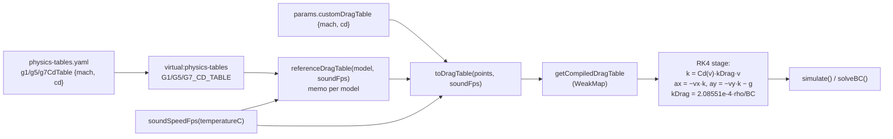

# Contract: engine drag calibration (standard point-mass retardation)

**Version:** 1.0.0
**Status:** Proposed. Needs user approval of ADR 011 and of open questions Q1–Q4 (§11) before the builder starts.
**Date:** 2026-11-23
**Author:** Architect
**ADR:** [`adr-engine-drag-calibration.md`](adr-engine-drag-calibration.md) (ADR 011)
**Owner:** backend builder (engine and tests). There is no UI change.
**Suggested branch:** `claude/engine-drag-calibration` from `main`. It must merge **before** S24-4 (PR #219). #219 then rebases and re-pins its numbers.
**Supersedes:** `feat3-custom-drag-ts.md` §3.4 and `spa1-ts-engine.md` §11.3 item 1 (the `a63f361` baseline). Both carry banners.

Builders implement this contract exactly. To change it, propose the change to the architect. Don't edit this file.

---

## 0. Deviations from the brief

| # | Brief said | Contract says | Why |
|---|---|---|---|
| D1 | "Whether the YAML table values need rescaling or the formula needs a different constant" | **Both, and rescaling isn't enough.** Replace the tables with the standard Mach-keyed C_d tables **and** change the formula (add v² and `CD_TO_RETARD`). | No single factor can fix it. The missing v² makes the error depend on velocity, and the old table shapes are not G1/G5/G7 (ADR §1.3). |
| D2 | "Keep the RK4 structure" | It is kept. **One addition:** the three loop stop checks move from total speed to horizontal speed `vx` (§3.4). | With real drag, low-BC inputs reachable from the UI would otherwise loop forever (ADR §4.1 item 5, R6a). |
| D3 | (not mentioned) | `solveBC` gains a feasible-lower-bound search (§3.7). | With real drag, BC 0.001 never reaches the range, and the current code would return `null` for **every** input. That would break the BC solver card and S24-4. |
| D4 | "Same public API" | The public API is unchanged. The **module** surface of `virtual:physics-tables` changes (`G1_TABLE` becomes `G1_CD_TABLE` and so on, with `{mach, cd}` rows). | Renaming makes any stale caller fail loudly. Only `engine.ts`, the Vite plugin and the Jest mock consume the module. |

## 1. Scope

### 1.1 In scope
- `app/data/physics-tables.yaml`: table data and keys (§2.1).
- `vite.config.mjs`: `physicsTablesPlugin()` body only (§2.2).
- `tests/__mocks__/physics-tables.js` (§2.3).
- `app/physics/virtual-physics-tables.d.ts` (§2.4).
- `app/physics/engine.ts` (§3).
- `app/physics/types.ts`: comments only (§4).
- Tests and the golden fixture (§7). `README.md` "Drag" subsection and `BACKLOG.md` (§8).

### 1.2 Don't touch
- The RK4 scheme: 4 stages, `DT_S = 0.0005`, the `sixthDt` combination, position update `x += vx*DT_S`, and the order of the `t` update.
- Bracket tracking (`findBracket`, the in-loop `while` walks), `compileDragTable`, `CompiledDragTable`, and the `WeakMap` compile cache mechanism.
- The zero-angle solver algorithm (PERF-16/30: bracket ±0.05 rad, hint logic, secant with bisection fallback). Only the `kDrag` value passed in changes.
- `solveBC`'s secant/Illinois iteration. Only the bracket setup changes (§3.7).
- Atmosphere functions (`airDensityRatio`, `stationAirDensityRatio`), `soundSpeedFps`, spin drift, Coriolis/Eötvös, wind-drift lag formula, rounding of output fields, density-altitude calculation, validation rules and messages.
- Public exports and their signatures: `simulate`, `solveBC`, `soundSpeedFps`, `TrajectoryInputError`, and all types in `types.ts`. Existing `@internal` exports keep their signatures (`findZeroAngleFps`, `integrateTrajectoryFps`, `toDragTable`, `compileDragTable`, `findBracket`, and the rest).
- `engine-async.ts`, `engine.worker.ts`, and every `app/*.js` UI module.

## 2. Data and module surface

### 2.1 `app/data/physics-tables.yaml`
- Delete `g1Table`, `g5Table` and `g7Table` (keyed `{ v, f }`) completely.
- Add `g1CdTable`, `g5CdTable` and `g7CdTable`, rows `{ mach: <number>, cd: <number> }`, **exactly** as in Appendix A: 79, 76 and 84 rows, Mach 0.00 → 5.00, strictly increasing.
- Header comment: say these are the standard BRL / JBM reference drag coefficients C_G(M) (public domain), keyed by Mach, and that the engine converts them to fps per run at the ambient speed of sound (ADR 011).
- `atmosphere:` is unchanged.

### 2.2 `vite.config.mjs`, `physicsTablesPlugin()` `load()` only
Emit:
```js
export const G1_CD_TABLE = [{"mach":0,"cd":0.2629}, ...];   // data.g1CdTable mapped to ({ mach, cd })
export const G5_CD_TABLE = [...];
export const G7_CD_TABLE = [...];
export const ATMOSPHERE  = {...};
export default { G1_CD_TABLE, G5_CD_TABLE, G7_CD_TABLE, ATMOSPHERE };
```
Map each row to a fresh `{ mach, cd }` object so stray YAML keys are dropped. Update the plugin comment ("G1 drag table" becomes "G1/G5/G7 reference C_d tables"). Change nothing else in the file.

### 2.3 `tests/__mocks__/physics-tables.js`
Mirror §2.2 exactly: same export names, same `{ mach, cd }` mapping, same `default` object.

### 2.4 `app/physics/virtual-physics-tables.d.ts`
```ts
declare module 'virtual:physics-tables' {
  type CdRow = { readonly mach: number; readonly cd: number };
  const G1_CD_TABLE: ReadonlyArray<CdRow>;
  const G5_CD_TABLE: ReadonlyArray<CdRow>;
  const G7_CD_TABLE: ReadonlyArray<CdRow>;
  const ATMOSPHERE: { /* unchanged */ };
  export { G1_CD_TABLE, G5_CD_TABLE, G7_CD_TABLE, ATMOSPHERE };
  const _default: { G1_CD_TABLE: typeof G1_CD_TABLE; G5_CD_TABLE: typeof G5_CD_TABLE; G7_CD_TABLE: typeof G7_CD_TABLE; ATMOSPHERE: typeof ATMOSPHERE };
  export default _default;
}
```
`CdRow` is structurally identical to `DragPoint`. Ambient modules can't import relative types, so it is written inline.

## 3. Engine changes (`app/physics/engine.ts`)

### 3.1 Imports and constants
```ts
import { G1_CD_TABLE, G5_CD_TABLE, G7_CD_TABLE, ATMOSPHERE } from 'virtual:physics-tables';
```
Add this to the "Physics constants" block:
```ts
/**
 * Converts a reference drag coefficient to retardation (ADR 011):
 *   a [ft/s²] = rhoRatio · CD_TO_RETARD · Cd(M) · v² / BC[lb/in²]
 * CD_TO_RETARD = ρ₀·π/(8·144), ρ₀ = 0.0764742 lb/ft³ (ICAO sea level). @internal
 */
export const CD_TO_RETARD = 2.08551e-4;
```
Use the literal `2.08551e-4`. Don't compute it at runtime.

### 3.2 Reference tables and the compile cache
Remove `G1_COMPILED`, `G5_COMPILED` and `G7_COMPILED`, and the pre-seeded entries in `_compiledCache`. `_compiledCache` becomes `new WeakMap<DragTable, CompiledDragTable>()`. `getCompiledDragTable` is unchanged.

Add:
```ts
type ReferenceDragModel = Exclude<EffectiveDragModel, 'custom'>;   // 'G1' | 'G5' | 'G7'

const REFERENCE_CD: Readonly<Record<ReferenceDragModel, readonly DragPoint[]>> = {
  G1: G1_CD_TABLE, G5: G5_CD_TABLE, G7: G7_CD_TABLE,
};

const _refMemo = new Map<ReferenceDragModel, { readonly soundFps: number; readonly table: DragTable }>();

/**
 * fps-keyed DragTable [mach × soundFps, Cd] for a standard reference model (ADR 011).
 * One-entry memo per model: the same (model, soundFps) returns the SAME array object,
 * so the WeakMap compile cache hits across runs at one temperature. @internal
 */
export function referenceDragTable(model: ReferenceDragModel, soundFps: number): DragTable {
  const hit = _refMemo.get(model);
  if (hit !== undefined && hit.soundFps === soundFps) return hit.table;
  const table = toDragTable(REFERENCE_CD[model], soundFps);
  _refMemo.set(model, { soundFps, table });
  return table;
}
```
Rewrite the `toDragTable` JSDoc to: "Converts a Mach→C_d table to the engine's `[velocity fps, C_d]` `DragTable`. Used for both the standard G1/G5/G7 tables and user custom tables. Drag is `CD_TO_RETARD · rho · C_d · v² / BC` (ADR 011). @internal". Delete the "scaled form-factor … near-vacuum" text. The function body is unchanged.

### 3.3 RK4 drag expression (12 sites, same pattern each)
In `evalHeightAtZero`, `integrateTrajectoryFps` and `evalDropCmAtRange`, every stage `s ∈ {1,2,3,4}` currently reads:
```ts
const d{s}  = drag{s} * rhoOverBc;
const ax{s} = -(v{x,s} / v{s}) * d{s};
const ay{s} = -(v{y,s} / v{s}) * d{s} - G_FPS2;
```
Replace it with exactly:
```ts
const k{s}  = drag{s} * kDrag * v{s};      // a/v, units 1/s
const ax{s} = -v{x,s} * k{s};
const ay{s} = -v{y,s} * k{s} - G_FPS2;
```
where `v{s}` is the stage speed already in scope (`v1`, or `vel` in stage 1 of `integrateTrajectoryFps` and `evalDropCmAtRange`, then `v2`, `v3`, `v4`), and `v{x,s}`/`v{y,s}` are the stage velocity components already used (`vx`/`vy`, `vx2`/`vy2`, …). Keep the multiplication order `drag * kDrag * v`, so the regenerated golden is reproducible. `k1`–`k4` don't clash with `ck`/`ek` in `integrateTrajectoryFps`.

`kDrag` replaces `rhoOverBc` everywhere:
```ts
const kDrag = CD_TO_RETARD * rho / bc;   // 1/ft
```
- `findZeroAngleFps`: compute `kDrag` in place of `rhoOverBc` and pass it to `evalHeightAtZero`.
- `evalHeightAtZero`: rename the parameter `rhoOverBc` to `kDrag`. The position is unchanged.
- `integrateTrajectoryFps`, `evalDropCmAtRange`: compute `kDrag` in place of `rhoOverBc`.

No identifier `rhoOverBc` remains in the file.

### 3.4 Loop termination guard (mandatory, D2)
| Function | Current | New |
|---|---|---|
| `evalHeightAtZero` (loop top) | `if (v1 < 50) break;` | `if (vx < 50) break;` |
| `integrateTrajectoryFps` (loop end) | `if (vel < MIN_VEL_FPS) break;` | `if (vx < MIN_VEL_FPS) break;` |
| `evalDropCmAtRange` (loop top) | `if (vel < MIN_VEL_FPS) return null;` | `if (vx < MIN_VEL_FPS) return null;` |

In `evalDropCmAtRange`, `vel` is still computed and used for drag. Rationale: |vx| ≤ v, so each new check fires whenever the old one did. vx starts positive (launch angle within ±0.05 rad) and only decreases (dvx/dt = −k·vx), so every loop now ends. Add a one-line comment at each site: `// horizontal-speed stop: guarantees termination under terminal-velocity fall (ADR 011)`.

### 3.5 Defaults on `@internal` functions
- `findZeroAngleFps(..., dragTable: DragTable = referenceDragTable('G1', soundSpeedFps(15)), hintAngle?)`
- `integrateTrajectoryFps(..., dragTable: DragTable = referenceDragTable('G1', soundSpeedFps(15)), extras = {}, soundFps = soundSpeedFps(15))`

The parameter lists and order are otherwise unchanged.

### 3.6 `simulate()`
Replace the `dragTable` selection with:
```ts
const dragTable = useCustom
  ? toDragTable(custom, soundFps)
  : referenceDragTable(dragModel as ReferenceDragModel, soundFps);
```
A narrowing helper is fine in place of the cast. `any` is not. Everything else in `simulate()` is unchanged. `rho` stays the station density ratio, and `soundFps` stays `soundSpeedFps(params.temperatureC)`.

### 3.7 `evalDropCmAtRange` and `solveBC`
`evalDropCmAtRange` (private): replace the `ct: CompiledDragTable` parameter with `dragTable: DragTable` in the same position, and derive `const ct = getCompiledDragTable(dragTable);` inside. Pass `dragTable`, not `G1_TABLE`, to `findZeroAngleFps`. Apply §3.3 and §3.4.

`solveBC`: the input validation, `mvFps`, `rho` (`airDensityRatio`, unchanged), `sightHtFt`, `zeroFt` and `targetFt` are unchanged. Replace everything from `startIdx` down to `const resLo … if (resLo === null) return null;` with:
```ts
const g1       = referenceDragTable('G1', soundSpeedFps(tempC));
const g1Ct     = getCompiledDragTable(g1);
const startIdx = findBracket(mvFps, g1Ct, g1Ct.last);

// Feasible lower bound (ADR 011 §4.1 item 6): with real drag a tiny BC never reaches the
// zero or target range. Double lo until the projectile reaches max(target, zero).
const probeFt = Math.max(targetFt, zeroFt);
let lo = 0.001, hi = 1.5;
while (lo < hi && evalDropCmAtRange(mvFps, lo, rho, zeroFt, sightHtFt, probeFt, g1, startIdx) === null) {
  lo = Math.min(lo * 2, hi);
}
const resLo = evalDropCmAtRange(mvFps, lo, rho, zeroFt, sightHtFt, targetFt, g1, startIdx);
if (resLo === null) return null;
```
After that the code is unchanged, except:
- `fLo >= 0` returns `Math.round(lo * 10000) / 10000`, not `lo`.
- Every `evalDropCmAtRange(..., G1_COMPILED, ...)` becomes `evalDropCmAtRange(..., g1, ...)`.

There are at most 12 evaluations in the doubling loop. Each infeasible one ends early under §3.4. `measuredDropCm` keeps its meaning: **bore-line** drop in cm, negative down, the same quantity as `TrajectoryPoint.dropCm`.

### 3.8 Comments
- Header block: add `CD_TO_RETARD` with its derivation (§3.1).
- Remove every remaining reference to "form factor F(v)" or "near-vacuum".

## 4. Types (`app/physics/types.ts`), comments only
- `DragTableRow` comment: `[velocity ft/s, reference drag coefficient C_d]. Built per run from a Mach-keyed table (ADR 011).`
- `Bullet.ballisticCoefficient` comment: append `lb/in², referenced to the selected drag model (G1/G5/G7) or to the custom C_d table`.

## 5. Data flow



## 6. Worked example and expected values

### 6.1 Inputs
```js
bullet = { id: 'x', name: 'x', bulletWeightGrams: 10.89, muzzleVelocityMps: 807,
           ballisticCoefficient: 0.475, bulletDiameterMm: 7.82, muzzleEnergyJoules: 3546 };
params = { zeroRangeMeters: 100, maxRangeMeters: 600, stepMeters: 100,
           windSpeedKph: 16, windDirectionDeg: 90, altitudeMeters: 0, temperatureC: 15,
           sightHeightMm: 38.1, shootingAngleDegrees: 0, dragModel: 'G1' };
```
This is .308 Win 168 gr (10.89 g), G1 BC 0.475, 807 m/s, ICAO sea level (`rho` = 1.000), 15 °C.

### 6.2 Hand derivation
1. v₀ = 807 × 3.28084 = **2,647.64 ft/s**. `soundSpeedFps(15)` = 331.3·√(1 + 15/273.15)·3.28084 = **1,116.39 ft/s**, so M₀ = **2.3716**.
2. G1 at M₀: rows 2.35 → 0.5527 and 2.40 → 0.5481, so C_d = 0.5527 − 0.432·0.0046 = **0.55071**.
3. kDrag = 2.08551e-4 × 1.000 / 0.475 = **4.39055e-4 ft⁻¹**.
4. Muzzle retardation a = kDrag · C_d · v² = 4.39055e-4 × 0.55071 × 2,647.64² = **1,695 ft/s²** (516.6 m/s², about 53 g). The current engine gives 0.245 ft/s².
5. Downrange, dv/dx = −kDrag·C_d(M)·v (flat fire). So x(M) = (1/kDrag)·∫ dM / (C_d(M)·M), integrated over the G1 table rows. 1/kDrag = 2,277.6 ft.
6. Time t(x) = ∫ dx / v. Drop below the bore line D(x) = g·∫₀ˣ ∫₀^ξ dη / v(η)² dξ. This is exact for flat fire, because d(vy/vx)/dx = −g/vx².
7. Wind drift (lag method, as in the engine) = 14.5815 ft/s × (t − x / v₀). 16 kph = 9.94194 mph = 14.5815 ft/s.
8. Path relative to the line of sight = `dropCm(x)` + (x/100 m)·(3.81 − `dropCm(100 m)`) − 3.81 cm.

### 6.3 Expected output
The engine samples at the first step past each range, so `rangeMeters` reads 100.x and so on. Match points with `|rangeMeters − R| < 1`.

| R (m) | `velocityMps` | `timeOfFlightSec` | `dropCm` (bore line) | Path vs LOS (cm, derived) | `windDriftCm` | `energyJoules` |
|---|---|---|---|---|---|---|
| 0 | 807.0 | 0 | 0 | −3.8 | 0 | 3,546 |
| 100 | 744.5 | 0.1290 | −7.96 | 0.0 | 2.3 | 3,018 |
| 200 | 684.7 | 0.2691 | −33.7 | −13.9 | 9.4 | 2,553 |
| 300 | 627.7 | 0.4216 | −80.4 | −48.9 | 22.2 | 2,145 |
| 400 | 573.6 | 0.5882 | −152.1 | −108.8 | 41.2 | 1,792 |
| 500 | 522.7 | 0.7709 | −253.7 | −198.6 | 67.3 | 1,488 |
| 600 | 475.3 | 0.9715 | −391.3 | −324.5 (5.41 mil) | 101.4 | 1,230 |

For comparison, the current engine (golden case `308-win-168gr condA G1`, MV 807.7) at 600 m gives `velocityMps` 807.7, `timeOfFlightSec` 0.743, `dropCm` −270.9 and `windDriftCm` 0.

### 6.4 Acceptance bands (the physics-sanity test, §7.2 N1–N4)
The hand integration is accurate to about ±0.5 % in v and t and ±1 % in drop. The test bands are wider so they test physics, not arithmetic.

| Field (100–600 m rows, §6.3) | Band |
|---|---|
| `velocityMps` | ±1.0 % |
| `timeOfFlightSec` | ±1.0 % |
| `dropCm` at 200–600 m | ±2.0 % (at 100 m: ±0.3 cm) |
| `windDriftCm` at 200–600 m | ±5.0 % |
| `energyJoules` | ±2.0 % |

Extra anchors:
| Check | Input change from §6.1 | Expected |
|---|---|---|
| A1 Supersonic limit | `maxRangeMeters: 1000, stepMeters: 25` | `supersonicLimitMeters` ∈ [955, 1010] (hand value 982) |
| A2 Very low BC | `ballisticCoefficient: 0.05, maxRangeMeters: 300, stepMeters: 25` | `supersonicLimitMeters` ∈ [95, 112] (hand value 103) |
| A3 G7 with the catalog G7 BC | `dragModel: 'G7', ballisticCoefficient: 0.224` | `velocityMps` at 600 m ∈ [445, 461] (hand value 453) |
| A4 BC response | BC ∈ {0.2, 0.3, 0.475, 0.6, 1.0}, 600 m point | `velocityMps` strictly increasing, `dropCm` strictly increasing (less negative), `timeOfFlightSec` strictly decreasing. v(0.475) − v(0.3) > 100 m/s (hand values 475 vs 348) |

## 7. Tests

Coverage must stay at **100/100/100/100**. `npm test` (including `tsc --noEmit`) must be green, and the E2E suite must pass against the built `dist/`.

### 7.1 Existing tests to update (`tests/physics-engine.test.js` unless stated)
| Where | Change |
|---|---|
| Line 13, import from the mock | Import `G1_CD_TABLE`, `G5_CD_TABLE` and `G7_CD_TABLE`. Where an fps table is needed, build it with `referenceDragTable('G1' \| 'G7' \| 'G5', soundSpeedFps(15))`. |
| "G1/G5/G7 velocities strictly ascending" (around line 324) | Assert `mach` strictly ascending in each C_d table, and fps strictly ascending after `referenceDragTable`. |
| PERF-15 `compileDragTable` / `findBracket` loops (around lines 1210, 1237) | Use the fps reference tables. Extend the sweeps to 6,000 fps so the top clamp is exercised (Mach 5 ≈ 5,582 fps). |
| PERF-16 reference bisection (around lines 1293–1336) | Mirror §3.3 in `refBisection`: `k = Cd·(2.08551e-4·rho/bc)·v; ax = −vx·k; ay = −vy·k − 32.174`. Use the `vx < 50` stop (§3.4). Use the fps G1 table at 15 °C. Keep the 1e-9 tolerance. |
| PERF-17 BC recovery (around line 1375) | BC 0.02 at 1000 m is now infeasible. Use BC 0.15 and 0.50 at 500 m. Keep the monotonicity and 4-dp assertions. |
| PERF-30 clamps (around line 1455) | `-50 cm @ 500 m` still returns 1.5. For `-5000 cm @ 500 m`, assert the result is `0.001·2ⁿ` (rounded to 4 dp) for some n ≥ 1, and that it is < 0.2. Pin the exact value from the engine. |
| PERF-30 interior roots (around line 1460) | Replace the three pinned cases with measured drops that give roots in (0.1, 1.2) at 500 m and 1000 m. Pin the engine's 4-dp results. Keep the secant and bisection-fallback paths both covered (check the coverage report). |
| PERF-30 branch tests (around line 1466) | **super-vMax** needs MV > 5 × `soundSpeedFps(15)` / 3.28084 ≈ 1,701 m/s, so use **1,800 m/s** in `simulate` and `solveBC`. **sub-vMin**: a custom table starting at Mach 0.5 is now 558.2 fps, and MV 160 m/s (525 fps) still works. **Upward bracket advance**: the 400 fps row is gone. Pick an MV just below a new row (for example Mach 0.35 = 390.74 fps at 15 °C) with a high BC (1.5) and a long range (≥ 400 m), so that gravity's along-path component beats drag. Confirm the branch in the coverage report. |
| FEAT-3 test 3, "G1-equivalent custom table" | Build the table as `G1_CD_TABLE.map(r => ({ mach: r.mach, cd: r.cd }))`. Strengthen the assertion from ±0.1 to `toEqual` the plain G1 run: same conversion path, so the result is bit-identical. |
| FEAT-3 test 7 (`toDragTable`) | Unchanged. |
| Zero-angle and integrate G1-vs-G7 tests (around lines 445, 502) | Pass fps reference tables. Keep the relational assertions. |
| Spin drift, Coriolis and Eötvös tests with pinned numbers | Re-pin from the engine. They scale with TOF, which is now about 30 % longer at 600 m. Formula tests on `spinDriftInches` and `stabilityFactor` are unchanged. |
| `tests/physics/packed-points.test.ts`, `tests/physics/engine-async.test.ts`, `tests/ballistics.test.js` (real-`simulate` blocks around lines 467 and 1836), `tests/custom-bullets.test.js` | Re-pin only the assertions that hard-code engine-derived numbers. Don't weaken relational assertions. |
| `tests/e2e/app.e2e.test.js` | Run it. No change expected (S24-3b is tolerant). If any assertion hard-codes engine numbers, re-pin it. |

### 7.2 New tests (`tests/physics-engine.test.js`, new `describe('ADR 011: drag calibration')`)
| # | Test |
|---|---|
| N1 | Worked example §6.1. Every §6.3 row is inside the §6.4 bands. |
| N2 | A1 and A2 (supersonic limit). |
| N3 | A3 (G7 with the G7 BC). |
| N4 | A4 (BC response, monotonic). |
| N5 | `CD_TO_RETARD === 2.08551e-4`, and `toBeCloseTo(0.0764742 * Math.PI / 1152, 8)`. |
| N6 | Table integrity. Row counts are G1 79, G5 76 and G7 84. The first `mach` is 0 and the last is 5, strictly ascending. Spot values: G1 {0: 0.2629, 1.40: 0.6625, 2.40: 0.5481, 5: 0.4988}; G5 {0: 0.1710, 1.40: 0.4406, 5: 0.2280}; G7 {0: 0.1198, 1.05: 0.4043, 2.40: 0.2752, 5: 0.1618}. |
| N7 | `referenceDragTable`. Rows equal `[mach × soundFps, cd]`. The same `(model, soundFps)` returns the same object (`toBe`). A different `soundFps` returns a different object with scaled fps and identical `cd`. Switching back rebuilds the table, which covers the memo-miss branch. |
| N8 | Temperature affects drag through Mach. Fix `pressureHpa: 1013.25, humidityPercent: 0` and compare −20 °C with +40 °C. Use `referenceDragTable` row-level checks to isolate the Mach effect (fps of row i = mach_i × `soundSpeedFps(T)`). |
| N9 | `solveBC` round trip. For each BC in {0.25, 0.475, 0.8}: `simulate` with §6.1 params (`windSpeedKph: 0`, `maxRangeMeters: 600`) and take the point nearest 500 m. Then `solveBC({ weightG: 10.89, mvMps: 807, measuredDropCm: p.dropCm, rangeM: p.rangeMeters, altM: 0, tempC: 15 })` must be within ±0.002 of the input BC. |
| N10 | `solveBC` feasible-lower-bound search: a case where 0.001 is infeasible but a larger BC is feasible returns a non-null value. The existing MV 20 m/s case still returns `null`. |
| N11 | **Termination in the zero solver and with a heavy custom table (Jest timeout 5,000 ms each).** (a) `simulate` with BC 0.01, MV 91.44 m/s (300 fps, the UI minimum), zero 100 m, max 1000 m: returns. With these inputs v_term ≈ 80 fps, which is above the old 50 fps zero-solver stop, and the 100 m zero is out of reach, so the old code hangs in `evalHeightAtZero`. `points.length` is ≥ 1 and < the full count. Every field is finite. (b) `simulate` with custom table `cd: 2.0` at Mach 0/1/3, BC 0.01, MV 800 m/s, zero 100 m, max 5000 m: returns. (c) `findZeroAngleFps` with the N11(a) inputs (fps G1 table at 15 °C) returns a finite angle in [−0.05, 0.05]. (d) `solveBC` with `weightG: 10, mvMps: 100, measuredDropCm: -100, rangeM: 3000`: returns (null or a number). |
| N12 | **Termination in `integrateTrajectoryFps` (Jest timeout 5,000 ms).** `simulate` with BC 0.02, MV 800 m/s, G1, zero 100 m, max 1000 m, step 25 (the old PERF-17 inputs). Here v_term ≈ 113 fps, which is above the old 100 fps stop, and the downrange limit is about 350 m. Assert that the call returns, the last point's `rangeMeters` < 1000, and the last point's `velocityMps` > 100 / 3.28084. That last check shows the old `vel < MIN_VEL_FPS` stop could never have fired, which is the reason the guard exists. If the hand estimates are off, pick inputs where all three hold. |

### 7.3 Golden fixture re-baseline (`tests/fixtures/spa1-golden.json`)
Do this **last**, after N1–N12 pass.
1. Generate it with a throwaway script or test. **Don't commit the script.**
2. Keep every case's `name`, `bullet` and `params` byte-identical. Replace only the `expected` values. Keep the existing `expected` keys, including `expected.dragModel` on the custom cases.
3. Set `generatedFrom` to `"<short-sha of the commit before the fixture commit> engine.ts simulate (ADR 011 drag calibration)"`.
4. Append to `amendments`: `"ADR 011: all expected values re-baselined under standard drag (CD_TO_RETARD, BRL G1/G5/G7 Cd tables, vx stop)"`.
5. Spot check: in case `308-win-168gr condA G1` (MV 807.7), the 600.x m point has `velocityMps` within ±1 % of 475.8 and `windDriftCm` > 90. If that fails, stop: the physics is wrong, not the fixture.
6. The golden loop assertion is unchanged (exact `toEqual`).

## 8. Docs
- `README.md` §"Drag": replace the `Cd = interpolate_drag(|v|) × ρ/BC` block with the §3.1 formula and one sentence on Mach-keyed standard tables converted at the ambient speed of sound. Line 291's comment becomes `# G1/G5/G7 reference Cd tables (Mach-keyed) + atmosphere constants`.
- `BACKLOG.md`: add this story under Sprint 24, marked done in the same PR. Note that S24-4 (PR #219) depends on it.

## 9. Threat model
See ADR 011 §5.3. Required mitigations, and where this contract covers each:
| Mitigation | Covered by |
|---|---|
| Termination guard against worker hang (DoS) | §3.4, tests N11 and N12 |
| Integrity of constants and tables (tampering or silent regression) | N5, N6, N1–N4 bands, §7.3 exact golden lock |
| Bounded `solveBC` work | §3.7 (at most 12 extra evaluations) |
| Custom-table validation | Unchanged (FEAT-3 §3.3) |

## 10. Acceptance criteria
1. §2–§4 are implemented exactly. `git diff` shows no change to the RK4 combination lines, `findBracket`, `compileDragTable`, the zero-solver iteration, or the `solveBC` secant loop body.
2. No identifier `rhoOverBc`, `G1_TABLE`, `G5_TABLE`, `G7_TABLE` or `G1_COMPILED` remains under `app/` or `tests/`.
3. N1–N12 pass. The golden fixture is re-baselined per §7.3. `npm test` is green at 100/100/100/100. The E2E suite passes against `dist/`.
4. Manual check (`npm run dev`): select the .308 168 gr with G1 at default conditions. The table shows velocity falling to about 475 m/s at 600 m. Changing BC visibly changes drop. The BC back-calculator returns a BC near 0.475 when given that run's 500 m `dropCm`.
5. Files changed are limited to §1.1.

## 11. Open questions (need the user)
- **Q1 – G5 with a G1 BC.** There is no G5 BC field. `bulletForDragModel` only swaps in G7, so G5 runs use the G1 BC and will under-predict drag by about 37 %. Recommend a follow-up story: add `ballisticCoefficientG5`, or disable G5 when no G5 BC is set. Not in this contract.
- **Q2 – Custom C_d curves and BC.** This contract keeps FEAT-3 semantics: the curve is divided by the bullet's BC. For Doppler-derived curves the user must enter sectional density (lb/in²) as the BC. Should a follow-up add help text, or auto-use sectional density when a custom table is active?
- **Q3 – Zero-angle bracket ±0.05 rad.** Long zeros (up to the 3,000 m validation limit) with low-BC bullets may now need more elevation, and the solver silently clamps. Recommend a follow-up: widen the bracket, or surface "zero unreachable".
- **Q4 – Stale trued bullets.** `(trued)` custom bullets saved by the MV truing tool were solved under near-vacuum drag, so their MVs are biased low. Release note only, or flag them for re-truing?

---

## Appendix A: reference C_d tables (copy exactly into `physics-tables.yaml`)

Source: standard BRL / JBM G-function tables (public domain). These are the same values distributed with JBM Ballistics and py-ballisticcalc (`drag_tables.py`).

```yaml
# ── G1 reference drag coefficients (flat-base, Ingalls/BRL) — 79 rows ──────────
g1CdTable:
  - { mach: 0.00,  cd: 0.2629 }
  - { mach: 0.05,  cd: 0.2558 }
  - { mach: 0.10,  cd: 0.2487 }
  - { mach: 0.15,  cd: 0.2413 }
  - { mach: 0.20,  cd: 0.2344 }
  - { mach: 0.25,  cd: 0.2278 }
  - { mach: 0.30,  cd: 0.2214 }
  - { mach: 0.35,  cd: 0.2155 }
  - { mach: 0.40,  cd: 0.2104 }
  - { mach: 0.45,  cd: 0.2061 }
  - { mach: 0.50,  cd: 0.2032 }
  - { mach: 0.55,  cd: 0.2020 }
  - { mach: 0.60,  cd: 0.2034 }
  - { mach: 0.70,  cd: 0.2165 }
  - { mach: 0.725, cd: 0.2230 }
  - { mach: 0.75,  cd: 0.2313 }
  - { mach: 0.775, cd: 0.2417 }
  - { mach: 0.80,  cd: 0.2546 }
  - { mach: 0.825, cd: 0.2706 }
  - { mach: 0.85,  cd: 0.2901 }
  - { mach: 0.875, cd: 0.3136 }
  - { mach: 0.90,  cd: 0.3415 }
  - { mach: 0.925, cd: 0.3734 }
  - { mach: 0.95,  cd: 0.4084 }
  - { mach: 0.975, cd: 0.4448 }
  - { mach: 1.00,  cd: 0.4805 }
  - { mach: 1.025, cd: 0.5136 }
  - { mach: 1.05,  cd: 0.5427 }
  - { mach: 1.075, cd: 0.5677 }
  - { mach: 1.10,  cd: 0.5883 }
  - { mach: 1.125, cd: 0.6053 }
  - { mach: 1.15,  cd: 0.6191 }
  - { mach: 1.20,  cd: 0.6393 }
  - { mach: 1.25,  cd: 0.6518 }
  - { mach: 1.30,  cd: 0.6589 }
  - { mach: 1.35,  cd: 0.6621 }
  - { mach: 1.40,  cd: 0.6625 }
  - { mach: 1.45,  cd: 0.6607 }
  - { mach: 1.50,  cd: 0.6573 }
  - { mach: 1.55,  cd: 0.6528 }
  - { mach: 1.60,  cd: 0.6474 }
  - { mach: 1.65,  cd: 0.6413 }
  - { mach: 1.70,  cd: 0.6347 }
  - { mach: 1.75,  cd: 0.6280 }
  - { mach: 1.80,  cd: 0.6210 }
  - { mach: 1.85,  cd: 0.6141 }
  - { mach: 1.90,  cd: 0.6072 }
  - { mach: 1.95,  cd: 0.6003 }
  - { mach: 2.00,  cd: 0.5934 }
  - { mach: 2.05,  cd: 0.5867 }
  - { mach: 2.10,  cd: 0.5804 }
  - { mach: 2.15,  cd: 0.5743 }
  - { mach: 2.20,  cd: 0.5685 }
  - { mach: 2.25,  cd: 0.5630 }
  - { mach: 2.30,  cd: 0.5577 }
  - { mach: 2.35,  cd: 0.5527 }
  - { mach: 2.40,  cd: 0.5481 }
  - { mach: 2.45,  cd: 0.5438 }
  - { mach: 2.50,  cd: 0.5397 }
  - { mach: 2.60,  cd: 0.5325 }
  - { mach: 2.70,  cd: 0.5264 }
  - { mach: 2.80,  cd: 0.5211 }
  - { mach: 2.90,  cd: 0.5168 }
  - { mach: 3.00,  cd: 0.5133 }
  - { mach: 3.10,  cd: 0.5105 }
  - { mach: 3.20,  cd: 0.5084 }
  - { mach: 3.30,  cd: 0.5067 }
  - { mach: 3.40,  cd: 0.5054 }
  - { mach: 3.50,  cd: 0.5040 }
  - { mach: 3.60,  cd: 0.5030 }
  - { mach: 3.70,  cd: 0.5022 }
  - { mach: 3.80,  cd: 0.5016 }
  - { mach: 3.90,  cd: 0.5010 }
  - { mach: 4.00,  cd: 0.5006 }
  - { mach: 4.20,  cd: 0.4998 }
  - { mach: 4.40,  cd: 0.4995 }
  - { mach: 4.60,  cd: 0.4992 }
  - { mach: 4.80,  cd: 0.4990 }
  - { mach: 5.00,  cd: 0.4988 }

# ── G5 reference drag coefficients (short 7.5° boat-tail, 6.19-cal tangent ogive) — 76 rows
g5CdTable:
  - { mach: 0.00,  cd: 0.1710 }
  - { mach: 0.05,  cd: 0.1719 }
  - { mach: 0.10,  cd: 0.1727 }
  - { mach: 0.15,  cd: 0.1732 }
  - { mach: 0.20,  cd: 0.1734 }
  - { mach: 0.25,  cd: 0.1730 }
  - { mach: 0.30,  cd: 0.1718 }
  - { mach: 0.35,  cd: 0.1696 }
  - { mach: 0.40,  cd: 0.1668 }
  - { mach: 0.45,  cd: 0.1637 }
  - { mach: 0.50,  cd: 0.1603 }
  - { mach: 0.55,  cd: 0.1566 }
  - { mach: 0.60,  cd: 0.1529 }
  - { mach: 0.65,  cd: 0.1497 }
  - { mach: 0.70,  cd: 0.1473 }
  - { mach: 0.75,  cd: 0.1463 }
  - { mach: 0.80,  cd: 0.1489 }
  - { mach: 0.85,  cd: 0.1583 }
  - { mach: 0.875, cd: 0.1672 }
  - { mach: 0.90,  cd: 0.1815 }
  - { mach: 0.925, cd: 0.2051 }
  - { mach: 0.95,  cd: 0.2413 }
  - { mach: 0.975, cd: 0.2884 }
  - { mach: 1.00,  cd: 0.3379 }
  - { mach: 1.025, cd: 0.3785 }
  - { mach: 1.05,  cd: 0.4032 }
  - { mach: 1.075, cd: 0.4147 }
  - { mach: 1.10,  cd: 0.4201 }
  - { mach: 1.15,  cd: 0.4278 }
  - { mach: 1.20,  cd: 0.4338 }
  - { mach: 1.25,  cd: 0.4373 }
  - { mach: 1.30,  cd: 0.4392 }
  - { mach: 1.35,  cd: 0.4403 }
  - { mach: 1.40,  cd: 0.4406 }
  - { mach: 1.45,  cd: 0.4401 }
  - { mach: 1.50,  cd: 0.4386 }
  - { mach: 1.55,  cd: 0.4362 }
  - { mach: 1.60,  cd: 0.4328 }
  - { mach: 1.65,  cd: 0.4286 }
  - { mach: 1.70,  cd: 0.4237 }
  - { mach: 1.75,  cd: 0.4182 }
  - { mach: 1.80,  cd: 0.4121 }
  - { mach: 1.85,  cd: 0.4057 }
  - { mach: 1.90,  cd: 0.3991 }
  - { mach: 1.95,  cd: 0.3926 }
  - { mach: 2.00,  cd: 0.3861 }
  - { mach: 2.05,  cd: 0.3800 }
  - { mach: 2.10,  cd: 0.3741 }
  - { mach: 2.15,  cd: 0.3684 }
  - { mach: 2.20,  cd: 0.3630 }
  - { mach: 2.25,  cd: 0.3578 }
  - { mach: 2.30,  cd: 0.3529 }
  - { mach: 2.35,  cd: 0.3481 }
  - { mach: 2.40,  cd: 0.3435 }
  - { mach: 2.45,  cd: 0.3391 }
  - { mach: 2.50,  cd: 0.3349 }
  - { mach: 2.60,  cd: 0.3269 }
  - { mach: 2.70,  cd: 0.3194 }
  - { mach: 2.80,  cd: 0.3125 }
  - { mach: 2.90,  cd: 0.3060 }
  - { mach: 3.00,  cd: 0.2999 }
  - { mach: 3.10,  cd: 0.2942 }
  - { mach: 3.20,  cd: 0.2889 }
  - { mach: 3.30,  cd: 0.2838 }
  - { mach: 3.40,  cd: 0.2790 }
  - { mach: 3.50,  cd: 0.2745 }
  - { mach: 3.60,  cd: 0.2703 }
  - { mach: 3.70,  cd: 0.2662 }
  - { mach: 3.80,  cd: 0.2624 }
  - { mach: 3.90,  cd: 0.2588 }
  - { mach: 4.00,  cd: 0.2553 }
  - { mach: 4.20,  cd: 0.2488 }
  - { mach: 4.40,  cd: 0.2429 }
  - { mach: 4.60,  cd: 0.2376 }
  - { mach: 4.80,  cd: 0.2326 }
  - { mach: 5.00,  cd: 0.2280 }

# ── G7 reference drag coefficients (long 7.5° boat-tail, 10-cal tangent ogive) — 84 rows
g7CdTable:
  - { mach: 0.00,  cd: 0.1198 }
  - { mach: 0.05,  cd: 0.1197 }
  - { mach: 0.10,  cd: 0.1196 }
  - { mach: 0.15,  cd: 0.1194 }
  - { mach: 0.20,  cd: 0.1193 }
  - { mach: 0.25,  cd: 0.1194 }
  - { mach: 0.30,  cd: 0.1194 }
  - { mach: 0.35,  cd: 0.1194 }
  - { mach: 0.40,  cd: 0.1193 }
  - { mach: 0.45,  cd: 0.1193 }
  - { mach: 0.50,  cd: 0.1194 }
  - { mach: 0.55,  cd: 0.1193 }
  - { mach: 0.60,  cd: 0.1194 }
  - { mach: 0.65,  cd: 0.1197 }
  - { mach: 0.70,  cd: 0.1202 }
  - { mach: 0.725, cd: 0.1207 }
  - { mach: 0.75,  cd: 0.1215 }
  - { mach: 0.775, cd: 0.1226 }
  - { mach: 0.80,  cd: 0.1242 }
  - { mach: 0.825, cd: 0.1266 }
  - { mach: 0.85,  cd: 0.1306 }
  - { mach: 0.875, cd: 0.1368 }
  - { mach: 0.90,  cd: 0.1464 }
  - { mach: 0.925, cd: 0.1660 }
  - { mach: 0.95,  cd: 0.2054 }
  - { mach: 0.975, cd: 0.2993 }
  - { mach: 1.00,  cd: 0.3803 }
  - { mach: 1.025, cd: 0.4015 }
  - { mach: 1.05,  cd: 0.4043 }
  - { mach: 1.075, cd: 0.4034 }
  - { mach: 1.10,  cd: 0.4014 }
  - { mach: 1.125, cd: 0.3987 }
  - { mach: 1.15,  cd: 0.3955 }
  - { mach: 1.20,  cd: 0.3884 }
  - { mach: 1.25,  cd: 0.3810 }
  - { mach: 1.30,  cd: 0.3732 }
  - { mach: 1.35,  cd: 0.3657 }
  - { mach: 1.40,  cd: 0.3580 }
  - { mach: 1.50,  cd: 0.3440 }
  - { mach: 1.55,  cd: 0.3376 }
  - { mach: 1.60,  cd: 0.3315 }
  - { mach: 1.65,  cd: 0.3260 }
  - { mach: 1.70,  cd: 0.3209 }
  - { mach: 1.75,  cd: 0.3160 }
  - { mach: 1.80,  cd: 0.3117 }
  - { mach: 1.85,  cd: 0.3078 }
  - { mach: 1.90,  cd: 0.3042 }
  - { mach: 1.95,  cd: 0.3010 }
  - { mach: 2.00,  cd: 0.2980 }
  - { mach: 2.05,  cd: 0.2951 }
  - { mach: 2.10,  cd: 0.2922 }
  - { mach: 2.15,  cd: 0.2892 }
  - { mach: 2.20,  cd: 0.2864 }
  - { mach: 2.25,  cd: 0.2835 }
  - { mach: 2.30,  cd: 0.2807 }
  - { mach: 2.35,  cd: 0.2779 }
  - { mach: 2.40,  cd: 0.2752 }
  - { mach: 2.45,  cd: 0.2725 }
  - { mach: 2.50,  cd: 0.2697 }
  - { mach: 2.55,  cd: 0.2670 }
  - { mach: 2.60,  cd: 0.2643 }
  - { mach: 2.65,  cd: 0.2615 }
  - { mach: 2.70,  cd: 0.2588 }
  - { mach: 2.75,  cd: 0.2561 }
  - { mach: 2.80,  cd: 0.2533 }
  - { mach: 2.85,  cd: 0.2506 }
  - { mach: 2.90,  cd: 0.2479 }
  - { mach: 2.95,  cd: 0.2451 }
  - { mach: 3.00,  cd: 0.2424 }
  - { mach: 3.10,  cd: 0.2368 }
  - { mach: 3.20,  cd: 0.2313 }
  - { mach: 3.30,  cd: 0.2258 }
  - { mach: 3.40,  cd: 0.2205 }
  - { mach: 3.50,  cd: 0.2154 }
  - { mach: 3.60,  cd: 0.2106 }
  - { mach: 3.70,  cd: 0.2060 }
  - { mach: 3.80,  cd: 0.2017 }
  - { mach: 3.90,  cd: 0.1975 }
  - { mach: 4.00,  cd: 0.1935 }
  - { mach: 4.20,  cd: 0.1861 }
  - { mach: 4.40,  cd: 0.1793 }
  - { mach: 4.60,  cd: 0.1730 }
  - { mach: 4.80,  cd: 0.1672 }
  - { mach: 5.00,  cd: 0.1618 }
```
