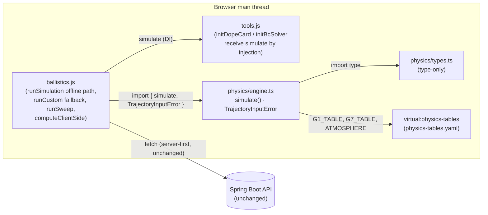

# Contract: TypeScript Physics Engine (SPA-1)

Version: 1.1.0 — 2026-11-23 (§11.3 item 1 baseline superseded by ADR 011; 1.0.0 was 2026-11-15)
Status: **Proposed** (pending user review)
ADR: [`../docs/adr/008-typescript-sole-physics-engine.md`](../docs/adr/008-typescript-sole-physics-engine.md)
Supersedes on merge: `wasm-integration.md` (removed) §3–§8 and §10 (engine client, fallback chain, async facade, overlay, WASM Jest strategy). Retires its mitigations M2, M3, M4, M6 (WASM part), M7, and M8 (§12.3).
Related: `engine-parity.md` (removed) §7 (field formulas; `dropCm` is bore-line-relative), `wa12-custom-drag.md` (removed), `wa13-coriolis.md` (removed)
Owners: frontend builder (§2–§9, §11, §13.1), backend builder (§10.1, §13.2), devsecops (§10.2, §12 review, §13.3)

Builders implement this contract exactly. To change it, propose the change to the architect. Don't edit this file.

---

## 0. Deviations from the brief

| Brief | This contract | Reason |
|---|---|---|
| SPA-1 is "in BACKLOG.md" | `BACKLOG.md` on `main` has no SPA-1 entry | Built from the main-session brief. Add the story to `BACKLOG.md` in the SPA-1 PR (repo rule: keep the backlog current). |
| `TrajectoryParams.shootingAngle` | Field stays **`shootingAngleDegrees`** | Renaming it would break `ballistics.js`, `url-state.js`, saved prefs, and the REST/JSON-RPC body that the same object is still posted as (§7.1). |
| Task IDs `WA1-FE-n` | **`SPA1-FE-n`** | `WA-1` already exists (Engine Scaffold, PR #42). Reusing the ID would confuse the history. |
| `latitudeDeg`, `azimuthDeg`, `customDragTable` as `TrajectoryParams` inputs | Typed, but **reserved**: accepted and ignored in SPA-1 (§4.4) | `simulateBulletJS()` doesn't implement Coriolis or custom drag. SPA-1 is a port with no physics changes. The types are there so WA-12 and WA-13 can be added later without changing signatures. |
| "The function already implements correct physics" | True for the six point fields and three summary fields it returns. It does **not** compute `spinDriftCm` or `densityAltitudeMeters`, which the WASM tier did return | Known regression in local (offline) results only. See §1.3 and Q1. |

---

## 1. Scope

### 1.1 Goals
1. Port `simulateBulletJS()` and its four helpers from `ballistics.js` into one TypeScript module. It becomes the only in-page physics engine.
2. Make the output **identical** (`toEqual`, exact floats) to today's `simulateBulletJS()` for every valid input. A golden fixture locks this in (§11.3).
3. Delete the WASM loader, worker, engine client, three-tier dispatch, `virtual:wasm-engine` plugin, and the Computing overlay that the worker tier drove.
4. Add input validation. Without it, pathological inputs hang the main thread now that no worker timeout exists (§4.3, §12 T1).
5. Add TypeScript tooling: type-check in `npm test`, Babel strip for Jest, and Vite's native TS for the build.

### 1.2 Non-goals
- No physics changes: no spin drift, density altitude, Coriolis, or custom drag in the engine (Q1, Q2).
- No changes to the server-first flow in `runSimulation()` (SSE stream, then `/compare`, then local) or to `runCustom()`'s server call. Removing the API from the SPA is a later story.
- `sw.js` stays unchanged, including its inline copy `simulateBulletSW` and the `.wasm` cache-version code (§9, Q3).
- `cross-validate-runner.cjs` stays unchanged (Java `CrossValidationTest` uses it).
- Converting `ballistics.js`, `tools.js`, or other UI modules to TypeScript.
- Deleting the Rust crate under `engine/` (Q4).

### 1.3 Accepted regression
Results computed locally (offline mode, `runCustom` fallback, sweep, DOPE inputs, BC solver) no longer carry `spinDriftCm` or `densityAltitudeMeters`. The UI already tolerates their absence:
- `updateReadout` checks `p.spinDriftCm > 0`.
- The spin-drift dataset is created only when `results.some(r => r.points.some(p => p.spinDriftCm))`.
- `renderStatCards` checks `r.densityAltitudeMeters !== undefined`.

Results served by the server are unaffected.

---

## 2. Module boundary



| File (new) | Contents | Exports |
|---|---|---|
| `src/main/resources/static/physics/types.ts` | Type declarations only (§3). **No runtime statements.** Review rejects any `const`, `function`, `class`, or `enum`. | All types in §3 |
| `src/main/resources/static/physics/engine.ts` | The engine (§4), helpers (§5), and the error class (§4.3) | **Public:** `simulate`, `TrajectoryInputError`, `export type * from './types.ts'`. **Test-only (`/** @internal */`):** `interpolateDragTable`, `airDensityRatio`, `findZeroAngleFps`, `integrateTrajectoryFps` |
| `src/main/resources/static/physics/virtual-physics-tables.d.ts` | Ambient `declare module 'virtual:physics-tables'` (§6.1) | — |

Rules:
- Application code imports only `simulate`, `TrajectoryInputError`, and types. Only `src/test/js/physics-engine.test.js` imports the `@internal` helpers.
- Import specifiers carry the `.ts` extension, matching the repo's explicit `.js` ESM style: `import { simulate, TrajectoryInputError } from './physics/engine.ts';`
- `engine.ts` must not import any application module. Its only runtime import is `virtual:physics-tables`.
- **Purity:** `simulate` performs no I/O, touches no DOM, does no logging (`console` included), mutates no inputs, and keeps no state between calls. `tsconfig` sets `lib: ["ES2022"]` and `types: []`, so DOM and `console` globals don't type-check inside `physics/` (§6.1).

---

## 3. Types (`physics/types.ts`, exact)

```ts
/** Reference drag model. Runtime is lenient: any value other than 'G7' selects G1 (§4.2). */
export type DragModel = 'G1' | 'G7';

/** One row of a reference drag table from physics-tables.yaml: [velocity ft/s, drag-function value]. */
export type DragTableRow = readonly [velocityFps: number, dragFunction: number];
export type DragTable = readonly DragTableRow[];

/**
 * One point on a user-supplied Mach → Cd curve (shape fixed by wa12-custom-drag.md §1.1).
 * RESERVED in SPA-1: accepted on TrajectoryParams.customDragTable, never read.
 */
export interface DragPoint {
  readonly mach: number; // 0.0–5.0 once WA-12 lands
  readonly cd: number;   // 0.001–2.0 once WA-12 lands
}

/** A projectile. Catalog entries (bullets.yaml → virtual:bullet-catalog) always include every field. */
export interface Bullet {
  readonly id: string;                   // kebab-case catalog id, or 'custom' / 'bc-solve'
  readonly name: string;
  readonly caliber: string;
  readonly bulletWeightGrams: number;    // engine input; > 0
  readonly muzzleVelocityMps: number;    // engine input; > 0
  readonly ballisticCoefficient: number; // engine input; > 0 (G1- or G7-referenced, matching dragModel)
  readonly bulletDiameterMm: number;     // not read by the engine
  readonly muzzleEnergyJoules: number;   // not read by the engine
  readonly description?: string;         // catalog only; absent on custom / bc-solve bullets
  readonly hexColor?: string;            // catalog only; '#RRGGBB'
}

/** Inputs for one trajectory. `null` and `undefined` both mean "absent" for optional fields (?? semantics). */
export interface TrajectoryParams {
  readonly zeroRangeMeters: number;      // (0, 3000]
  readonly maxRangeMeters: number;       // (0, 5000]
  readonly stepMeters: number;           // (0, 500]
  readonly windSpeedKph: number;         // >= 0, total wind speed
  readonly altitudeMeters: number;       // >= 0
  readonly temperatureC: number;         // [-50, 60]
  readonly windDirectionDeg?: number | null;       // [0, 360], meteorological "from"; default 90
  readonly sightHeightMm?: number | null;          // <= 150; default 38.1
  readonly shootingAngleDegrees?: number | null;   // [-45, 45]; default 0
  readonly dragModel?: DragModel | null;           // default 'G1'
  readonly twistRateInchesPerTurn?: number | null; // accepted, IGNORED (spin drift not in engine; Q1)
  readonly latitudeDeg?: number | null;            // RESERVED, IGNORED (WA-13; Q2)
  readonly azimuthDeg?: number | null;             // RESERVED, IGNORED (WA-13; Q2)
  readonly customDragTable?: readonly DragPoint[] | null; // RESERVED, IGNORED (WA-12; Q2)
  readonly bulletIds?: readonly string[];          // passthrough from UI request objects; IGNORED
}

/** One output sample. Every value is rounded as specified in §4.5. */
export interface TrajectoryPoint {
  rangeMeters: number;
  dropCm: number;
  velocityMps: number;
  energyJoules: number;
  windDriftCm: number;
  timeOfFlightSec: number;
}

/** Return value of simulate(). */
export interface TrajectoryResult {
  readonly bullet: Bullet;            // the SAME object reference passed in
  readonly request: TrajectoryParams; // the SAME object reference passed in
  readonly points: TrajectoryPoint[];
  readonly maxOrdinateCm: number;
  readonly maxOrdinateRangeMeters: number;
  readonly supersonicLimitMeters: number;
}
```

Notes:
- `TrajectoryPoint` has exactly the six fields `simulateBulletJS()` emits today. It deliberately omits `moaAdjustment`/`mradAdjustment` (the UI computes them with `computeAdjustments`), `spinDriftCm`, and `coriolisDeflectionCm`. Server results can carry extra fields. `ballistics.js` stays JavaScript and keeps treating those fields as optional.
- `ballistics.js` stays JS, so it can pass objects with extra properties (`name`, `bulletIds`, custom-bullet fields). The engine ignores them, and `result.request` echoes them unchanged (same reference).

---

## 4. `simulate` behaviour

### 4.1 Signature

```ts
export function simulate(bullet: Bullet, params: TrajectoryParams): TrajectoryResult;
```

`simulate` is **synchronous**. Existing `await simulateBulletFn(...)` call sites in `tools.js` keep working, because awaiting a plain value is fine.

### 4.2 Defaults (identical to today's `simulateBulletJS`)

| Field | When `null`/`undefined` | Notes |
|---|---|---|
| `windDirectionDeg` | `90` | `windMph = windSpeedKph × 0.621371 × sin(dir × π/180)` (signed crosswind) |
| `sightHeightMm` | `38.1` | `0` is a valid explicit value and is **not** replaced (the existing `??` behaviour). The old inline comment "or ≤ 0" is wrong. Delete it and don't implement it. |
| `shootingAngleDegrees` | `0` | `cosAngle = cos(angle × π/180)` scales both the zero distance and the reported drop (rifleman's rule) |
| `dragModel` | `'G1'` | `(dragModel ?? 'G1') === 'G7' ? G7_TABLE : G1_TABLE`. Any other string, including `''` from a select with no matching option, selects G1. **Not validated.** |

### 4.3 Validation and `TrajectoryInputError`

`simulate` validates before integrating and throws on the **first** failing rule, checked in table order. Bounds mirror `TrajectoryRequest.java` (bean-validation annotations) plus a finiteness check, so the engine accepts the same domain as the API. Every value the UI, `url-state.js` (`maxRange ≤ 5000`, `step ≤ 500`), or the BC solver produces under normal use passes.

```ts
export class TrajectoryInputError extends RangeError {
  override readonly name = 'TrajectoryInputError';
  readonly field: string;            // e.g. 'maxRangeMeters', 'bullet.muzzleVelocityMps'
  constructor(field: string, constraint: string); // message = `${field} must be ${constraint}`
}
```

| # | Field | Rule (value must be a finite `number`, and…) | `constraint` text (exact) |
|---|---|---|---|
| 1 | `bullet.bulletWeightGrams` | `> 0` | `a finite number greater than 0` |
| 2 | `bullet.muzzleVelocityMps` | `> 0` | `a finite number greater than 0` |
| 3 | `bullet.ballisticCoefficient` | `> 0` | `a finite number greater than 0` |
| 4 | `zeroRangeMeters` | `> 0` and `≤ 3000` | `a finite number greater than 0 and at most 3000` |
| 5 | `maxRangeMeters` | `> 0` and `≤ 5000` | `a finite number greater than 0 and at most 5000` |
| 6 | `stepMeters` | `> 0` and `≤ 500` | `a finite number greater than 0 and at most 500` |
| 7 | `windSpeedKph` | `≥ 0` | `a finite number of at least 0` |
| 8 | `altitudeMeters` | `≥ 0` | `a finite number of at least 0` |
| 9 | `temperatureC` | `−50 ≤ v ≤ 60` | `a finite number between -50 and 60` |
| 10 | `windDirectionDeg` (if non-null) | `0 ≤ v ≤ 360` | `a finite number between 0 and 360` |
| 11 | `sightHeightMm` (if non-null) | `≤ 150` | `a finite number of at most 150` |
| 12 | `shootingAngleDegrees` (if non-null) | `−45 ≤ v ≤ 45` | `a finite number between -45 and 45` |

- "Finite number" means `typeof v === 'number' && Number.isFinite(v)`. `NaN`, `±Infinity`, strings, and a missing required field all fail with the same message.
- Messages never include the rejected value (§12 T3).
- `dragModel`, `twistRateInchesPerTurn`, `latitudeDeg`, `azimuthDeg`, `customDragTable`, `bulletIds`, and non-engine `Bullet` fields are **not** validated in SPA-1.
- Validation doesn't change results for valid inputs. It only rejects inputs that today produce NaN or garbage, or that never terminate (e.g. `maxRangeMeters: Infinity`).

### 4.4 Reserved fields

`latitudeDeg`, `azimuthDeg`, `customDragTable`, and `twistRateInchesPerTurn` are accepted with any value and have **no effect**. A test asserts that `simulate(b, p)` and `simulate(b, { ...p, latitudeDeg: 45, azimuthDeg: 90, customDragTable: [...], twistRateInchesPerTurn: 10 })` give equal `points` and summary fields. The engine emits no warning; no current caller sends them.

### 4.5 Output semantics (must match today exactly)

The algorithm, constants, operation order, and rounding are a **verbatim port** of `ballistics.js` lines 56–300 at commit `a63f361`:
- RK4 with `DT_S = 0.0005`
- 64-step bisection zero on `[-0.05, 0.05]` rad
- `SOUND_FPS = 1125`
- early exit at `MIN_VEL_FPS = 100`, and at 50 fps in the zero solver

Don't reorder, merge, or "simplify" arithmetic. Floating-point results must stay bit-identical.

| Field | Definition (internal units: ft, s, in, lb) | Rounding |
|---|---|---|
| `rangeMeters` | `x/3` yd × 0.9144 | `Math.round(v*10)/10` |
| `dropCm` | `(y − x·tan θ₀) × 12 × cosAngle` in → cm. **Bore-line-relative** (`engine-parity.md` §7). Negative = below. | `Math.round(v*10)/10` |
| `velocityMps` | `hypot(vx, vy) / 3.28084` | `Math.round(v*10)/10` |
| `energyJoules` | `0.5 × (w_lb / 32.174) × v²` ft·lbf × 1.35582 | `Math.round(v*10)/10` |
| `windDriftCm` | `windFps × (t − x / (mvFps·cos θ₀)) × 12` in → cm (Pejsa lag time). Positive for `windDirectionDeg` in (0, 180). | `Math.round(v*10)/10` |
| `timeOfFlightSec` | `t` | `Math.round(t*10000)/10000` |
| `maxOrdinateCm` | max of `y×12` (bore-height, in) **sampled at output points**, → cm. `0` if never positive. | `Math.round(v*10)/10` |
| `maxOrdinateRangeMeters` | range of that sample | `Math.round(v*10)/10` |
| `supersonicLimitMeters` | range at the first integration step with `v < 1125` fps. If never reached, `maxRangeMeters` (via yd round-trip). | `Math.round(v*10)/10` |

- `Math.round` is JS half-toward-+∞. Keep it; don't swap in half-away-from-zero.
- Points start at range 0 and are sampled every `stepMeters` (tolerance 0.01 yd). The loop runs while `x/3 ≤ maxRangeYd + stepYd`, so the last point **can sit one step past `maxRangeMeters`**. That is existing behaviour; preserve it.
- `result.bullet === bullet` and `result.request === params` (reference identity, as today).

---

## 5. Internal helpers (`@internal`, exported for unit tests only)

```ts
/** Linear interpolation on |v|, clamped to the first and last rows. */
export function interpolateDragTable(v: number, table: DragTable): number;
export function airDensityRatio(altFt: number, tempF: number): number;
export function findZeroAngleFps(mvFps: number, bc: number, rho: number, zeroFt: number,
                                 sightHtFt: number, dragTable: DragTable = G1_TABLE): number;
export function integrateTrajectoryFps(mvFps: number, angle: number, bc: number, rho: number,
                                       wLbs: number, windMph: number, maxRangeYd: number, stepYd: number,
                                       cosAngle: number = 1, dragTable: DragTable = G1_TABLE): {
  points: TrajectoryPoint[]; maxOrdIn: number; maxOrdRangeYd: number; supersonicLimYd: number;
};
```

- `interpolateDragTable`: keep the two early clamps exactly as written. Under `strict`/`noImplicitReturns`, the loop's fall-through needs an explicit final `return Number.NaN;`. Only a `NaN` input reaches it, and it preserves today's NaN propagation (today the function returns `undefined`, which also yields NaN downstream). Cover it with a test. Don't use `istanbul ignore`.
- `g1Drag` is **deleted**. It had no app call sites. Its tests become `interpolateDragTable(v, G1_TABLE)` cases.
- No new `/* istanbul ignore */` comments in `engine.ts`. The two loop early exits are covered by the existing slow-bullet and ultra-slow-bullet tests (§11.2).

---

## 6. Tooling

### 6.1 TypeScript
- `devDependencies`: add `typescript` (latest stable major at implementation time, caret-pinned) and `@babel/preset-typescript` (the Babel 8 major matching `@babel/core`). Update `package-lock.json`. Neither ships in the bundle.
- New `tsconfig.json` (repo root):

  ```jsonc
  {
    "compilerOptions": {
      "target": "ES2022", "module": "ESNext", "moduleResolution": "Bundler",
      "lib": ["ES2022"], "types": [],
      "strict": true, "noImplicitReturns": true, "noUnusedLocals": true,
      "noUnusedParameters": true, "noFallthroughCasesInSwitch": true,
      "isolatedModules": true, "verbatimModuleSyntax": true,
      "allowImportingTsExtensions": true, "noEmit": true, "skipLibCheck": true
    },
    "include": ["src/main/resources/static/physics/**/*.ts"]
  }
  ```
  `noUncheckedIndexedAccess` stays **off**: the drag-table indexing would need non-null assertions everywhere.
- `physics/virtual-physics-tables.d.ts` declares `G1_TABLE` and `G7_TABLE` as `ReadonlyArray<readonly [number, number]>`. It declares `ATMOSPHERE` with readonly `stdTempF`, `lapseRatePer1000Ft`, `rankineOffset`, `pressureCoeff`, and `pressureExp` numbers, plus the default export. Ambient modules can't import relative paths, so the types are written inline.

### 6.2 `package.json`
- Scripts: add `"typecheck": "tsc -p tsconfig.json"`. Change `"test"` to `"npm run typecheck && jest --coverage"`. CI's `npm test -- --ci` and Maven's `npm test -- --watchAll=false` pass their arguments to `jest`, the last command, so neither needs changing.
- `jest`:
  - `roots`: remove `"engine"`.
  - `transform`: `"^.+\\.[jt]s$": "babel-jest"`.
  - `moduleNameMapper`: remove `^virtual:wasm-engine$`.
  - `collectCoverageFrom`: remove `engine/loader.js`, `engine/worker-core.js`, `engine/engine.worker.js`, and `src/main/resources/static/engine-client.js`. Add `src/main/resources/static/physics/engine.ts`. Don't list `types.ts` or `*.d.ts`.
  - `testMatch` stays `**/*.test.js`. Jest 30's default `moduleFileExtensions` already includes `ts`.
  - Thresholds stay at 100/100/100/100.

### 6.3 `babel.config.json`
In `env.test.presets`, add `"@babel/preset-typescript"` after `@babel/preset-env`.

### 6.4 `vite.config.js`
- Delete `wasmEnginePlugin()` and its registration.
- Delete `worker: { format: 'es' }`.
- `existsSync` and `readdirSync` become unused. Remove them from the import.
- In `serviceWorkerPlugin.closeBundle`, delete the `.wasm` lookup and always use `Date.now().toString(36)`. That is the current fallback: the SW cache version changes on every build.
- Leave the `sw.js` copy and the `_wasmHash` string replacement unchanged (§9).
- Vite compiles `.ts` natively. No plugin is needed.

---

## 7. Call-site changes

### 7.1 `ballistics.js`
| Change | Detail |
|---|---|
| Imports | Remove the `engine-client.js` import. Remove `virtual:physics-tables` if nothing still uses it. Add `import { simulate, TrajectoryInputError } from './physics/engine.ts';` |
| Delete | `simulateBulletJS`, `simulateBullet`, `interpolateDragTable`, `g1Drag`, `airDensityRatio`, `findZeroAngleFps`, `integrateTrajectoryFps`. Also the physics and conversion constants (`G_FPS2` … `MPH_PER_KPH`) that have no remaining reference. Plus `COMPUTING_OVERLAY_DELAY_MS`, `_computingTimer`, and `_setComputing`. |
| `computeClientSide(req)` | Becomes **synchronous**. Returns `req.bulletIds.map(find).filter(Boolean).map(b => simulate(b, req))`. May throw `TrajectoryInputError`. |
| `runSimulation()` offline branches (network error, and non-problem 4xx/5xx) | Call `computeClientSide`. On `TrajectoryInputError`: `_setSimulationError(err.message)`, render nothing, and return (the `finally` block still resets the button). Rethrow other errors to the existing outer `catch`. Leave the server path unchanged. |
| `runCustom()` offline fallback | `simulate(bullet, { ...req, bulletIds: ['custom'] })`. On `TrajectoryInputError`: `showCustomError(err.message)` and return without rendering. |
| `runSweep()` | **Local only.** Delete the WASM batch and the `trajectory.batch` RPC fallback. If `bullet` isn't found, reset the button label to `SWEEP` and return. Otherwise `results = requests.map(r => simulate(bullet, r))`. On `TrajectoryInputError`: `_setSimulationError(err.message)`, reset the label, and return. This keeps WA-7's local-first behaviour; the API fallback was only reachable when WASM failed. |
| `init()` | Delete `onBusyChange`, `startEngine`, and the `pagehide`/`pageshow` engine listeners. Delete the `data-engine-tier` attribute writes. Change `initDopeCard(simulateBullet)` / `initBcSolver(simulateBullet)` to `initDopeCard(simulate)` / `initBcSolver(simulate)`. |
| `_resetState()` | Delete the `_computingTimer`, overlay, and `aria-busy` lines. |
| Export list | Remove every deleted symbol. Keep `computeClientSide`. Don't re-export `simulate`; tests import it from `physics/engine.ts`. |

### 7.2 Markup and CSS
- `index.html`: delete the `#computingOverlay` element. The engine is synchronous on the main thread, so the overlay could never paint during a compute.
- `ballistics.css`: delete the `.computing-overlay` and `.computing-spinner` rules, plus any keyframes only they use.

### 7.3 `tools.js`
No code change. `calcBC` already wraps the call in `try/catch` and shows "Could not converge. Check inputs." for any throw, `TrajectoryInputError` included. You may update JSDoc that names `simulateBullet`.

---

## 8. Delete list (frontend PR)

| Path | Why |
|---|---|
| `src/main/resources/static/engine-client.js` | Tier state machine, worker protocol, `toEngineParams`, `toEngineBullet` |
| `engine/loader.js`, `engine/loader.d.ts` | WASM loader and its types (replaced by `physics/types.ts`) |
| `engine/protocol.d.ts` | Worker message types |
| `engine/worker-core.js`, `engine/engine.worker.js`, `engine/engine-entry.js` | Worker and `virtual:wasm-engine` entry |
| `engine/loader.test.js`, `engine/worker-core.test.js`, `engine/engine.worker.test.js` | Tests for the deleted modules |
| `src/test/js/engine-client.test.js` | Same |
| `src/test/js/__mocks__/wasm-engine.js`, `src/test/js/__mocks__/fake-worker.js` | Test doubles that only WASM tests used |
| `vite.config.js` → `wasmEnginePlugin`, `worker` block | §6.4 |
| `ballistics.js` symbols | §7.1 |
| `#computingOverlay` markup and CSS | §7.2 |

`engine/stage.sh` is deleted by the backend task (§10.1), not the frontend.

## 9. Keep list (unchanged unless noted)

| Path | Note |
|---|---|
| `src/main/resources/static/sw.js`, `src/test/js/sw.test.js` | Keeps `simulateBulletSW` and the `.wasm`/`_wasmHash` code. The SW compute branch only exists to fake API responses offline. It is deleted wholesale when the SPA stops calling the API (Q3). Changing it now would be churn. |
| `tools.js`, `tools.test.js` | JSDoc-only edits allowed |
| `url-state.js`, `custom-rounds.js`, and their tests | — |
| `src/test/js/__mocks__/physics-tables.js`, `bullet-catalog.js`, `chart.js` | — |
| `src/test/js/cross-validate-runner.cjs` | Java `CrossValidationTest` subprocess |
| `src/test/js/e2e/app.e2e.test.js`, `jest.e2e.config.cjs` | No engine references |
| `src/main/resources/physics-tables.yaml`, `bullets.yaml`, the `virtual:physics-tables` and `virtual:bullet-catalog` plugins | Single source of truth for tables and catalog |
| `engine/Cargo.toml`, `Cargo.lock`, `src/**`, `tests/**`, `rust-toolchain.toml` | Rust crate kept pending Q4. It is no longer built into the frontend. |
| All Java code and the REST/JSON-RPC API | Wire contract unchanged |

---

## 10. Coordinated changes outside the frontend PR

Today `Dockerfile` `COPY`s `engine/loader.js`, `protocol.d.ts`, `loader.d.ts`, `worker-core.js`, `engine.worker.js`, and `engine-entry.js`. The CI step "Verify JAR WASM content" expects one `.wasm` and one `engine.worker-*.js` in the JAR. **If the frontend PR merges alone, the container build breaks, and so does CI on the next PR that changes `ci.yml` or `engine/src`.**

**Merge order:** §10.1 and §10.2 merge **first**. With staging gone, `virtual:wasm-engine` resolves to the existing stub: worker `null`, then inline rejects, then the JS tier. The app keeps running on today's `simulateBulletJS`, which is the same physics. The frontend PR merges after.

### 10.1 Backend (`pom.xml`, `engine/stage.sh`, CSP)
- `pom.xml`: delete the `exec-maven-plugin` executions `wasm-pack-build` and `stage-wasm`. Delete the `skip.wasm.pack` and `wasm.required` properties, and the `WASM_REQUIRED` env var on `npm-build`.
- Delete `engine/stage.sh`.
- After the frontend PR merges: remove `'wasm-unsafe-eval'` from `script-src` in `SecurityHeadersFilter` and update its test (§12 M-4). Optionally remove the `application/wasm` MIME and compression config and its test (retired M7).

### 10.2 DevSecOps (`.github/workflows/ci.yml`, `Dockerfile`)
- **CI:**
  - In `changes` filters, remove `engine/stage.sh`, `engine/*.js`, and `engine/*.d.ts`. Add `tsconfig.json` to `frontend`.
  - In `rust-build`, delete wasm-pack install, `wasm-pack build`, the d.ts check, the gzip size check, and the artifact upload. Keep `cargo test` and `llvm-cov` while the crate exists (Q4).
  - In `java-build`, delete "Download WASM pkg", "Stage WASM artifacts", "Verify JAR WASM content", the `WASM_FLAG` logic, and `-Dskip.wasm.pack`.
- **Dockerfile:** delete the `wasm-builder` stage, the `engine/*` `COPY` lines, `RUN sh engine/stage.sh`, and `-Dwasm.required=true`. Re-pin digests only if base images change.

---

## 11. Tests and coverage

The requirement is 100% statements, branches, functions, and lines, global, in Jest. That includes `physics/engine.ts`. JaCoCo must stay at 100% for the backend changes in §10.1.

### 11.1 Classification of existing tests

| File / block | Covers | Action |
|---|---|---|
| `ballistics.test.js` → `g1Drag`, `interpolateDragTable`, `airDensityRatio`, `simulateBulletJS`, `findZeroAngleFps`, `integrateTrajectoryFps`, `sight height parameter`, `shooting angle correction` | **Physics** | **Move** to `src/test/js/physics-engine.test.js`, retargeted at `simulate` and the `@internal` helpers. `g1Drag` cases become `interpolateDragTable(v, G1_TABLE)`. |
| `ballistics.test.js` → UI tests that build fixtures with `mod.simulateBulletJS(...)` (exports, crosshair, readout, pin, etc.) | UI | **Keep.** Replace the fixture call with `simulate(...)`, imported from `../../main/resources/static/physics/engine.ts`. |
| `ballistics.test.js` → `jest.mock('…/engine-client.js')`, the `engineClient` require, and the `beforeEach` engine resets | WASM dispatch | **Delete** |
| `ballistics.test.js` → `simulateBullet async facade`, `_setComputing overlay`, `init() engine wiring`, and the overlay cases in `_resetState coverage gaps` | WASM dispatch and overlay | **Delete** |
| `ballistics.test.js` → `MH-4: runSweep` (WA-7 WASM tests and RPC-batch tests) | Dispatch | **Rewrite** for local-only sweep (§11.2) |
| `ballistics.test.js` → `computeClientSide`, `runSimulation` offline cases, `runCustom` fallback | UI using the engine | **Update** for the sync API and error handling |
| `buildDOM()` `#computingOverlay` fixture | Overlay | **Delete** |
| `engine-client.test.js`; `engine/{loader,worker-core,engine.worker}.test.js`; `__mocks__/{wasm-engine,fake-worker}.js` | WASM dispatch | **Delete** (§8) |
| `sw.test.js`, `tools.test.js`, `url-state.test.js`, `custom-rounds.test.js` | Unrelated to dispatch | Unchanged |

### 11.2 New or changed cases (minimum)
- **`physics-engine.test.js`:**
  - Every moved case.
  - The golden fixture (§11.3).
  - Each validation rule from §4.3, with one failing value and one boundary-passing value. Check `instanceof TrajectoryInputError`, `instanceof RangeError`, `name`, `field`, and the exact `message`.
  - `NaN`, `Infinity`, and a missing required field.
  - `null` *and* `undefined` for each optional field, each giving the default.
  - `dragModel: ''` and `'X'` select G1.
  - Reserved fields have no effect (§4.4).
  - `result.bullet === bullet` and `result.request === params`.
  - `interpolateDragTable(NaN, G1_TABLE)` is `NaN`.
  - Inputs aren't mutated: use `Object.freeze` on the bullet, the params, and nested arrays.
- **`runSweep`:**
  - Local results render (5 variants).
  - `fetch` is never called.
  - Missing bullet: label reset, no render.
  - `TrajectoryInputError` (e.g. `maxRange` input set to `6000`): error banner shown, label reset.
- **`runSimulation` offline:** an invalid input shows `#simulationError` with the engine message and renders no results.
- **`runCustom` fallback:** an invalid input shows `#customError`.
- **`init()`:** `data-engine-tier` is not set, and no `pagehide` engine listener is registered.

### 11.3 Golden fixture (behaviour lock)

> **SUPERSEDED in part (2026-11-23) by ADR 011 / `engine-drag-calibration.md` §7.3.** The `a63f361` `simulateBulletJS` baseline encoded near-vacuum drag. The fixture is re-baselined once under the calibrated drag model. The exact-equality lock (items 3–4) stays in force from the new baseline.
1. **Before** deleting `simulateBulletJS`, generate `src/test/js/fixtures/spa1-golden.json` from the current implementation using a throwaway script or test. Don't commit the script. The fixture records `generatedFrom: "a63f361 ballistics.js simulateBulletJS"`.
2. Matrix (21 cases):
   - Bullets: `223-rem-55gr`, `308-win-168gr`, `65-creedmoor-140gr`, copied from `bullets.yaml`.
   - Condition A, each with `dragModel` G1 and G7: zero 100, max 1000, step 25, wind 16 kph @ 90°, alt 0, 15 °C, sight 38.1, angle 0.
   - Condition B, each with G1 and G7: wind 20 kph @ 270°, alt 1524, −5 °C, sight 50, angle +20.
   - Condition D, each with G1 and G7: zero 300, max 2000, step 50, wind 0, angle −30.
   - Condition C, once per bullet: all optional fields absent.
3. Shape: `{ generatedFrom, cases: [{ name, bullet, params, expected: { points, maxOrdinateCm, maxOrdinateRangeMeters, supersonicLimitMeters } }] }`.
4. Assertion: `expect(simulate(c.bullet, c.params)).toEqual({ ...c.expected, bullet: c.bullet, request: c.params })`. Exact, no `toBeCloseTo`.

---

## 12. Threat model delta (STRIDE-lite)

**Assets:**
- Integrity of firing solutions (safety-relevant: a wrong come-up can put rounds past a backstop).
- Availability of the tab.
- User-entered location (reserved `latitudeDeg`).

**Trust boundaries:**
- URL query (shared links) → `url-state.js` → DOM inputs.
- `localStorage` prefs → DOM inputs.
- Free-typed inputs.
- Server responses (unchanged).
- npm dev toolchain.

| # | STRIDE | Threat | Mitigation |
|---|---|---|---|
| T1 | DoS | Crafted link, tampered `localStorage`, or a typed value (`maxRange=1e400` → `Infinity`, huge finite range) makes the RK4 loop run unbounded **on the main thread**. The worker timeout (old M4) is gone. | **M-1:** engine validation (§4.3) rejects non-finite and out-of-domain values before integrating. Callers show the message instead of computing (§7.1). |
| T2 | Tampering (integrity) | The port silently changes numeric output (reordered arithmetic, a changed constant or rounding). | **M-2:** exact-equality golden fixture (§11.3), plus the moved behavioural tests, plus `tsc --noEmit` in `npm test`. |
| T3 | Injection / info disclosure | Engine error text is rendered in the UI. | **M-3:** messages are fixed templates (§4.3) that never interpolate input values. They are rendered only via `textContent` (`_setSimulationError`, `showCustomError`, and `tools.js` all already use it). |
| T4 | Elevation of privilege | CSP stays wider than needed after WASM is removed. | **M-4:** drop `'wasm-unsafe-eval'` (§10.1). No `'unsafe-eval'`, no `blob:` or `worker-src` additions. The engine uses no `eval` or `Function`. |
| T5 | Supply chain | New dev dependencies (`typescript`, `@babel/preset-typescript`). | **M-5:** devDependencies only, lockfile-pinned, covered by the `npm audit --audit-level=high` CI gate. Devsecops verifies that the production bundle contains no TypeScript compiler code. |
| T6 | Info disclosure | The engine logs or transmits inputs (future `latitudeDeg`). | **M-6:** purity rule (§2). `tsconfig` `lib: ["ES2022"]` and `types: []` stop `fetch`, `document`, `console`, and `localStorage` from type-checking inside `physics/`. |
| T7 | Availability (delivery) | Merge order breaks Docker or CI (§10). | **M-7:** merge §10.1 and §10.2 before the frontend PR. Devsecops reviews the order. |

**12.3 Retired mitigations** (from `wasm-integration.md` §9): M2 and M3 (worker message validation and binding), M4 (worker timeouts, replaced by M-1), M6 (WASM part; `/assets/*` hashing still applies to JS), M7 (WASM MIME), M8 (`stage.sh` allowlist). M1 is replaced by M-4. M5 (no HTML rendering of engine strings) carries forward as M-3.

---

## 13. Task split

### 13.1 Frontend (ux-frontend): 7 tasks
| ID | Task | Acceptance |
|---|---|---|
| **SPA1-FE-1** | Generate the golden fixture from the current `simulateBulletJS` (§11.3). Do this first, before any deletion. | `src/test/js/fixtures/spa1-golden.json` has 21 cases and `generatedFrom` set. No generator script committed. |
| **SPA1-FE-2** | TS tooling: `typescript` and `@babel/preset-typescript` devDeps, `tsconfig.json`, `babel.config.json`, `typecheck` script, the `test` script change, and the Jest config changes (§6.1–§6.3). | `npm run typecheck` passes. `npm test` runs `tsc` and then Jest. Lockfile updated. |
| **SPA1-FE-3** | Create `physics/types.ts`, `physics/virtual-physics-tables.d.ts`, and `physics/engine.ts` (§2–§5), including validation and `TrajectoryInputError`. | `tsc` is clean under the §6.1 flags. `types.ts` has no runtime statements. Only the listed exports exist. |
| **SPA1-FE-4** | `src/test/js/physics-engine.test.js`: moved physics tests, the golden fixture assertion, and the new cases from §11.2. | Golden cases pass with `toEqual`. `engine.ts` is at 100/100/100/100 with no new `istanbul ignore`. |
| **SPA1-FE-5** | Rewire `ballistics.js` (§7.1). Delete the overlay markup and CSS (§7.2). | No `engine-client`, `wasm`, `simulateBullet`, or `_setComputing` references remain under `static/` except in `sw.js`. Sweep never calls `fetch`. Invalid inputs show the engine message. |
| **SPA1-FE-6** | Deletions (§8) and `vite.config.js` cleanup (§6.4). Update `ballistics.test.js` per §11.1. | `npm run build` succeeds with no WASM or worker assets in `target/classes/static/assets/`. Global coverage is 100/100/100/100. |
| **SPA1-FE-7** | Docs and backlog: add SPA-1 to `BACKLOG.md` and mark it done in the same PR. | `BACKLOG.md` updated in the PR. |

### 13.2 Backend: 2 tasks
| ID | Task | Acceptance |
|---|---|---|
| **SPA1-BE-1** | `pom.xml` WASM executions, properties, and env; delete `engine/stage.sh` (§10.1). Merge **before** the frontend PR. | `mvn verify` passes with no wasm-pack on the PATH. JaCoCo at 100%. |
| **SPA1-BE-2** | After the frontend PR merges: drop `'wasm-unsafe-eval'` from the CSP and update the test. Optionally drop the WASM MIME and compression config. | CSP header test asserts `script-src 'self'`. JaCoCo at 100%. |

### 13.3 DevSecOps: 1 task, plus review
| ID | Task | Acceptance |
|---|---|---|
| **SPA1-OPS-1** | CI and Dockerfile changes (§10.2). Merge **before** the frontend PR. | `docker build` passes without wasm-pack. A PR touching `ci.yml` passes all jobs. No WASM steps remain. |
| Review | Gate every SPA-1 PR against §12 (M-1…M-7). | PASS or PASS WITH NOTES |

---

## 14. Acceptance checklist
- [ ] Golden fixture (21 cases) passes with exact equality.
- [ ] `simulate` is synchronous and pure, and returns the same `bullet`/`request` references.
- [ ] All 12 validation rules throw `TrajectoryInputError` with the exact message. Valid UI defaults never throw.
- [ ] Reserved fields have no effect.
- [ ] No WASM, worker, `engine-client`, or overlay code remains in the frontend (`sw.js` excepted, §9).
- [ ] `npm test` runs `tsc` and Jest. Jest is at 100/100/100/100. JaCoCo is at 100%.
- [ ] `npm run build` emits no `.wasm` and no `engine.worker-*.js`.
- [ ] Docker build and all CI jobs pass after the §10 merge order.
- [ ] CSP no longer contains `'wasm-unsafe-eval'` (SPA1-BE-2).
- [ ] `BACKLOG.md` updated in the same PR.

## 15. Open questions (need the user)
- **Q1:** SPA-1 drops `spinDriftCm` and `densityAltitudeMeters` from local results. Should a follow-up story port both formulas (Java/Rust → TS) into `engine.ts`? Recommended before the SPA stops calling the server.
- **Q2:** WA-12 (custom drag) and WA-13 (Coriolis) are written against `engine-client.js` and WASM. Should they be re-scoped as TS-engine stories? Their FE sections are on hold (banners added).
- **Q3:** When does the SPA stop calling the API? That story deletes `sw.js`'s offline API interception, `simulateBulletSW`, and the `.wasm` cache-version code.
- **Q4:** Should the Rust crate (`engine/`) be deleted, or kept for WA-10/WA-11? Both roadmap items assume a Rust backend, which conflicts with a pure-browser SPA. Until you decide, CI keeps running `cargo test`.
