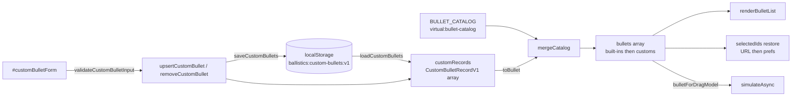

# Contract: custom bullet catalog (UX-1)

Version: 1.0.0, 2026-11-16
Scope: frontend only (static SPA). There is no server, no wire API, and no change to `app/physics/*`.
Backlog story: `BACKLOG.md` → "UX-1 · Custom bullet catalog · FE · Size M"

Builders implement this contract exactly. If something needs to change, propose it to the architect. Don't edit this file.

---

## 0. Goal, non-goals, files

**Goal.** Users can add, edit, and delete their own bullets. The bullets are stored in `localStorage`, merged with the built-in `BULLET_CATALOG` when the app starts, shown in a labelled "Custom bullets" group below the built-in cards, and can be selected and simulated like any built-in bullet.

**Non-goals**
- Syncing across tabs or devices. If two tabs write, the last write wins. No `storage` event listener.
- Import or export of custom bullets.
- Including custom bullet *definitions* in the share URL. Only their ids travel, and on another device those ids are silently dropped (see §3.4).
- Editing or deleting built-in bullets.
- Keyboard selection of bullet cards. Built-in cards are click-only today. Custom cards match them. See open question Q3.
- Changes to the FE-2 "Custom Round" presets (`custom-rounds.js`, `bv_customRounds`). That feature remains unchanged and independent. See open question Q1.
- Any change to `simulate()`, `types.ts`, or the golden fixture.

**Files**

| File | Change |
|---|---|
| `app/custom-bullets.js` | **New** ES module containing schema, validation, storage, conversion, merge, and custom-group rendering. It imports nothing from `ballistics.js` (no cycle). DOM callbacks are injected |
| `app/ballistics.js` | Glue code: init merge, `renderBulletList()` extension, `updateBulletCards()` extension, form handlers, `colorFor()`, and drag-model BC resolution in `computeClientSide` and `runSweep` |
| `app/index.html` | New static `#customBulletPanel` placed directly after `#bulletList` (see §2.2) |
| `app/ballistics.css` | Styles for the custom group, the custom card actions, and the form |
| `package.json` | Add `app/custom-bullets.js` to `jest.collectCoverageFrom`. The 100% threshold applies |
| `tests/custom-bullets.test.js` | **New** unit tests (§6.1) |
| `tests/ballistics.test.js` | Glue and integration tests (§6.2). `buildDOM()` gains the §2.2 elements |
| `tests/url-state.test.js` | One case (§6.3) |

`ballistics:custom-bullets:v1` must **not** be added to `PREF_KEYS`.



---

## 1. Data schema

### 1.1 Stored record (`CustomBulletRecordV1`)

The stored record keeps the values **in the units the user typed** (grains, fps, inches). That way, Edit pre-populates exactly what was entered, with no float drift from a grains→grams→grains round trip. Field names follow the camelCase `Bullet` convention in `app/physics/types.ts` (`bulletWeightGrams`, `muzzleVelocityMps`, `ballisticCoefficient`, `bulletDiameterMm`), with the unit suffix changed to the stored unit.

```ts
interface CustomBulletRecordV1 {
  id:                     string;        // /^usr-[0-9a-f]{16}$/  (20 chars; see §3.3)
  name:                   string;        // trimmed, 1–64 chars, no forbidden chars (§4.2)
  shortName:              string;        // trimmed, 1–16 chars, no forbidden chars (§4.2)
  bulletWeightGrains:     number;        // finite, 1 ≤ v ≤ 1000
  ballisticCoefficientG1: number;        // finite, 0.01 ≤ v ≤ 1.2
  ballisticCoefficientG7: number | null; // null = not provided; else finite, 0.01 ≤ v ≤ 1.0
  bulletDiameterInches:   number;        // finite, 0.1 ≤ v ≤ 1.0
  muzzleVelocityFps:      number;        // finite, 300 ≤ v ≤ 5000
}
```

- All 8 properties are required in storage. `ballisticCoefficientG7` must be present, and is `null` when the user leaves it blank.
- There is no colour field. Colour is derived from `id` (§3.5), so stored data can never reach a CSS value.
- There are no timestamps. Array order is display order: new records are appended, and an edited record keeps its index.

### 1.2 Runtime bullet (`toBullet(record)` output)

`toBullet` returns an object that satisfies the `Bullet` interface (`app/physics/types.ts`) plus three JS-only extension properties. `types.ts` is **not** changed, because the engine ignores unknown properties.

| Property | Value |
|---|---|
| `id` | `record.id` |
| `name` | `record.name` |
| `caliber` | `'Custom'` (the same literal `runCustom` uses) |
| `bulletWeightGrams` | `record.bulletWeightGrains * GRAINS_TO_GRAMS` (not rounded) |
| `muzzleVelocityMps` | `record.muzzleVelocityFps * FPS_TO_MPS` (not rounded) |
| `ballisticCoefficient` | `record.ballisticCoefficientG1` |
| `bulletDiameterMm` | `record.bulletDiameterInches * INCH_TO_MM` (not rounded) |
| `muzzleEnergyJoules` | `Math.round(0.5 * (bulletWeightGrams / 1000) * muzzleVelocityMps ** 2)`, the same formula as `runCustom` |
| `hexColor` | `customColor(record.id)` (§3.5) |
| *ext* `shortName` | `record.shortName` |
| *ext* `ballisticCoefficientG7` | `record.ballisticCoefficientG7` (`number \| null`) |
| *ext* `source` | `'custom'` |

`description` is absent. Conversion constants are exact by definition:

```js
export const GRAINS_TO_GRAMS = 0.06479891;
export const FPS_TO_MPS      = 0.3048;
export const INCH_TO_MM      = 25.4;
```

### 1.3 Storage example

```json
[{"id":"usr-3f2b8c1e9a4d4e6f","name":"175gr SMK handload","shortName":"308 175","bulletWeightGrains":175,"ballisticCoefficientG1":0.505,"ballisticCoefficientG7":0.243,"bulletDiameterInches":0.308,"muzzleVelocityFps":2600},
 {"id":"usr-9c0d1e2f3a4b5c6d","name":"300 BLK 220gr subsonic","shortName":"BLK SUB","bulletWeightGrains":220,"ballisticCoefficientG1":0.608,"ballisticCoefficientG7":null,"bulletDiameterInches":0.308,"muzzleVelocityFps":1010}]
```

---

## 2. UI layout

### 2.1 Inside `#bulletList` (rendered by JS on every `renderBulletList()`)

Order inside `#bulletList`:

1. The built-in `.bullet-card` elements. These are unchanged except that their colour comes from `colorFor(b)` (§3.5).
2. One custom group element, **always rendered**, including when there are zero custom bullets. This lets users find the feature.

| Element | ID / class | Notes |
|---|---|---|
| `div` | `#customBulletGroup.bullet-group` | `role="group"`, `aria-labelledby="customBulletsHeading"` |
| ↳ `div` | `#customBulletsHeading.bullet-group-label` | Text `Custom bullets`. Styled like `.section-label`, without the side padding (it sits inside `.bullet-list`'s 12 px padding) |
| ↳ `p` | `.bullet-group-empty` | Present **only** when there are 0 custom bullets and storage is available. Text `No custom bullets yet.` |
| ↳ `p` | `.bullet-group-notice` | Present **only** when `storageStatus === 'unavailable'`. Text `Custom bullets unavailable: browser storage is blocked.` `role="status"` |
| ↳ `div` per custom bullet | `#card-<id>.bullet-card.bullet-card--custom` | `--bullet-color` set with `style.setProperty`. Gets class `active` when selected (same as built-ins). Clicking the card body calls `onToggle(id)` |
| ↳↳ `div` | `.bullet-name` | `textContent = name` |
| ↳↳ `div` | `.bullet-specs` | `textContent` = `<shortName> · <gr> gr · <fps> fps · G1 <bc1>`, plus ` · G7 <bc7>` when it isn't null. Numbers use `String(n)` on the stored values |
| ↳↳ `div` | `.bullet-card-actions` | Row below the specs |
| ↳↳↳ `button type="button"` | `.bullet-edit-btn` | Label `Edit`, `aria-label="Edit <name>"`. The click calls `event.stopPropagation()` then `onEdit(id)` |
| ↳↳↳ `button type="button"` | `.bullet-delete-btn` | Label `Delete`, `aria-label="Delete <name>"`. The click calls `event.stopPropagation()` then `onDelete(id)`. **Disabled** when `selectedIds.has(id)`, with `title="Deselect this bullet to delete it"` |
| ↳↳ `div` | `.check` | Same as the built-in cards |

Pending-delete state for a button: label `Confirm`, class `confirming`, `aria-label="Confirm delete <name>"`.

**The custom group must be built with `document.createElement`, `textContent`, `setAttribute`, and `dataset`. Never use `innerHTML`, `insertAdjacentHTML`, or `outerHTML`.** The built-in template keeps its existing `innerHTML` + `escapeHtml` path, which is not user data.

### 2.2 Static panel in `index.html`, placed directly after `#bulletList` and before the `Parameters` section label

The Add button and the form live **outside** `#bulletList`. `renderBulletList()` replaces the contents of `#bulletList`, and if the form were inside, any re-render would wipe input that is still in progress. Visually, the panel reads as the footer of the custom group.

| Element | ID / class | Notes |
|---|---|---|
| `div` | `#customBulletPanel.custom-bullet-panel` | Wrapper |
| ↳ `button type="button"` | `#addCustomBulletBtn.add-bullet-btn` | Label `+ ADD CUSTOM BULLET`. `aria-controls="customBulletForm"`, `aria-expanded="false"`. `disabled` when `storageStatus === 'unavailable'` |
| ↳ `form` | `#customBulletForm.custom-bullet-form` | `hidden` and `novalidate` initially. `aria-labelledby="customBulletFormTitle"` |
| ↳↳ `div` | `#customBulletFormTitle.bullet-group-label` | `Add custom bullet` or `Edit custom bullet` |
| ↳↳ fields | see table below | Each field is a `label[for]`, an `input`, and a `small.field-error#<inputId>-error`. The input has `aria-describedby="<inputId>-error"` |
| ↳↳ `div` | `#customBulletFormError.form-error` | `role="alert"`. Form-level errors (limit, storage). Empty when there are none |
| ↳↳ `div.form-actions` → `button type="submit"` | `#customBulletSaveBtn` | Label `SAVE` |
| ↳↳ `div.form-actions` → `button type="button"` | `#customBulletCancelBtn` | Label `CANCEL` |

Field order, layout, and attributes. The order follows the story. Rows use the existing `.param-row` 2-column grid.

| # | Row | Label text | Input id | `type` | Attributes |
|---|---|---|---|---|---|
| 1 | full width | `Name` | `cbName` | `text` | `maxlength="64"` `required` `autocomplete="off"` |
| 2 | row A, col 1 | `Short name` | `cbShortName` | `text` | `maxlength="16"` `required` `autocomplete="off"` |
| 3 | row A, col 2 | `Mass (gr)` | `cbBulletWeightGrains` | `number` | `min="1"` `max="1000"` `step="0.1"` `inputmode="decimal"` `required` |
| 4 | row B, col 1 | `BC G1` | `cbBcG1` | `number` | `min="0.01"` `max="1.2"` `step="0.001"` `inputmode="decimal"` `required` |
| 5 | row B, col 2 | `BC G7 (optional)` | `cbBcG7` | `number` | `min="0.01"` `max="1.0"` `step="0.001"` `inputmode="decimal"` |
| 6 | row C, col 1 | `Diameter (in)` | `cbBulletDiameterInches` | `number` | `min="0.1"` `max="1.0"` `step="0.001"` `inputmode="decimal"` `required` |
| 7 | row C, col 2 | `MV (fps)` | `cbMuzzleVelocityFps` | `number` | `min="300"` `max="5000"` `step="1"` `inputmode="decimal"` `required` |

The HTML `min`/`max`/`step` attributes are hints only. Because of `novalidate`, `validateCustomBulletInput` is authoritative.

### 2.3 Interaction states

| Trigger | Result |
|---|---|
| Add click | Form opens in **add** mode: fields reset, errors cleared, title `Add custom bullet`, `editingCustomId = null`, Add `aria-expanded="true"`, focus `#cbName`. Clears any pending delete |
| Edit click (custom card) | Form opens in **edit** mode, pre-populated from the record. `ballisticCoefficientG7: null` becomes `''`. Title `Edit custom bullet`, `editingCustomId = id`, focus `#cbName`. Clears any pending delete. Allowed whether or not the bullet is selected |
| Cancel click | Form `hidden`, fields reset, `editingCustomId = null`, Add `aria-expanded="false"`, focus Add |
| Submit with invalid fields | Each failing field gets its message in `#<id>-error` and `aria-invalid="true"`. Passing fields get `aria-invalid` removed and their message cleared. Focus moves to the **first** failing field in the §2.2 order. Nothing is persisted |
| Submit valid, persist ok | Form closes (same as Cancel). The list re-renders. Toast `Custom bullet added` or `Custom bullet updated`. The new bullet is **not** auto-selected |
| Submit valid, persist fails | `#customBulletFormError` = `Couldn't save: browser storage is full or unavailable.` The form stays open with the input intact, and in-memory state is unchanged |
| Delete click, bullet selected | No state change. Toast `Deselect this bullet before deleting it.` (This defends against the button not being disabled, for example a programmatic click) |
| Delete click, first time on this id | `pendingDeleteId = id`. The button enters the pending-delete state (§2.1) |
| Delete click, second time on the same id | `removeCustomBullet` → `saveCustomBullets`. On success: re-render, toast `Custom bullet deleted`, and if `editingCustomId === id`, close the form. On failure: toast `Couldn't delete: browser storage unavailable.` and nothing changes |
| Any selection change, other Delete click, form open, or re-render | A pending confirmation is cancelled: `pendingDeleteId = null` and every `.confirming` button returns to the `Delete` label |

No `confirm()`/`alert()` dialogs and no timers.

---

## 3. State management

### 3.1 New module state in `ballistics.js`

```js
let customRecords       = [];     // CustomBulletRecordV1[] — mirror of storage
let customStorageStatus = 'ok';   // 'ok' | 'empty' | 'corrupt' | 'unavailable'
let editingCustomId     = null;   // string | null
let pendingDeleteId     = null;   // string | null
```

`_resetState()` resets all four. Add test helpers `_setCustomRecords(r)` and `_setCustomStorageStatus(s)` to the export list, and include all four in `_getState()`.

### 3.2 Merge at init

In `init()`, replace `bullets = getMockBullets();` with:

1. `const { records, status } = loadCustomBullets();` then `customRecords = records; customStorageStatus = status;`
2. `bullets = mergeCatalog(getMockBullets(), customRecords);`
3. If `status === 'corrupt'`, call `console.warn('Custom bullets: stored data was invalid and has been ignored')`. There is no UI notice.

This happens **before** `renderBulletList()` and before the selection-restore block. That way, `validIds` already contains the custom ids, and URL or prefs selections of custom bullets survive a refresh.

**First-visit default.** When `merged.selectedIds === null`, the default selection is computed from **built-in bullets only** (`getMockBullets()`), not from `bullets`. Today that means all built-ins. Under UX-3 it becomes `getMockBullets()[0]`. Custom bullets are never auto-selected.

`mergeCatalog(builtIns, records)` returns a **new** array: `[...builtIns, ...records.filter(r => !builtInIds.has(r.id)).map(toBullet)]`. The order is built-ins in catalog order, then customs in storage order. The filter is defensive, because the id regex already makes collisions impossible.

### 3.3 Id convention

- Custom ids are `usr-` followed by 16 lowercase hex characters (`/^usr-[0-9a-f]{16}$/`, 20 characters total). That gives 64 bits of randomness from `crypto.getRandomValues(new Uint8Array(8))`, which is available in non-secure contexts too.
- The prefix `usr-` is **reserved**. No `bullets.yaml` id may start with it, and a unit test enforces this (§6.1).
- The id satisfies `url-state.js` `BULLET_ID_RE` (`/^[a-z0-9][a-z0-9-]{0,31}$/`), so custom ids round-trip through `?b=` and `bv_selectedIds` with no change to `url-state.js`. A UUID would **not** pass (too long), and a `:` separator would be rejected.
- `newCustomBulletId(existingIds: Set<string>)` regenerates until the id is not in `existingIds`.
- `isCustomBulletId(id)` returns `CUSTOM_BULLET_ID_RE.test(id)`.

### 3.4 `selectedIds` behaviour

- Custom ids live in `selectedIds` exactly like built-in ids. `toggleBullet`, `savePrefs`, `syncUrl`, and `currentState` are unchanged.
- Stale ids (deleted elsewhere, or a shared URL from another device) are dropped by the existing `validIds` filter in `init()`.
- Deleting a selected bullet is impossible, so `selectedIds` never holds an id that is missing from `bullets` after a delete.
- The story's phrase "currently selected in either slot" is interpreted as **present in `selectedIds`**. The app has no two-slot compare model.

### 3.5 Colour

- `customColor(id)` returns `CUSTOM_BULLET_PALETTE[parseInt(id.slice(4, 12), 16) % CUSTOM_BULLET_PALETTE.length]`. It is stable across deletes and reloads.
- `CUSTOM_BULLET_PALETTE = Object.freeze(['#F472B6', '#38BDF8', '#FACC15', '#C084FC', '#22D3EE', '#FB7185', '#A3E635', '#FDBA74'])`. None of these colours collide with a built-in `hexColor`.
- New helper in `ballistics.js`: `colorFor(bullet)` returns `bullet.hexColor || BULLET_COLORS[bullet.id] || '#4ADE80'`. **Every** existing `BULLET_COLORS[x.id] || '#4ADE80'` expression is replaced by `colorFor(x)`. Today these are at lines ~120, 476, 509, 703, 719, 736, 788, 799, and 915. For built-ins the result is identical, since catalog `hexColor` equals the `BULLET_COLORS` entry. Export `colorFor`.

### 3.6 `renderBulletList()` extension

1. Split `bullets` into `builtIns` (`!isCustomBulletId(b.id)`) and `customs`.
2. Render `builtIns` with the existing template and listeners. The only change is `colorFor(b)`.
3. Call `renderCustomBulletGroup(list, customs, ctx)` with `ctx = { selectedIds, storageStatus: customStorageStatus, onToggle: toggleBullet, onEdit: openCustomBulletEdit, onDelete: requestCustomBulletDelete }`.
4. Set `pendingDeleteId = null`.

### 3.7 `updateBulletCards()` extension

After the existing loop, call `syncCustomDeleteGuards(document.getElementById('bulletList'), selectedIds)`. This sets `disabled` and `title` on each `.bullet-delete-btn` according to selection, and resets any `.confirming` button. The glue also sets `pendingDeleteId = null`.

### 3.8 Drag-model BC resolution

`bulletForDragModel(bullet, dragModel)`:
- If `dragModel === 'G7'` and `typeof bullet.ballisticCoefficientG7 === 'number'`, return `{ ...bullet, ballisticCoefficient: bullet.ballisticCoefficientG7 }`.
- Otherwise return **the same reference**. This covers built-ins, G1, and customs without a G7 BC.

Call sites:
- `computeClientSide`: `simulateAsync(bulletForDragModel(bullet, req.dragModel), req)`
- `runSweep`: `simulateAsync(bulletForDragModel(bullet, r.dragModel), r)`

When G7 is selected and the custom bullet has no G7 BC, its G1 BC is used against the G7 table. That matches how built-ins behave today. See open question Q2.

### 3.9 CRUD glue (`ballistics.js`)

- **Submit handler** (`#customBulletForm` `submit`, `preventDefault()`):
  1. Read the 7 raw input strings.
  2. `validateCustomBulletInput(raw, { records: customRecords, builtInNames: getMockBullets().map(b => b.name), editingId: editingCustomId })`.
  3. On errors, apply §2.3.
  4. Otherwise, `next = upsertCustomBullet(customRecords, result.value, editingCustomId)`, then `saveCustomBullets(next)`.
  5. On `ok`, set `customRecords = next`, `bullets = mergeCatalog(getMockBullets(), customRecords)`, call `renderBulletList()` and `updateBulletCards()`, close the form, and show the toast.
- **`openCustomBulletEdit(id)`, `requestCustomBulletDelete(id)`, `openCustomBulletAdd()`, `closeCustomBulletForm()`**: behaviour as in §2.3. Export them for tests.
- Listeners are registered in `init()` with the existing `{ signal }` AbortController, so a re-`init()` doesn't double-bind.

### 3.10 `app/custom-bullets.js` public API

```js
export const CUSTOM_BULLETS_KEY     = 'ballistics:custom-bullets:v1';
export const CUSTOM_BULLET_ID_RE    = /^usr-[0-9a-f]{16}$/;
export const MAX_CUSTOM_BULLETS     = 50;
export const CUSTOM_BULLET_LIMITS   = Object.freeze({ /* §4.1 table, as { min, max } per numeric field */ });
export const CUSTOM_BULLET_PALETTE  = Object.freeze([/* §3.5 */]);
export const GRAINS_TO_GRAMS, FPS_TO_MPS, INCH_TO_MM;   // §1.2

export function newCustomBulletId(existingIds);          // → string
export function isCustomBulletId(id);                    // → boolean
export function customColor(id);                         // → '#RRGGBB'
export function isValidCustomBulletRecord(obj);          // → boolean  (§4, storage-side)
/** raw: { name, shortName, bulletWeightGrains, ballisticCoefficientG1, ballisticCoefficientG7,
 *         bulletDiameterInches, muzzleVelocityFps } — all strings from inputs.
 *  ctx: { records, builtInNames, editingId }                                          */
export function validateCustomBulletInput(raw, ctx);
//   → { ok: true,  value: Omit<CustomBulletRecordV1,'id'> }
//   | { ok: false, errors: Array<{ field: keyof raw | 'form', message: string }> }
export function upsertCustomBullet(records, value, editingId);   // → new array; never mutates input
export function removeCustomBullet(records, id);                 // → new array; unknown id → equal copy
export function loadCustomBullets();      // → { records, status: 'ok'|'empty'|'corrupt'|'unavailable' }; never throws
export function saveCustomBullets(records); // → { ok: true } | { ok: false, error: 'storage' }; never throws
export function toBullet(record);          // §1.2
export function mergeCatalog(builtIns, records); // §3.2
export function bulletForDragModel(bullet, dragModel); // §3.8
export function renderCustomBulletGroup(listEl, customBullets, ctx); // §2.1; appends to listEl
export function syncCustomDeleteGuards(listEl, selectedIds);         // §3.7; missing listEl → no-op
```

`upsertCustomBullet` behaviour:
- `editingId == null`: append `{ id: newCustomBulletId(new Set(records.map(r => r.id))), ...value }`.
- `editingId` set: replace the record at that index, keeping `id` and position. If the id is unknown, return an unchanged copy.

The custom-bullets module **never** imports `ballistics.js` and never reads `selectedIds` except through `ctx`.

---

## 4. Validation rules

### 4.1 Numeric fields (inclusive ranges)

`simulate()` accepts any finite value above 0 for mass, velocity, and BC (`engine.ts` `validate()`). The bounds below are tighter and physically realistic. They also keep the RK4 loop bounded: with MV ≥ 300 fps the `MIN_VEL_FPS = 100` cutoff and the `maxRangeMeters ≤ 5000` bound end integration in a reasonable number of steps, even in the worker. Every combination of limits produces a valid `TrajectoryResult` (proved by test §6.1-K).

| Field | Label in messages | Min | Max | Required | Reference loads |
|---|---|---|---|---|---|
| `bulletWeightGrains` | `Mass` | 1 | 1000 | yes | .17 HMR 17 gr … .50 BMG 750 gr |
| `ballisticCoefficientG1` | `BC G1` | 0.01 | 1.2 | yes | Same upper bound as `runCustom` and `#customBC` |
| `ballisticCoefficientG7` | `BC G7` | 0.01 | 1.0 | **no** (blank → `null`) | G7 BCs run about half of G1 |
| `bulletDiameterInches` | `Diameter` | 0.1 | 1.0 | yes | .172 … .510, slugs up to about .73 |
| `muzzleVelocityFps` | `Muzzle velocity` | 300 | 5000 | yes | Subsonic 300 BLK about 1000 … .220 Swift about 4000 |

Parsing a raw string `s`:
1. `t = s.trim()`
2. `t === ''` → required fields fail with `<Label> is required`. The optional G7 field gives `null`.
3. `t` must match `/^(?:\d{1,5}(?:\.\d{1,6})?|\.\d{1,6})$/`. No sign, exponent, hex, or `Infinity`. Otherwise `<Label> must be a number`.
4. `n = Number(t)`. If outside `[min, max]` → `<Label> must be between <min> and <max>`, where min and max are formatted with `String()`, for example `BC G1 must be between 0.01 and 1.2`.

### 4.2 Text fields

Forbidden characters (`FORBIDDEN_CHARS_RE`): C0/C1 controls `\u0000-\u001F\u007F-\u009F` and bidi overrides `‪-‮⁦-⁩`.

| Field | Rule (applied to `trim()`ed value), in this order | Message |
|---|---|---|
| `name` | empty | `Name is required` |
| | length > 64 | `Name must be 64 characters or fewer` |
| | contains a forbidden char | `Name contains invalid characters` |
| | equals a **built-in** name (case-insensitive, `toLowerCase()`) | `Name matches a built-in bullet` |
| | equals another **custom** name (case-insensitive), excluding the record with `editingId` | `A custom bullet with this name already exists` |
| `shortName` | empty | `Short name is required` |
| | length > 16 | `Short name must be 16 characters or fewer` |
| | contains a forbidden char | `Short name contains invalid characters` |

Only the first failing rule per field is reported. `value.name` and `value.shortName` are the trimmed strings.

The built-in name check is slightly stricter than the story, which only requires uniqueness among custom bullets. Results, tables, CSV, and exports identify rounds by `name`, so a collision with a built-in name would be ambiguous.

### 4.3 Form-level rule

When `editingId == null` and `records.length >= MAX_CUSTOM_BULLETS`, the result includes `{ field: 'form', message: 'Custom bullet limit reached (50). Delete one to add another.' }`. This is reported alongside any field errors. The glue writes it to `#customBulletFormError`.

### 4.4 Storage-side validation (`isValidCustomBulletRecord`)

- `obj` is a non-null, non-array object.
- `id` is a string matching `CUSTOM_BULLET_ID_RE`.
- `name` and `shortName` are strings equal to their own `trim()`, satisfy the length and forbidden-char rules, and are non-empty.
- Each numeric field has `typeof === 'number'`, `Number.isFinite`, and lies within §4.1.
- `ballisticCoefficientG7` is `null` or a valid number.

Uniqueness is enforced by `loadCustomBullets` (§5.2), not by this predicate.

---

## 5. localStorage contract

### 5.1 Key and format

- Key: `ballistics:custom-bullets:v1` (`CUSTOM_BULLETS_KEY`). The version lives **in the key**.
- Value: `JSON.stringify(CustomBulletRecordV1[])`, at most `MAX_CUSTOM_BULLETS` (50) elements. Records are written with exactly the 8 schema properties.
- This key is separate from `bv_*` prefs, `bv_customRounds` (FE-2), and `ballistics.customDragTable` (WA-12).

### 5.2 Read: `loadCustomBullets()`

The whole function body is wrapped in `try/catch`, **including** the `window.localStorage` property access, because that access itself throws `SecurityError` when site data is blocked.

| Condition | `records` | `status` |
|---|---|---|
| `localStorage` access or `getItem` throws | `[]` | `'unavailable'` |
| Key absent (`null`) | `[]` | `'empty'` |
| `JSON.parse` throws, or the value is not an array | `[]` | `'corrupt'` |
| Array (possibly with bad elements) | filtered list (below) | `'ok'` |

Filtering, in order:
1. Drop elements failing `isValidCustomBulletRecord`.
2. Drop elements whose `id` was already seen (first wins).
3. Drop elements whose name (case-insensitive) was already seen among customs (first wins).
4. Keep the first 50.
5. Rebuild each kept record as a new object with only the 8 schema properties. Extra or prototype-ish keys are discarded.

Reading **never writes back**. Bad entries are removed from storage only the next time the list is saved.

### 5.3 Write: `saveCustomBullets(records)`

- Wrapped in `try/catch`. Any throw (quota, `SecurityError`, private mode) returns `{ ok: false, error: 'storage' }` and logs `console.warn('Custom bullets: storage write failed', e)`.
- Success returns `{ ok: true }`.
- The caller commits in-memory state **only** after `{ ok: true }`. A failed save leaves `customRecords` and `bullets` unchanged.
- An empty list writes `'[]'`. It does not call `removeItem`.

### 5.4 Graceful degradation

- `status === 'unavailable'`: built-ins render normally. The custom group shows `.bullet-group-notice`, and `#addCustomBulletBtn` is `disabled`. No uncaught error.
- `status === 'corrupt'`: the app behaves as `'empty'` (Add enabled) and logs one `console.warn`. The first successful save overwrites the corrupt value.
- Reads succeed but writes fail: handled per save (§2.3).

### 5.5 Migration policy (for future versions)

- **Any** change to the record shape bumps the key (`…:v2`). This includes adding an optional field, because v1 readers strip unknown properties and would silently drop the new field on the next save. Extending `v1` in place is not allowed.
- A future `loadCustomBullets` for vN:
  1. Reads `…:vN`. If it is present, it follows §5.2.
  2. If it is absent, it looks for the highest older key, `…:v(N-1)` … `…:v1`, parses it, and runs pure step functions `migrateV1toV2`, `migrateV2toV3`, and so on. Each one is unit-tested.
  3. It writes the result to `…:vN`. **Only after that write succeeds** does it `removeItem` the old key. If the write fails, it uses the migrated records in memory for the session and leaves the old key untouched.
- An older cached app version (service worker) keeps reading `v1` and ignores `v2`. Users who downgrade see their pre-migration list. That is acceptable.
- `CHANGELOG.md` records every key bump as a contract change.

---

## 6. Test contract

Coverage must stay at **100/100/100/100** (`npm test`). `app/custom-bullets.js` is added to `collectCoverageFrom`. To simulate storage failures, use `jest.spyOn(Storage.prototype, 'getItem' | 'setItem')` with `mockImplementation(() => { throw new DOMException('x', 'QuotaExceededError') })`. For the access-throws case, use `Object.defineProperty(window, 'localStorage', { get() { throw … }, configurable: true })` and restore it afterwards.

### 6.1 `tests/custom-bullets.test.js` (new)

| # | Function | Required cases |
|---|---|---|
| A | `newCustomBulletId` | Matches `CUSTOM_BULLET_ID_RE`. Passes `url-state` `decodeState('?b=<id>')`. Regenerates on collision (mock `crypto.getRandomValues` to return a colliding value first) |
| B | `isCustomBulletId` | true for a valid id. False for every `BULLET_CATALOG` id, `'custom'`, `'bc-solve'`, `'usr-XYZ'`, and `'usr-'` + 15 hex |
| C | Catalog guard | No `BULLET_CATALOG` id starts with `usr-` |
| D | `customColor` | Deterministic for the same id. Always a member of `CUSTOM_BULLET_PALETTE`. Palette ∩ built-in `hexColor` set = ∅ |
| E | `validateCustomBulletInput` | All valid → `ok`, trimmed strings, G7 blank → `null`. **Missing**: each required field blank → `<Label> is required`. **Not a number**: `'abc'`, `'-5'`, `'1e3'`, `'0x10'`, `'Infinity'`. **Out of range**: each numeric field just below min and just above max. **Boundaries**: exact min and max accepted. **Name**: empty or whitespace, 65 chars, control char, bidi override, built-in name in different case, duplicate custom name in different case, editing a record keeps its own name (no duplicate error). **shortName**: empty, 17 chars, control char. **Limit**: 50 records + add → `form` error. 50 records + edit → no `form` error. Multiple field errors are reported together, one per field |
| F | `isValidCustomBulletRecord` | A valid record passes. Each property missing, wrong type, out of range, or `NaN`/`Infinity` fails. Untrimmed name fails. Bad id fails. G7 `null` passes. G7 `undefined` fails. Non-object, `null`, and array fail |
| G | `loadCustomBullets` | Absent key → `empty`. Invalid JSON → `corrupt`. `{}` → `corrupt`. `getItem` throws → `unavailable`. `localStorage` getter throws → `unavailable`. Invalid elements dropped. Duplicate id dropped (first wins). Duplicate name (case-insensitive) dropped. 60 valid → first 50. Extra properties (including `__proto__` in the JSON text) stripped. Never calls `setItem` |
| H | `saveCustomBullets` | Writes exactly `JSON.stringify(records)` under the key. `setItem` throws → `{ ok:false, error:'storage' }` plus `console.warn`. Empty list writes `'[]'`. **Round trip**: save then load yields deep-equal records (serialisation/deserialisation) |
| I | `upsertCustomBullet` / `removeCustomBullet` | Add appends with a fresh id. Edit keeps the id and index. Unknown editing id → unchanged copy. Remove by id. Unknown id → equal copy. Inputs are never mutated |
| J | `toBullet` / `mergeCatalog` | Conversions checked with `toBeCloseTo(x, 9)` (175 gr → 11.33980925 g; 2600 fps → 792.48 m/s; 0.308 in → 7.8232 mm). `muzzleEnergyJoules` formula. `caliber === 'Custom'`. Extension fields are present. Merge order is built-ins then customs. Built-in array is not mutated. A record whose id collides with a built-in is excluded |
| K | Simulate compatibility | Using the **real** `simulate` from `app/physics/engine.ts` (not mocked) with default params (zero 100 m, max 1000 m, step 25 m, 15 °C, 0 m): the corner records (all-min, all-max, min-mass + max-MV, max-mass + min-MV, BC 0.01 and 1.2) do not throw and return `points.length > 0` with all values finite. Also run with `dragModel: 'G7'` through `bulletForDragModel` |
| L | `bulletForDragModel` | G7 + number → new object with the G7 BC, other fields equal. G7 + `null` → same reference. G1 → same reference. Built-in under G7 → same reference |
| M | `renderCustomBulletGroup` | Group, heading, and `role`/`aria-labelledby` present. 0 customs → empty-state `p`. `storageStatus 'unavailable'` → notice, no empty-state. One card per bullet, in order. Spec line with and without G7. `--bullet-color` equals `customColor(id)`. Selected bullet → `active` class and Delete `disabled` with title. Card click → `onToggle(id)`. Edit and Delete clicks → `onEdit`/`onDelete` and **not** `onToggle` (stopPropagation). **XSS**: name and shortName `` render as literal text, and `listEl.querySelector('img') === null` |
| N | `syncCustomDeleteGuards` | Toggles `disabled`/`title` to follow `selectedIds`. Resets `.confirming` buttons. Missing `listEl` → no-op |

### 6.2 `tests/ballistics.test.js` (additions)

- `buildDOM()` includes the full §2.2 panel.
- **init merge**: with 2 valid records stored, `init()` → `_getState().bullets` has length 12, and `#customBulletGroup` holds 2 cards after the 10 built-ins. With an empty store → group with the empty state and 10 built-in cards (existing counts unchanged).
- **Survives refresh**: add via the form → `_resetState()` + `init()` → the bullet is present.
- **Selection restore**: a custom id in `bv_selectedIds` is restored. A custom id in `?b=` is restored. A stale custom id is dropped. First visit with customs stored → no custom id selected.
- **Storage unavailable**: the `localStorage` getter throws → `init()` doesn't throw, 10 built-in cards render, the notice is shown, `#addCustomBulletBtn.disabled === true`.
- **Add flow**: open → focus on `#cbName` → invalid submit → field errors, `aria-invalid`, focus on the first invalid field, storage untouched → valid submit → record stored, card rendered, toast, form hidden, not selected.
- **Persist failure on add**: `setItem` throws → form error text, form stays open, `bullets` unchanged.
- **Limit**: 50 stored → submit add → `#customBulletFormError` shows the limit message.
- **Edit flow**: Edit → fields pre-populated (G7 `null` → `''`) → change MV → save → same id and index, new value in storage and on the card, toast `Custom bullet updated`.
- **Delete guard**: selected → button disabled. A programmatic `requestCustomBulletDelete(id)` → toast and nothing removed.
- **Delete confirm**: first click → `Confirm` label and `confirming` class. Toggling any card → reset. Click again twice → removed from storage and from the DOM, toast. Deleting the bullet being edited closes the form. `setItem` throws on delete → toast and nothing removed.
- **G7 resolution in compute**: the `simulateAsync` mock receives `ballisticCoefficient === ballisticCoefficientG7` when `dragModel` is `G7`. It receives the G1 BC when the G7 BC is `null` or the model is `G1`. Covered in both `computeClientSide` and `runSweep`.
- **`colorFor`**: `hexColor` wins, then the `BULLET_COLORS` fallback, then `'#4ADE80'`. Existing colour tests still pass.

### 6.3 `tests/url-state.test.js`

- `decodeState('?b=usr-0123456789abcdef&b=308-win-168gr')` → both ids kept, in order.

---

## 7. Acceptance criteria

From the backlog story, made testable:

- [ ] The sidebar shows a **Custom bullets** group inside `#bulletList`, below all built-in cards, and the `+ ADD CUSTOM BULLET` button directly beneath it.
- [ ] The form has fields in the order name, short name, mass (gr), BC G1, BC G7 (optional), diameter (in), MV (fps).
- [ ] Submit validates every field per §4. Missing, non-numeric, out-of-range, and duplicate-name inputs each show the specified message, and nothing is saved.
- [ ] A saved custom bullet survives a hard refresh (stored under `ballistics:custom-bullets:v1`).
- [ ] Selecting a custom bullet and running **Compute** produces a valid trajectory, plotted in its palette colour. Under G7 it uses the G7 BC when one is provided.
- [ ] **Edit** pre-populates the form and saves back to the same entry (same id and position).
- [ ] **Delete** needs a second click to confirm, then removes the bullet from the selector and from storage.
- [ ] **Delete** is disabled while the bullet is selected and can't be triggered programmatically.
- [ ] With `localStorage` unavailable, the UI renders built-in bullets only, shows the notice, disables Add, and throws no uncaught error.
- [ ] Custom bullet names render as text everywhere. No `img` element is created from a payload name.
- [ ] Custom bullet ids round-trip through the share URL and `bv_selectedIds`.
- [ ] `npm test` passes at 100/100/100/100, with `app/custom-bullets.js` in `collectCoverageFrom`.
- [ ] `BACKLOG.md` UX-1 is marked done or removed in the same PR.

---

## 8. Threat model (STRIDE-lite)

Assets: the user's custom bullet definitions (low sensitivity, local only) and the integrity of the rendered DOM.
Trust boundary: `localStorage` and form input are **untrusted**. They are user-editable, and other same-origin code or extensions could plant values.

| Threat | Mitigation required by this contract |
|---|---|
| **Stored XSS** via `name`/`shortName` (typed or planted) reaching the sidebar | The custom group uses `createElement` + `textContent`/`setAttribute` only (§2.1). Test §6.1-M |
| **Stored XSS** via `name` reaching existing result sinks (stat cards, readout, data table, DOPE table) | Existing `escapeHtml` (`ballistics.js`) and `_esc` (`tools.js`) are already applied at those sinks. Builders confirm that no new sink is added without escaping. This is in scope for the SEC-2 audit |
| **CSS injection** via colour | No colour is stored. `hexColor` comes only from the frozen palette (§3.5) |
| **CSV/formula injection** in exports | The existing `csvCell` prefixes `= + - @ \t \r` |
| **Spoofing** via bidi overrides or lookalike names | Bidi overrides and controls are rejected (§4.2). Exact built-in names are rejected |
| **Tampering**: corrupt or hostile JSON | `isValidCustomBulletRecord` runs on every read. Unknown keys are stripped (no prototype pollution: objects are rebuilt with explicit keys). Dedupe. Never throws (§5.2) |
| **DoS**: huge store, or pathological numbers stalling the RK4 loop | Cap of 50 records. Numeric bounds (§4.1) keep integration finite. Simulation runs in the PERF-1 worker. Test §6.1-K |
| **Information disclosure** | Definitions never leave the browser. Share URLs carry only random `usr-` ids, which reveal nothing |

---

## 9. Open questions (need the user)

- **Q1.** Two features now cover similar ground: FE-2 "Custom Round" presets (metric, a separate form, computed via `runCustom`) and UX-1 custom bullets (imperial, in the selector). Should a later story retire FE-2 or migrate its presets into UX-1? Until then the "Custom Round" section is left unchanged.
- **Q2.** When G7 is selected and a custom bullet has no G7 BC, this contract falls back to the G1 BC, matching built-in behaviour. The alternative is to block the bullet with an inline error. Is the fallback acceptable?
- **Q3.** Bullet cards (built-in and custom) are mouse/touch only. Should a follow-up make all cards `role="checkbox"` + `tabindex="0"` with Space/Enter toggling?
- **Q4.** `shortName` is stored and shown on the card only. Should it replace `name` in space-constrained places (chart legends, stat cards)? That would be a separate change.
- **Q5.** UX-3 (pending) edits the same `init()` default-selection line and `updateBulletCards()`. Whichever story merges second rebases. Under both, select-all includes custom bullets, and the first-visit default stays `getMockBullets()[0]`.
