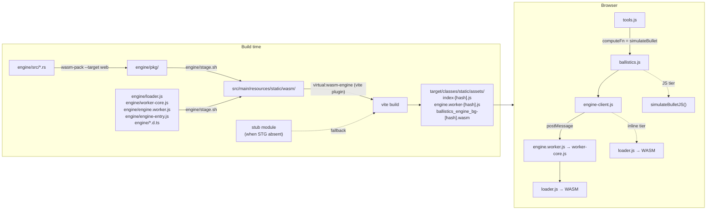
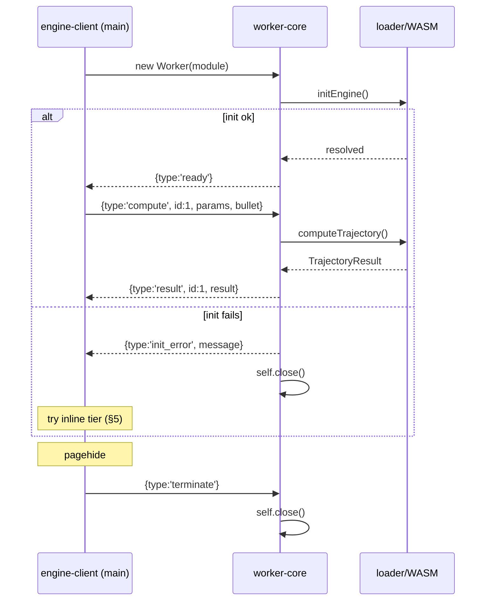
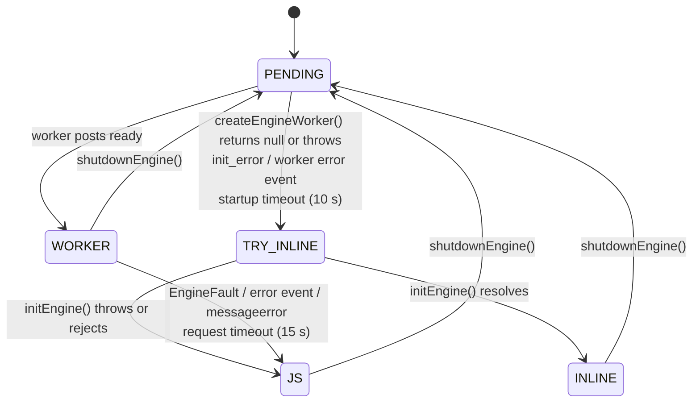

# Contract: WASM Runtime Integration (WA-3 gap, WA-4, WA-5)

Version: 1.0.0 — 2026-11-09
ADR: [`../docs/adr/005-wasm-runtime-integration.md`](../docs/adr/005-wasm-runtime-integration.md) (amends [`adr-004-wasm-engine.md`](./adr-004-wasm-engine.md) invariant 5)
Related: [`wasm-engine.md`](./wasm-engine.md) (WASM exports, JSON schemas §3, loader API §4), [`wasm-build-pipeline.md`](./wasm-build-pipeline.md), [`../docs/architecture/wasm-threat-model.md`](../docs/architecture/wasm-threat-model.md)
Owners: frontend builder (§3–§8, §10), backend builder (§2.3, §2.5), devsecops (§2.4, §9 review)

Builders implement this contract exactly. To change it, propose the change to the architect. Don't edit this file.

**Precedence:** This contract **supersedes `wasm-engine.md` §5 (worker protocol)** and the WA-5 items in `wasm-engine.md` §9. Where `wasm-build-pipeline.md` §2–§4 conflict with §2 below, this contract wins.

---

## 0. Deviations from the backlog brief and earlier contracts

| Brief / earlier contract | This contract | Reason |
|---|---|---|
| `wasm-engine.md` §5: "standard Web Worker (not a module worker)" | **Module worker** (`{ type: 'module' }`) | `loader.js` is ESM, and `wasm-pack --target web` emits ESM glue. A classic worker can't `import` either one. Browsers without module-worker support use the inline tier (§5). |
| §5: `id` is an opaque string, e.g. `crypto.randomUUID()` | `id` is a positive safe integer from a page-lifetime counter | `crypto.randomUUID()` exists only in secure contexts (it is missing on plain-HTTP LAN deployments). Integers are deterministic in tests. |
| §5 / WA-5: terminate on `beforeunload` | Terminate on **`pagehide`** and restart on `pageshow` when `event.persisted` | `beforeunload` is unreliable on mobile and interferes with the back/forward cache. `pagehide` is the recommended lifecycle hook. |
| §9: "No `worker.terminate()` in production code" | Allowed **only** on the request-timeout path (§5.4) | A wedged worker can't process the graceful `terminate` message. Every other path uses the graceful message. |
| ADR-004 invariant 5: "the loader is not imported by the main thread" | The main thread imports the engine module (via `virtual:wasm-engine`) for the **inline-WASM** tier | Implements the requested chain Worker WASM → inline WASM → JS. See ADR 005. |
| WA-4: "Jest covers WASM-success and fallback" | Also covers the `BallisticsEngineError` path (per-call fallback, no demotion) | Engine-side validation errors are a third distinct outcome. |
| `wasm-build-pipeline.md` §2: WASM served from `static/wasm/` | `static/wasm/` is a **staging** directory only. Vite bundles everything into content-hashed `/assets/*` | `static/**` is excluded from Maven resources, and Vite empties its out dir, so `/wasm/*` is never in the JAR (§1.2). |

---

## 1. WA-3 completion verdict

**Not done.** The loader *module* meets its behavioural criteria. The story's acceptance criteria are not met end-to-end.

### 1.1 What is done

| Criterion | Status | Evidence |
|---|---|---|
| Loader initialises once | Done | `engine/loader.js` caches `_initPromise`, and clears it on failure so the next call retries. Tested. |
| Subsequent calls are synchronous | Done | `computeTrajectory()` is a sync call into WASM after init. Tested. |
| Named error when `WebAssembly` is undefined | Done | `WasmUnavailableError`, thrown **synchronously** (not as a rejection). Callers must handle both forms; §5.3 does. |
| Jest 100% on `engine/loader.js` | Done | `engine/loader.test.js`, listed in `collectCoverageFrom`. |
| wasm-bindgen TS types generated | Done for the glue | `wasm-pack build --target web` emits `ballistics_engine.d.ts` by default. It types only `compute_trajectory(params_json: string, bullet_json: string): string`. |

### 1.2 Gaps (must close before WA-4 ships)

| # | Gap | Fix | Task |
|---|---|---|---|
| G1 | The hand-written loader types that `wasm-engine.md` §4.4 requires don't exist. Nothing types `TrajectoryParams`, `Bullet`, `TrajectoryResult`, `initEngine`, `computeTrajectory`, or the error classes. | Add `engine/loader.d.ts` and `engine/protocol.d.ts` (§3.2) | FE-1 |
| G2 | **WASM never reaches the JAR or the browser.** (a) `maven-resources-plugin` excludes `static/**`, so static content comes only from Vite's output. (b) Vite emits only files reachable from `index.html`, and `emptyOutDir: true` wipes everything else. (c) `npm-build` (generate-resources, frontend plugin declared first) runs **before** `wasm-pack-build` (same phase, declared later) and before `copy-wasm-to-static` (process-resources). The WA-1 checklist item "`static/wasm/` present in the built JAR" is therefore not satisfiable today. | Bundle through Vite via `virtual:wasm-engine`, and stage WASM **before** the Vite build (§2) | FE-2, BE-1, BE-2 |
| G3 | The CI `java-build` copy step copies only `engine/pkg/*`. `loader.js` and `engine.worker.js` are never staged in CI. | One staging script used by both Maven and CI (§2.2) | BE-2, DS-1 |
| G4 | `wasm-engine.md` §4.4 names the generated file `engine.d.ts`. The actual name is `ballistics_engine.d.ts`. | Corrected in `wasm-engine.md` 1.2.0 | done (architect) |

No change to `engine/loader.js` is required.

---

## 2. Build and bundling integration

### 2.1 Data flow



### 2.2 Staging script: `engine/stage.sh` (new; owner: backend)

POSIX `sh`. Maven and CI both call it, so the file list is defined in one place.

1. Fail (`exit 1`) with a clear message if `engine/pkg/ballistics_engine.js` or `engine/pkg/ballistics_engine_bg.wasm` is missing.
2. `rm -rf src/main/resources/static/wasm`, then `mkdir -p` it. This removes stale files.
3. Copy this **explicit allowlist** and nothing else. Test files must never ship.

| Source | Destination (`src/main/resources/static/wasm/`) |
|---|---|
| `engine/pkg/ballistics_engine.js` | `ballistics_engine.js` |
| `engine/pkg/ballistics_engine_bg.wasm` | `ballistics_engine_bg.wasm` |
| `engine/pkg/ballistics_engine.d.ts` | `ballistics_engine.d.ts` |
| `engine/loader.js` | `loader.js` |
| `engine/loader.d.ts` | `loader.d.ts` |
| `engine/protocol.d.ts` | `protocol.d.ts` |
| `engine/worker-core.js` | `worker-core.js` |
| `engine/engine.worker.js` | `engine.worker.js` |
| `engine/engine-entry.js` | `engine-entry.js` |

4. Run from the repository root, and resolve paths relative to the script's own directory so the working directory doesn't matter.

### 2.3 Maven (`pom.xml`; owner: backend)

| Execution | Old phase | New phase | Change |
|---|---|---|---|
| `wasm-pack-build` | `generate-resources` | **`generate-sources`** | Phase change only |
| `copy-wasm-to-static` → rename to **`stage-wasm`** | `process-resources` | **`generate-sources`** (declared after `wasm-pack-build`) | Command becomes `sh ${project.basedir}/engine/stage.sh` |
| `npm-build` (frontend-maven-plugin) | `generate-resources` | unchanged | Add `<environmentVariables><WASM_REQUIRED>${wasm.required}</WASM_REQUIRED></environmentVariables>` |

New property: `<wasm.required>false</wasm.required>`. Both WASM executions keep `<skip>${skip.wasm.pack}</skip>`.

Resulting order on `mvn package`: wasm-pack → stage → vite build (bundles the staged WASM into `/assets`) → compile → test → package.

### 2.4 CI (`.github/workflows/ci.yml`; owner: devsecops)

- `java-build`: replace the step "Copy WASM to static" (`cp -r engine/pkg/* …`) with `sh engine/stage.sh`. Keep the same `if:`. When engine artifacts are present, pass `-Dwasm.required=true` to `mvn verify`.
- `java-build`: add a step, gated the same way, that fails unless `unzip -l target/*.jar` lists exactly one `BOOT-INF/classes/static/assets/*.wasm` and at least one `BOOT-INF/classes/static/assets/engine.worker-*.js`.
- `rust-build`: add `test -f engine/pkg/ballistics_engine.d.ts` after `wasm-pack build`. This is the WA-3 "TS types generated" gate.
- `changes` filter: under `frontend`, replace the three explicit `engine/*.js` entries with `engine/*.js` and `engine/*.d.ts`. Add `engine/stage.sh` under both `engine` and `java`.
- `frontend-build` stays Rust-free. The Vite plugin uses the stub module (§2.5), so `npm run build` and `npm test` pass without WASM.

### 2.5 Vite (`vite.config.js`; owner: frontend)

Add `wasmEnginePlugin()` alongside the existing virtual-module plugins, and set `worker: { format: 'es' }`.

| Hook | Behaviour |
|---|---|
| `resolveId('virtual:wasm-engine')` | If `src/main/resources/static/wasm/engine-entry.js` exists, return its **absolute file path**. Vite then resolves its relative imports, the worker `new URL(...)`, and the `.wasm` asset normally. Otherwise return `'\0virtual:wasm-engine-stub'`. |
| `load('\0virtual:wasm-engine-stub')` | Return the stub module below. If `process.env.WASM_REQUIRED === 'true'`, call `this.error('WASM engine artifacts missing: run wasm-pack + engine/stage.sh')`. Otherwise `this.warn(...)` once. |

The stub module has the same export surface as `engine-entry.js`:

```js
export class WasmUnavailableError extends Error { constructor(m) { super(m); this.name = 'WasmUnavailableError'; } }
export class BallisticsEngineError extends Error { constructor(m) { super(m); this.name = 'BallisticsEngineError'; } }
export function initEngine() { return Promise.reject(new WasmUnavailableError('WASM engine not built')); }
export function computeTrajectory() { throw new WasmUnavailableError('WASM engine not built'); }
export function createEngineWorker() { return null; }
```

**Forbidden:** `?worker&inline`, `?url` blob workers, or any `blob:`/`data:` worker URL. Any of these would need a CSP `worker-src blob:` relaxation (§9 M1).

---

## 3. Module map

### 3.1 Files

| File | New/changed | Owner | Jest coverage | Purpose |
|---|---|---|---|---|
| `engine/loader.js` | unchanged | FE | 100% (existing) | WASM init and sync compute |
| `engine/loader.d.ts` | **new** | FE | n/a | Hand-written types (§3.2) |
| `engine/protocol.d.ts` | **new** | FE | n/a | Worker message types (§4.1) |
| `engine/worker-core.js` | **new** | FE | 100% | All worker logic: `bootstrap(scope)` |
| `engine/engine.worker.js` | stub → **2 lines** | FE | 100% | `import { bootstrap } from './worker-core.js'; bootstrap(self);` |
| `engine/engine-entry.js` | **new** | FE | **excluded** (see below) | Main-thread entry behind `virtual:wasm-engine` |
| `engine/stage.sh` | **new** | BE | n/a | §2.2 |
| `src/main/resources/static/engine-client.js` | **new** | FE | 100% | Tier selection, worker RPC, busy state (§5) |
| `src/main/resources/static/ballistics.js` | changed | FE | 100% | §6 |
| `src/main/resources/static/tools.js` | changed | FE | 100% | §7 |
| `src/main/resources/static/index.html`, `ballistics.css` | changed | FE | n/a | Overlay (§8) |

`engine/engine-entry.js` contents, exactly:

```js
export { initEngine, computeTrajectory, WasmUnavailableError, BallisticsEngineError } from './loader.js';
export function createEngineWorker() {
  return new Worker(new URL('./engine.worker.js', import.meta.url), { type: 'module', name: 'ballistics-engine' });
}
```

It's excluded from `collectCoverageFrom` because `import.meta` can't be parsed by babel-jest's CommonJS transform. Jest never loads it, since `virtual:wasm-engine` is mapped to a mock. The CI JAR-content check (§2.4) and the e2e tier check (§10.6) verify it. See Open Question Q4.

### 3.2 `engine/loader.d.ts` (exact surface)

```ts
export interface TrajectoryParams {
  bulletId: string;
  zeroRangeMeters?: number; maxRangeMeters?: number; stepMeters?: number;
  windSpeedKph?: number; altitudeMeters?: number; temperatureC?: number;
  sightHeightMm?: number; shootingAngleDegrees?: number; windDirectionDeg?: number;
  dragModel?: 'G1' | 'G7'; twistRateInchesPerTurn?: number;
}
export interface Bullet {
  id: string; name: string; caliber: string;
  bulletWeightGrams: number; muzzleVelocityMps: number; ballisticCoefficient: number;
  bulletDiameterMm: number; muzzleEnergyJoules: number; description: string; hexColor: string;
}
export interface TrajectoryPoint {
  rangeMeters: number; dropCm: number; velocityMps: number; energyJoules: number;
  windDriftCm: number; timeOfFlightSec: number; moaAdjustment: number;
  mradAdjustment: number; spinDriftCm: number;
}
export interface TrajectoryResult {
  bullet: Bullet; request: TrajectoryParams; points: TrajectoryPoint[];
  maxOrdinateCm: number; maxOrdinateRangeMeters: number;
  supersonicLimitMeters: number; densityAltitudeMeters: number;
}
/** Throws WasmUnavailableError synchronously when WebAssembly is undefined; otherwise returns a cached Promise. */
export function initEngine(): Promise<void>;
/** initEngine() must have resolved. Throws BallisticsEngineError on an engine error envelope or malformed output. */
export function computeTrajectory(params: TrajectoryParams, bullet: Bullet): TrajectoryResult;
export class WasmUnavailableError extends Error { name: 'WasmUnavailableError'; constructor(message: string); }
export class BallisticsEngineError extends Error { name: 'BallisticsEngineError'; constructor(message: string); }
```

Field semantics and ranges are defined in `wasm-engine.md` §3. They are not repeated here.

---

## 4. Worker message protocol

### 4.1 Message shapes (`engine/protocol.d.ts`)

```ts
import type { TrajectoryParams, Bullet, TrajectoryResult } from './loader';

// main → worker
export type ComputeRequest   = { type: 'compute'; id: number; params: TrajectoryParams; bullet: Bullet };
export type TerminateRequest = { type: 'terminate' };
export type ToWorker = ComputeRequest | TerminateRequest;

// worker → main
export type ReadyMessage     = { type: 'ready' };
export type InitErrorMessage = { type: 'init_error'; message: string };
export type ResultMessage    = { type: 'result'; id: number; result: TrajectoryResult };
export type ErrorMessage     = { type: 'error'; id: number; name: 'BallisticsEngineError' | 'EngineFault'; message: string };
export type FromWorker = ReadyMessage | InitErrorMessage | ResultMessage | ErrorMessage;
```

| Field | Rule |
|---|---|
| `id` | Positive safe integer (`Number.isSafeInteger(id) && id >= 1`). It comes from a module-level counter in `engine-client.js` that starts at 1 and is **never reused within a page lifetime**, not even across worker restarts. It is echoed unchanged in `result`/`error`. Responses are matched by `id` only. The main thread must not assume FIFO order, even though the worker processes requests in order. |
| `params`, `bullet` | Plain objects produced by the adapters in §6.3, sent by structured clone. They are **not** pre-stringified. |
| `message` | String, truncated by the worker to **500 characters**. Diagnostic only. It must never be rendered as HTML (§9 M5). |
| `name` | `BallisticsEngineError`: the engine rejected *this input* (error envelope or malformed output). `EngineFault`: any other exception, such as a WASM `RuntimeError` trap. |

Examples:

```json
{ "type": "compute", "id": 7, "params": { "bulletId": "308-win-168gr", "zeroRangeMeters": 100, "maxRangeMeters": 500, "stepMeters": 25, "windSpeedKph": 16, "windDirectionDeg": 90, "altitudeMeters": 0, "temperatureC": 15, "sightHeightMm": 38.1, "shootingAngleDegrees": 0, "dragModel": "G1" }, "bullet": { "id": "308-win-168gr", "name": ".308 Win 168gr BTHP", "caliber": ".308 Winchester", "bulletWeightGrams": 10.89, "muzzleVelocityMps": 807.7, "ballisticCoefficient": 0.475, "bulletDiameterMm": 7.82, "muzzleEnergyJoules": 3552.0, "description": "", "hexColor": "#F97316" } }
{ "type": "result", "id": 7, "result": { "bullet": { "...": "" }, "request": { "...": "" }, "points": [ { "rangeMeters": 0, "dropCm": -3.8, "velocityMps": 807.7, "energyJoules": 3552.0, "windDriftCm": 0, "timeOfFlightSec": 0, "moaAdjustment": 0, "mradAdjustment": 0, "spinDriftCm": 0 } ], "maxOrdinateCm": 4.1, "maxOrdinateRangeMeters": 75, "supersonicLimitMeters": 875, "densityAltitudeMeters": 0 } }
{ "type": "error", "id": 8, "name": "BallisticsEngineError", "message": "params validation error: stepMeters must be >0 and ≤500, got 0" }
{ "type": "init_error", "message": "CompileError: WebAssembly.instantiate(): expected magic word" }
```

### 4.2 Worker behaviour (`engine/worker-core.js`)

`export function bootstrap(scope)` takes the worker global, or a fake in tests, with the shape `{ addEventListener, postMessage, close }`.

1. Register `scope.addEventListener('message', onMessage)` **before** starting init.
2. `ready = Promise.resolve().then(() => initEngine())`. This turns the loader's synchronous throw into a rejection.
   - On resolve: `postMessage({ type: 'ready' })`.
   - On reject: `postMessage({ type: 'init_error', message })`, then `scope.close()`.
3. `onMessage({ data })`:
   - If `data` is not a non-null object, ignore it.
   - `type === 'terminate'`: call `scope.close()`.
   - `type === 'compute'`:
     - If `id` is invalid (§4.1), ignore the message. It can't be correlated.
     - If `params` or `bullet` is not a non-null, non-array object, post `error` with `name: 'BallisticsEngineError'` and `message: 'invalid compute message'`.
     - Otherwise run `ready.then(() => computeTrajectory(params, bullet))`:
       - Success: post `result`.
       - `BallisticsEngineError`: post `error` with `name: 'BallisticsEngineError'`.
       - Any other error: post `error` with `name: 'EngineFault'`, then call `scope.close()`. The WASM instance may be corrupt.
     - If `ready` rejected, post nothing, since `init_error` was already sent. Attach a `.catch(() => {})` so the rejection isn't reported as unhandled.
   - Any other `type`: ignore.
4. No parallelism. `computeTrajectory` is synchronous, so requests run one at a time in arrival order.
5. No `window`/`document` references. No `importScripts`.

### 4.3 Lifecycle sequence



---

## 5. Engine client and fallback chain (`src/main/resources/static/engine-client.js`)

### 5.1 Exports (exact)

```js
export { WasmUnavailableError, BallisticsEngineError } from 'virtual:wasm-engine';
export const EngineTier = Object.freeze({ PENDING: 'pending', WORKER: 'worker', INLINE: 'inline', JS: 'js' });
export const STARTUP_TIMEOUT_MS = 10_000;
export const REQUEST_TIMEOUT_MS = 15_000;

/** Idempotent. Returns the cached startup Promise. Never rejects. Resolves to WORKER | INLINE | JS. */
export function startEngine(): Promise<string>;
/** Resolves a TrajectoryResult. Rejects WasmUnavailableError (no WASM tier) or BallisticsEngineError (engine rejected input / fault). */
export function computeWithEngine(params, bullet): Promise<TrajectoryResult>;
export function getEngineTier(): string;
/** Called with true on in-flight 0→1 and false on 1→0. Returns an unsubscribe function. */
export function onBusyChange(listener: (busy: boolean) => void): () => void;
/** Graceful shutdown: posts {type:'terminate'}, rejects pending with WasmUnavailableError, clears timers, sets tier to PENDING. */
export function shutdownEngine(): void;
export function toEngineParams(bullet, req): TrajectoryParams;   // §6.3
export function toEngineBullet(bullet): Bullet;                   // §6.3
export function _resetEngineClient(): void;                       // test-only; also resets the id counter and listeners
```

`engine-client.js` does not touch the DOM.

### 5.2 Tier state machine



The rules behind the state machine:

- **Startup failures demote to INLINE.** These are environmental: module workers unsupported, worker fetch or CSP failure, worker-context WASM failure. The main thread may still run WASM.
- **Runtime failures of a ready worker demote to JS for the rest of the session** (until the next `shutdownEngine` → `startEngine`). These indicate an engine bug, so reusing the engine isn't safe.
- **`BallisticsEngineError` never demotes.** It's an input problem. The caller falls back to JS for that call only (§6.2).
- On any startup failure, post `{type:'terminate'}` as a best-effort graceful stop, then drop the worker reference.
- Startup timeout: if neither `ready` nor `init_error` arrives within `STARTUP_TIMEOUT_MS`, treat it as a startup failure.

### 5.3 Behaviour of `computeWithEngine(params, bullet)`

1. Increment the in-flight count. Notify busy listeners on 0→1.
2. `await startEngine()`. Requests made during PENDING wait for startup, which the startup timeout bounds.
3. Dispatch by tier:
   - **WORKER**:
     - Allocate `id = ++counter`.
     - Store `{ resolve, reject, timer }` in `pending` **before** calling `postMessage`. The synchronous test stand-in enforces this ordering.
     - Start the request timer (`REQUEST_TIMEOUT_MS`), then post the `compute` request.
   - **INLINE**: return `computeTrajectory(params, bullet)`. If it throws, rethrow as-is.
   - **JS**: reject with `new WasmUnavailableError('no WASM tier available')`.
4. `finally`: decrement the in-flight count. Notify listeners on 1→0.

### 5.4 Main-thread handling of worker events (after `ready`)

| Event | Action |
|---|---|
| `result` with known `id` | Clear its timer, delete it from `pending`, resolve with `result` |
| `error`, `name: 'BallisticsEngineError'` | Reject that `id` with `new BallisticsEngineError(message)`. No tier change. |
| `error`, `name: 'EngineFault'` | Reject that `id` with `BallisticsEngineError`. **Degrade**: tier becomes JS, reject all other pending with `WasmUnavailableError`, drop the worker (it has already closed itself). |
| Worker `error` event, or `messageerror` | **Degrade** (as above). Post `{type:'terminate'}` best-effort. |
| Request timer fires | Call `worker.terminate()`. **This is the only permitted call site.** Then **degrade** and reject all pending with `WasmUnavailableError`. |
| Unknown `id`, unknown `type`, non-object `data` | Ignore |

Handlers are bound to the specific `Worker` instance. After a degrade or shutdown, events from the old instance are ignored.

### 5.5 Busy state

The busy state is driven by the in-flight count across all tiers. For INLINE and JS, the 0→1→0 transition happens inside one task, so the overlay delay (§8) suppresses any flicker. In practice the overlay appears only for the WORKER tier and while waiting for startup.

---

## 6. `ballistics.js` changes (WA-4)

### 6.1 Rename

Rename the current `simulateBullet(bullet, req)` (line ~239) to **`simulateBulletJS(bullet, req)`**. The body is unchanged and it stays synchronous. Export it.

### 6.2 New async `simulateBullet` facade (exported; same name, now async)

```js
async function simulateBullet(bullet, req) {
  try {
    const result = await computeWithEngine(toEngineParams(bullet, req), toEngineBullet(bullet));
    return { ...result, bullet, request: req };   // restore the caller's echo objects
  } catch (err) {
    if (!(err instanceof WasmUnavailableError)) {
      console.warn('[engine] WASM compute failed; using JS fallback:', err?.message);
    }
    return simulateBulletJS(bullet, req);
  }
}
```

- **Echo restore:** `result.bullet` and `result.request` are replaced by the caller's own objects. Downstream code (`BULLET_COLORS[r.bullet.id]`, `r.bullet.name`, stat cards) sees exactly what it sees on the JS path, and engine-produced strings never reach a renderer.
- **The facade never rejects** unless `simulateBulletJS` itself throws, which would be a bug.
- WASM results add `moaAdjustment`, `mradAdjustment`, `spinDriftCm` per point and `densityAltitudeMeters`. Consumers that read only the original six fields are unaffected. This is already noted in `wasm-engine.md` §3.4.

### 6.3 Adapters (in `engine-client.js`, pure)

The Rust structs require `bulletId`, `description`, and `hexColor` (`engine/src/types.rs`). Current call sites pass `bulletIds[]`, and the BC-solver and custom bullets lack `description`/`hexColor`. Without these adapters, every WASM call returns a parse-error envelope.

`toEngineParams(bullet, req)` returns a new object:

- `bulletId`: `String(bullet.id)`
- Copy these keys from `req` **only when the value is neither `null` nor `undefined`**: `zeroRangeMeters`, `maxRangeMeters`, `stepMeters`, `windSpeedKph`, `altitudeMeters`, `temperatureC`, `sightHeightMm`, `shootingAngleDegrees`, `windDirectionDeg`, `dragModel`, `twistRateInchesPerTurn`.
- Omitted keys take the Rust defaults (`wasm-engine.md` §3.1).
- No other keys are sent. In particular `bulletIds` and the custom-round fields are not sent.
- Non-finite numbers (`NaN`) are passed through. JSON turns them into `null`, the engine rejects with `BallisticsEngineError`, and the call falls back to JS. This matches today's behaviour.

`toEngineBullet(bullet)` returns a new object:

- `id`, `name`, `caliber`, `description`, `hexColor`: `String(bullet[k] ?? '')`
- `bulletWeightGrams`, `muzzleVelocityMps`, `ballisticCoefficient`, `bulletDiameterMm`: passed through
- `muzzleEnergyJoules`: `bullet.muzzleEnergyJoules ?? 0`

### 6.4 Call sites going async

| Site | Before | After |
|---|---|---|
| `computeClientSide(req)` | sync `map` + `filter` | `async`. `Promise.all(req.bulletIds.map(id => bullet ? simulateBullet(bullet, req) : null))`, then `.filter(Boolean)`. Order is preserved. |
| `runSimulation()`: network-error branch and 5xx/non-problem branch | `computeClientSide(req).forEach(…)` | `(await computeClientSide(req)).forEach(…)` |
| `runCustom()`: offline fallback | `result = simulateBullet(…)` | `result = await simulateBullet(…)` |
| `runSweep()`: RPC failure fallback | `requests.map(r => simulateBullet(bullet, r))` | `await Promise.all(requests.map(r => simulateBullet(bullet, r)))` |
| `init()`: tools wiring | `initDopeCard(simulateBullet); initBcSolver(simulateBullet);` | Unchanged text. These now receive the async facade (§7). |

`runSimulation`, `runCustom`, `runSweep`, and `init` are already `async`, so their signatures don't change.

### 6.5 `init()` additions (at the very start of `init()`)

Starting here lets the WASM fetch overlap with the `bullets.list` RPC.

```js
onBusyChange(_setComputing);
startEngine().then(tier => { document.documentElement.dataset.engineTier = tier; });
window.addEventListener('pagehide', shutdownEngine);
window.addEventListener('pageshow', e => {
  if (e.persisted) startEngine().then(tier => { document.documentElement.dataset.engineTier = tier; });
});
```

`_resetState()` also clears the overlay timer (§8) and hides the overlay.

New exports: `simulateBulletJS`, `_setComputing`, `COMPUTING_OVERLAY_DELAY_MS`.

---

## 7. `tools.js` changes: dependency injection, not direct loader access

**Decision:** `initDopeCard` and `initBcSolver` keep receiving a **`computeFn` callback**: `ballistics.js`'s async `simulateBullet`. `tools.js` must **not** import `engine-client.js` or the loader.

Reasons:
- It keeps `tools.js` engine-agnostic. The fallback chain lives in exactly one place.
- It preserves the existing test seam, where tests pass stub functions.
- It avoids a circular import.

Type: `computeFn: (bullet, req) => Promise<TrajectoryResult> | TrajectoryResult`. Callers always `await` it, so synchronous test stubs still work.

| Function | Change |
|---|---|
| `initDopeCard(computeFn)` | No behaviour change. The callback is stored but unused today (the DOPE card renders from `renderDopeCard(results)`). Keep the parameter. |
| `calcBC(computeFn, …)` | Becomes **`async`** and returns `Promise<number \| null>`. Each of the 64 iterations builds a **fresh** bullet object (`{ ...base, ballisticCoefficient: mid }`) instead of mutating a shared one, then runs `await computeFn(bullet, req)`. The bisection logic and return values are unchanged. |
| `initBcSolver(computeFn)` click handler | Becomes `async`. Before solving: set `#bcCalcBtn.disabled = true` and `aria-busy="true"`. `try { await calcBC(…) } catch { result.textContent = 'Could not converge. Check inputs.' } finally { re-enable; remove aria-busy }`. The input validation and result rendering are unchanged. |

---

## 8. "Computing…" overlay protocol (WA-5)

**Element** (in `index.html`, first child of `<main class="main">`):

```html
<div id="computingOverlay" class="computing-overlay" role="status" aria-live="polite" hidden>
  <span class="computing-spinner" aria-hidden="true"></span><span>Computing…</span>
</div>
```

**CSS** (`ballistics.css`):
- `.main` gets `position: relative`.
- The overlay is `position:absolute; inset:0`, semi-transparent, and `pointer-events:none`. It's visual only: it doesn't block inputs and doesn't trap focus.
- The spinner animation is disabled under `prefers-reduced-motion: reduce`.

**Controller:** `_setComputing(busy)` in `ballistics.js`, registered through `onBusyChange`. `COMPUTING_OVERLAY_DELAY_MS = 150`.

| Input | Action |
|---|---|
| `busy === true` and no timer pending and overlay hidden | Start a 150 ms timer. When it fires, remove `hidden` from `#computingOverlay` and set `aria-busy="true"` on `main.main`. |
| `busy === false` | Clear any pending timer, add `hidden`, remove `aria-busy`. |
| `#computingOverlay` absent | No-op, no throw. |

The 150 ms delay keeps sub-frame WASM computes (typically 1–5 ms) from flickering the overlay. The overlay shows only for the worker tier and while waiting for startup.

The existing `#runBtn` `loading` state and the sweep button text are unchanged and independent of the overlay.

---

## 9. Threat model delta (STRIDE-lite)

**Assets:**
- Integrity of computed firing solutions. Wrong come-ups are a real-world safety concern.
- UI availability.
- CSP posture.
- Integrity of the shipped WASM/JS bundle.

**Data classification:** every value crossing the worker boundary is **public**: ballistic parameters and the catalog bullet data. There is no PII, no secrets, and no auth material.

**Trust boundaries:**
1. Main thread ↔ dedicated worker: same origin, same build, structured clone.
2. JS ↔ WASM: JSON strings (`wasm-threat-model.md` §3).
3. Server → browser for static assets.

| STRIDE | Threat | Mitigation (required) |
|---|---|---|
| Tampering | Stale or mismatched glue/WASM/worker after a deploy (cache skew) | **M6**: all engine assets are content-hashed under `/assets/` (immutable cache, `WebConfig`). `index.html` stays `no-cache`. Nothing is served from an unhashed `/wasm/` path. |
| Tampering / integrity | Silent degradation to the JS engine, which lacks spin drift and has small parity differences | `data-engine-tier` attribute and `console.warn` on non-`WasmUnavailableError` fallbacks. Making this visible to users is Q3. |
| Spoofing | Foreign messages accepted as results | **M3**: handlers are bound to the owning `Worker` instance. Unknown `id`/`type` are ignored. Ids are never reused. |
| Tampering | Malformed messages into the worker | **M2**: `worker-core` validates the message shape (§4.2) and ignores unknown types. |
| DoS | Pathological inputs (e.g. a tiny `stepMeters`) hang the compute | **M4**: startup timeout of 10 s and request timeout of 15 s. A wedged worker is `terminate()`d and the session degrades to JS. The main thread stays responsive in the worker tier. The JS fallback can still block, as it does today. |
| Elevation of privilege | CSP weakened to make workers or WASM work | **M1**: **no CSP change.** The worker is a same-origin `/assets/` URL, so `worker-src` falls back to `script-src 'self'`. The worker response carries the same CSP from `SecurityHeadersFilter` (including `'wasm-unsafe-eval'`). No `blob:`/`data:` workers, no `'unsafe-eval'`. |
| Injection | Engine or worker strings rendered as HTML | **M5**: echo restore (§6.2) means renderers never see engine-produced `bullet`/`request`. Error `message` goes only to `console.warn` and is truncated to 500 characters. It is never assigned to `innerHTML`. |
| Supply chain | Test or dev files shipped in the bundle | **M8**: `engine/stage.sh` copies an explicit allowlist (§2.2). |
| Availability | `.wasm` served with the wrong MIME type, so streaming compile fails or nosniff issues arise | **M7**: a backend test asserts `/assets/*.wasm` → `Content-Type: application/wasm`. `application/wasm` is added to `server.compression.mime-types`. |

**No API (JSON-RPC/REST) change.** Server rate limits and body caps are unaffected.

---

## 10. Jest 100% coverage strategy

### 10.1 Config (`package.json` → `jest`)

- `moduleNameMapper`: add `"^virtual:wasm-engine$": "<rootDir>/src/test/js/__mocks__/wasm-engine.js"`.
- `collectCoverageFrom`: add `engine/worker-core.js`, `engine/engine.worker.js`, `src/main/resources/static/engine-client.js`. Do **not** add `engine/engine-entry.js` (§3.1).
- Thresholds stay at 100/100/100/100.

### 10.2 Test doubles (new, under `src/test/js/__mocks__/`)

`wasm-engine.js` exports:
- `WasmUnavailableError` and `BallisticsEngineError` classes, with the same `name` values as the real ones
- `initEngine: jest.fn()`
- `computeTrajectory: jest.fn()`
- `createEngineWorker: jest.fn(() => null)`

`fake-worker.js` exports `class FakeWorker`, the **synchronous stand-in**:
- `postMessage(msg)` records the message in `this.sent`. It then synchronously invokes `this.responder?.(msg, this)` if a responder is set.
- `emit(data)` synchronously dispatches `{ data }` to `message` listeners.
- `emitError()` and `emitMessageError()` dispatch `error` and `messageerror` events.
- `terminate = jest.fn()`.
- `addEventListener`/`removeEventListener` are real.
- `FakeWorker.bridge(workerCore)`: creates a fake `scope` whose `postMessage` calls `emit` on the FakeWorker, and calls `workerCore.bootstrap(scope)`. This gives an in-process end-to-end protocol test without a real `Worker`.

Jest uses fake timers (`jest.useFakeTimers()`) for the startup, request, and overlay timers.

### 10.3 `engine/worker-core.test.js` (new)

Mock `./loader.js`. Use a fake `scope` with `{ addEventListener, postMessage, close }` as `jest.fn`s. Required cases:
- init resolves → `ready`
- init throws synchronously → `init_error` + `close`
- init rejects → `init_error` + `close`
- `terminate` → `close`
- compute success → `result` with the same `id`
- compute → `BallisticsEngineError` → `error` with `name: 'BallisticsEngineError'`
- compute → generic `Error` → `EngineFault` + `close`
- compute posted before init resolves → answered after `ready`
- compute after init failure → nothing posted, and no unhandled rejection
- invalid `id` (0, -1, 1.5, `'7'`, missing) → ignored
- `params`/`bullet` null or array → `error` with `'invalid compute message'`
- non-object `data` → ignored
- unknown `type` → ignored
- error `message` longer than 500 characters → truncated

### 10.4 `engine/engine.worker.test.js` (new)

`jest.mock('./worker-core.js')`, require `./engine.worker.js`, then assert `bootstrap` was called once with `self`.

### 10.5 `src/test/js/engine-client.test.js` (new)

Use the real `engine-client.js` with the mapped `virtual:wasm-engine` mock and `FakeWorker`. Call `_resetEngineClient()` in `beforeEach`.

**Startup:**
- ready → WORKER
- `createEngineWorker` returns null → INLINE
- `createEngineWorker` throws → INLINE
- `init_error` → INLINE
- `error` event before ready → INLINE
- startup timeout → INLINE, and `{type:'terminate'}` was sent
- inline `initEngine` throws synchronously → JS
- inline `initEngine` rejects → JS
- `startEngine` is idempotent (same Promise)

**Compute:**
- WORKER: resolves with `result`
- `BallisticsEngineError` reply → rejects, tier unchanged
- `EngineFault` reply → that request rejects with `BallisticsEngineError`, other pending requests reject with `WasmUnavailableError`, tier becomes JS
- `error` event after ready → degrade
- `messageerror` → degrade
- request timeout → `worker.terminate()` called, degrade
- unknown `id`, unknown `type`, and non-object data are all ignored
- events from a stale worker after a degrade are ignored
- INLINE: success, and a thrown error is rethrown
- JS: rejects `WasmUnavailableError`
- a compute during PENDING waits for startup
- ids increase monotonically across a restart

**Busy:**
- listener receives true/false only on transitions
- unsubscribe works

**Shutdown:**
- posts `terminate`, rejects pending with `WasmUnavailableError`, sets tier to PENDING
- next `startEngine` creates a new worker
- shutdown with no worker is a no-op

**Adapters:**
- `bulletId` comes from `bullet.id`
- null/undefined keys are omitted (including `twistRateInchesPerTurn`)
- `bulletIds` and extra keys are dropped
- missing `description`, `hexColor`, `caliber` → `''`
- missing `muzzleEnergyJoules` → 0

**Protocol integration:** use `FakeWorker.bridge` with the real `worker-core.js` and a mocked `engine/loader.js`. Cover success and `BallisticsEngineError` round trips.

### 10.6 `src/test/js/ballistics.test.js` (changed)

Mock `../../main/resources/static/engine-client.js` as `{ ...jest.requireActual(...), computeWithEngine: jest.fn(), startEngine: jest.fn(), onBusyChange: jest.fn(), shutdownEngine: jest.fn() }`. **By default, `computeWithEngine` rejects with `WasmUnavailableError`.** That way the existing offline, sweep, and custom tests keep exercising the JS path and their expected values don't change.

- **Mechanical change:** every existing direct call to `mod.simulateBullet(` in the physics tests becomes `mod.simulateBulletJS(`. There are about 40 of them. These tests stay synchronous.
- **New: `simulateBullet` facade**
  - WASM success: points come from the mock, and `result.bullet`/`result.request` are the caller's objects by identity
  - `WasmUnavailableError` → JS result, no `console.warn`
  - `BallisticsEngineError` → JS result, `console.warn` called once
  - adapters are invoked with `(bullet, req)`
- **New: async call sites**
  - `computeClientSide`: preserves order and filters unknown ids
  - `runSimulation`: network-error path and 5xx path both await the client results
  - `runCustom` offline fallback and `runSweep` fallback both go through the facade
- **New: overlay** (fake timers)
  - shown after 150 ms
  - not shown if busy clears before 150 ms
  - hidden on false, and `aria-busy` is toggled on `main.main`
  - missing `#computingOverlay` → no throw
  - `_resetState` clears the timer
- **New: `init()`**
  - calls `onBusyChange(_setComputing)` and `startEngine`, and sets `data-engine-tier`
  - `pagehide` → `shutdownEngine`
  - `pageshow` with `persisted: true` → `startEngine` (and sets the tier attribute); with `persisted: false` → no call
- `buildDOM()` gains a `<main class="main">` wrapper and `#computingOverlay`.

### 10.7 `src/test/js/tools.test.js` (changed)

- Existing `calcBC` tests now `await calcBC(...)`.
- `initBcSolver` click tests flush with `await new Promise(r => setTimeout(r, 0))` under real timers.
- New cases:
  - an async `computeFn` (returns a Promise)
  - a distinct bullet object per iteration, with no mutation of a shared object
  - the button is disabled and `aria-busy` is set during the solve, then re-enabled after
  - `computeFn` rejects → error message, and the button is re-enabled

### 10.8 E2E (recommended, `npm run test:e2e`)

When WASM is built, assert that `document.documentElement.dataset.engineTier === 'worker'` after load. Also assert that offline compute renders points that include `spinDriftCm`.

---

## 11. Task split

### Frontend tasks (ux-frontend): 8

| ID | Story | Task | Acceptance criteria |
|---|---|---|---|
| FE-1 | WA-3 | Add `engine/loader.d.ts` (§3.2) and `engine/protocol.d.ts` (§4.1) | Both files match the contract surface exactly |
| FE-2 | WA-3 | `vite.config.js`: `wasmEnginePlugin()` + `worker.format: 'es'` (§2.5). Jest mapper + `__mocks__/wasm-engine.js` (§10.1–10.2) | `npm run build` succeeds with and without staged WASM. With staged WASM, `target/classes/static/assets/` contains exactly one `.wasm` and one `engine.worker-*.js`. With `WASM_REQUIRED=true` and no WASM, the build fails. |
| FE-3 | WA-5 | `engine/worker-core.js`, `engine/engine.worker.js` (2 lines), `engine/engine-entry.js` (§3.1, §4.2) | Protocol behaviour per §4.2. 100% coverage on `worker-core.js` and `engine.worker.js`. |
| FE-4 | WA-4/5 | `src/main/resources/static/engine-client.js` (§5, §6.3) | Exports exactly §5.1. State machine per §5.2. Event table per §5.4. `worker.terminate()` appears only in the request-timeout handler. 100% coverage. |
| FE-5 | WA-4 | `ballistics.js`: rename to `simulateBulletJS`, async facade, async call sites, `init()` wiring (§6) | §6.4 table fully applied. No synchronous use of `simulateBullet` remains. Existing behaviour is unchanged when WASM is unavailable. |
| FE-6 | WA-4 | `tools.js`: async `calcBC`, fresh bullet per iteration, button busy state (§7) | Same solved BC values as before for the existing test vectors. No import of the engine or loader from `tools.js`. |
| FE-7 | WA-5 | Overlay markup, CSS, `_setComputing` (§8) | Appears only after 150 ms of in-flight work. `role="status"`. Non-blocking. Honours reduced motion. |
| FE-8 | all | Tests per §10. Update `BACKLOG.md` (WA-3/4/5 → done) in the same PR | `npm test -- --ci` passes at 100/100/100/100 |

### Backend tasks: 3

| ID | Story | Task | Acceptance criteria |
|---|---|---|---|
| BE-1 | WA-3 | `pom.xml` phase reorder + `stage-wasm` execution + `WASM_REQUIRED` passthrough + `wasm.required` property (§2.3) | `mvn clean package` on a machine with Rust: the JAR contains `static/assets/*.wasm` and `static/assets/engine.worker-*.js`. `mvn clean package -Dskip.wasm.pack=true` with no staged WASM: succeeds (JS-only). |
| BE-2 | WA-3 | `engine/stage.sh` (§2.2) | Copies only the allowlist. Clears stale files. Exits non-zero with a message if `engine/pkg` is missing. Works from any working directory. |
| BE-3 | WA-5 | Add `application/wasm` to `server.compression.mime-types`. Add an integration test asserting that a `.wasm` under `/assets/**` is served with `Content-Type: application/wasm` and an `immutable` Cache-Control, and that a `.js` under `/assets/**` carries the CSP header containing `'wasm-unsafe-eval'` | Test green. JaCoCo stays at 100%. |

### DevSecOps tasks: 2

| ID | Task | Acceptance criteria |
|---|---|---|
| DS-1 | CI changes per §2.4 | `java-build` stages via `engine/stage.sh`. The JAR-content check passes when the engine changed. The `.d.ts` existence gate is in `rust-build`. The paths filter covers `engine/*.js`, `engine/*.d.ts`, `engine/stage.sh`. |
| DS-2 | Production image includes WASM (see Q1) | Decision recorded. If yes: the image's JAR contains `static/assets/*.wasm`. |

---

## 12. Acceptance checklist

### WA-3 (gap closure)
- [ ] `engine/loader.d.ts` and `engine/protocol.d.ts` exist and match §3.2/§4.1.
- [ ] CI asserts that `engine/pkg/ballistics_engine.d.ts` is generated.
- [ ] `mvn clean package` produces a JAR with `static/assets/*.wasm` (G2 closed).
- [ ] CI `java-build` stages via `engine/stage.sh` (G3 closed).

### WA-4
- [ ] `simulateBulletJS()` exists and is byte-for-byte the previous `simulateBullet()` body.
- [ ] `simulateBullet()` is async and delegates to `computeWithEngine`, falling back to `simulateBulletJS` (§6.2).
- [ ] The DOPE card, BC solver, sweep fallback, custom fallback, and offline compute all route through the facade.
- [ ] Jest covers WASM success, `WasmUnavailableError` fallback, and `BallisticsEngineError` fallback.
- [ ] Jest is at 100% across all files in `collectCoverageFrom`.

### WA-5
- [ ] A `compute` request to the worker yields a `result` with the same `id` (unit + bridge test).
- [ ] The "Computing…" overlay appears after 150 ms of in-flight work and hides on completion.
- [ ] `pagehide` posts `{type:'terminate'}`, the worker calls `self.close()`, and `pageshow` (persisted) restarts it.
- [ ] `worker.terminate()` appears only in the request-timeout handler.
- [ ] Fallback chain verified: Worker → inline → JS per §5.2.
- [ ] No CSP change. No `blob:` worker. Jest 100% on `worker-core.js`, `engine.worker.js`, `engine-client.js`.

---

## 13. Open questions (need user input)

| # | Question | Recommendation |
|---|---|---|
| Q1 | The production `Dockerfile` only `COPY`s `pom.xml` and `src/`. It has no `engine/` and no `wasm-pack`, and it also lacks `package.json`/`vite.config.js`. So the image can't build WASM, and may not build the frontend at all. Should the image ship WASM? | Yes. Add a pinned Rust/wasm-pack builder stage and COPY `engine/`, `package*.json`, `vite.config.js`. Set `-Dwasm.required=true`. Without this, production silently ships JS-only (the fallback still works). |
| Q2 | Add `typescript` as a devDependency to type-check the `.d.ts` files (`tsc --noEmit`)? | Optional. The baseline gate is the file-existence check (§2.4). |
| Q3 | Show the engine tier in the status pill (e.g. "LOCAL COMPUTE · WASM" / "· JS")? The JS fallback silently omits spin drift. | Yes, as a small follow-up story. It is not in WA-4/5 scope. |
| Q4 | Accept excluding `engine/engine-entry.js` (3 lines, `import.meta`) from Jest coverage, or add the `babel-plugin-transform-import-meta` devDependency to cover it? | Exclude. It's verified by the CI JAR check and the e2e tier check. |
| Q5 | Warm up the engine eagerly on every page load (about 150 KB gzip fetch), or lazily on first compute? | Eager. It is needed for WA-6 offline mode anyway, and the BC solver is always client-side. |
